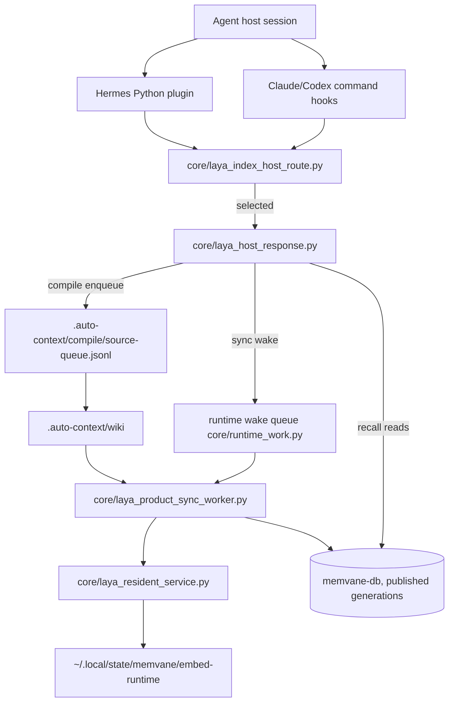

# MemVane Architecture

기능별 그림과 짧은 해설은 [아키텍처 흐름도 목차](architecture/flows/README.md)를 참고하세요.

This document describes the current runtime architecture of MemVane
(plugin id `memvane`).
It is meant for maintainers who need to change the plugin safely. For user-facing
setup and troubleshooting, start with `README.md`.

## Scope

MemVane is a host plugin that injects project-local wiki context
into agent conversations. Every hook action first classifies the event cwd's
memvane-db route; only a selected route does work. It coordinates:

- host hooks for Claude Code, Codex, and Hermes Agent;
- per-project memvane-db onboarding from minimal `.auto-context/settings.json`;
- the Laya wiki index, its off-hook full-scan sync and the local embedding
  runtime;
- recall over the last published wiki index generation;
- optional wiki compile, verify, and dedup workflows.

The main architectural rule is:

> Domain behavior lives in `core/`. Host adapters stay thin and translate host
> events into the shared core JSON contract.

## Design Principles

- **Onboarded projects only.** A project is active only when it has a selected
  Laya route, published by the reviewed setup flow. A project without a route
  gets no recall, indexing, compile or learning work; SessionStart shows one
  onboarding notice line when it has `.auto-context/settings.json`.
- **Hooks are quiet.** Hook stdout is reserved for host hook payloads or deliberate
  one-time notices. Background work writes to logs.
- **Fail closed on a selected route.** A selected route whose proof fails exits 3;
  there is no fallback to another search path. Empty recall results stay a
  valid no-result state.
- **One core, many hosts.** Claude/Codex command hooks and Hermes Python hooks call
  the same `core/` route classifier and `core/laya_host_response.py`.
- **User-facing control is agent-mediated.** Public docs should guide users to
  ask the host agent in natural language or through exposed skills. Direct
  `core/` and `skills/` shell commands are maintainer/debugging interfaces
  unless a user explicitly asks for them.
- **Queue first, work later.** Hooks record durable wakes and queue rows; off-hook
  workers do embedding, sync, compile and verify.
- **Current state only.** This document describes the code paths that are
  true now. Plans under `docs/plans/` describe direction, not shipped behavior.

## Repository Map

```text
core/
  Platform-neutral behavior: route classification, selected-route host
  responses, memvane-db install/sync/upgrade, embedding runtime, runtime wake
  queue and resource admission, wiki compile/verify/dedup, extractor adapters,
  context learning, owner legacy cleanup.

hooks/
  Claude/Codex command hook manifests plus the shared dispatcher. The
  dispatcher accepts a `gemini` engine label, but AGY automatic hooks are
  disabled.

hermes_adapter/
  Hermes Agent Python plugin adapter. It maps Hermes callbacks to the same
  route classifier and selected-route responses used by command hooks.

locks/
  Pinned npm lock for the Laya embedding runtime (`locks/laya-embed-runtime`).

skills/
  Manual workflows (setup, query, update, wiki-compile, wiki-dedup).

agents/
  Resolver prompt for wiki-dedup queue cleanup.

test/
  Deterministic node:test suites using fixtures and temporary projects.
```

## Runtime Components



## Host Adapter Layer

### Claude and Codex

Claude and Codex use command hook manifests:

- `hooks/hooks.json`
- `hooks/hooks-codex.json`
- `hooks/run-hook`

`hooks/run-hook` accepts:

```text
run-hook <action> <engine>
```

Actions: `recall`, `update`, `update-queued`, `gate`, `posttool`, `index`,
`compile`, `file-change-event`.

The dispatcher resolves the plugin root from its own location, applies
sandbox/headless no-op guards, and classifies the event cwd with
`core/laya_index_host_route.py classify-hook`:

| Route state | Behavior |
|---|---|
| `candidate`, `preview`, `worktree` | `exec core/laya_host_response.py serve-stdin` |
| `legacy` (no route) | No work, exit 0. On `update-queued` only, one onboarding notice line for a project with `.auto-context/settings.json` (Codex receives it as SessionStart JSON). |
| `blocked` or lookup failure | exit 3, no fallback |

`worktree` is a linked git worktree of a selected main checkout; search serves
the main checkout's published index read-only, and sync, compile, wiki
lifecycle and learning run only from the main checkout.

### Hermes Agent

Hermes does not read Claude/Codex hook JSON. It uses:

- `plugin.yaml`
- `__init__.py`
- `hermes_adapter/plugin.py`
- `hermes_adapter/core_bridge.py`

Hermes mapping (each call goes through `laya_index_host_route.select_route`
and, on a selected route, `laya_host_response.serve_selected`):

| Hermes callback | Bridge function | Selected-route action |
|---|---|---|
| `pre_llm_call` | `recall_context` | `recall` |
| `on_session_start` | `session_update` | `update-queued` |
| `pre_tool_call` | `pre_edit_gate` | `gate` |
| `post_tool_call` | `post_edit_sync` | `posttool`, `index` |

Hermes `post_tool_call` is observer-only. It records a sync wake, but it must
not be documented as equivalent to Claude/Codex posttool context injection.

### Gemini / AGY

The shared dispatcher still has a `gemini` engine label and accepts Gemini-style
event aliases such as `AfterTool`. AGY automatic posttool/index/compile stays
disabled until there is a reliable payload adapter for edited file paths and
stdout behavior.

## Configuration Model

The project file is:

```text
.auto-context/settings.json
```

Onboarding accepts only the minimal shape `{name, skipPaths}`; any other shape
refuses as `minimal_settings_required`. `core/config.py` expands it: the project
root is the raw collection `<slug>` (wiki generation input), `.auto-context/wiki`
is the wiki collection `<slug>-wiki`, recall is wiki-only, compile runs the
host builtin extractor in `auto-wiki` mode, and context learning is on. A
selected route binds the resolved settings identity: editing `skipPaths` keeps
it selected, while changing `name` blocks the route as `route_settings_changed`.

Path safety for collection roots is checked by `core/resolve_paths.py`.
Post-edit collection selection is handled by `core/collection_match.py`, using a
longest-prefix rule so nested collection paths behave predictably. Field-level
details live in [settings](settings.md).

## Main Flows

### 1. SessionStart Update

```text
hooks/run-hook update-queued <engine>
  -> core/laya_index_host_route.py classify-hook
  -> core/laya_host_response.py serve-stdin
       -> record a laya-sync wake (runtime_work) and a session_start compile grant
       -> return one "update queued" notice
```

The hook records only a durable wake. The owner worker
(`core/laya_product_sync_worker.py`) performs resource admission, document
embedding through the resident service and the journal-fenced full-scan sync,
then discovers changed raw sources for wiki compile
(`core/laya_wiki_discovery.py`). When the host executes a different installed
plugin bundle, SessionStart instead asks `core/laya_bundle_upgrade.py` to move
the install to that bundle off the hook; until it finishes, recall serves the
last published index read-only and sync, compile and index wakes wait.

### Hook Budget and Detached Jobs

Every command in `hooks/hooks.json` and `hooks/hooks-codex.json` carries an
explicit host `timeout`: 22 seconds for `recall` and `posttool`, 5 seconds for
`update-queued`, `index`, `compile` and `file-change-event`, 3 seconds for
`gate`. Prompt injection
and the gate stay synchronous; maintenance hooks record a durable job and
return.

Python hook entrypoints share one absolute monotonic deadline from
`core/hook_budget.py` (SSOT). The default is 18 seconds;
`QMD_HOOK_TOTAL_SECONDS` accepts 2–20 seconds and falls back to the default
outside that range. The deadline is exported as `QMD_HOOK_DEADLINE_MONO`, so a
child process inherits it and never resets an exhausted parent budget.

`run-hook` replaces its shell with the selected-route Python process, so a host
timeout kills the work itself rather than a waiting shell.

### 2. UserPromptSubmit Recall

```text
hooks/run-hook recall <engine>
  -> core/laya_index_host_route.py classify-hook
  -> core/laya_host_response.py serve-stdin (recall)
```

Hermes reaches the same response through `recall_context`.

Recall verifies the installed route proof, pins one completed index
generation without model work in the hook, searches wiki-role rows only
(lexical and vector), verifies each returned row against the published
generation, and admits a card only when `wiki_card.is_auto_trusted_card`
holds (`status: verified`, `createdBy: memvane` or the earlier plugin name
`qmd-auto-context`, non-empty
`sourceRevisions`). It does not reread current source files; after a source
change, the last completed generation answers until the sync owner publishes a
new one. Details are in [flow 03](architecture/flows/03-wiki-index-search.md).

### 3. PreToolUse Gate

```text
hooks/run-hook gate <engine>
  -> core/laya_host_response.py serve-stdin (gate)
```

On a selected route the gate verifies the edit payload and the route proof and
answers `allow` (Hermes: `continue`). A project without a route gets no gate
work.

### 4. PostToolUse Posttool and Index

```text
hooks/run-hook posttool <engine>   -> verified edit, route proof, no hint
hooks/run-hook index <engine>      -> laya-sync wake for paths inside the project
hooks/run-hook file-change-event   -> laya-sync wake after a successful Bash
```

`posttool` is an explicit observer: it returns no context; the index owner
handles durable sync. `index` wakes the same full-scan owner as SessionStart for
edited paths inside the project. A path outside the project is not routed
anywhere; that project's own full-scan sync reconciles it.

### 5. PostToolUse Wiki Compile Enqueue

Goal: turn edited raw/session/source Markdown into durable generated wiki candidates
without storing raw transcript content in the hook path.

```text
hooks/run-hook compile <engine>
  -> core/laya_host_response.py serve-stdin (compile)
  -> core/wiki_compile_enqueue.py
  -> core/wiki_selected_laya.py request_compile
  -> core/wiki_compile_worker.py
```

`core/wiki_compile_enqueue.py` records metadata only:

- project root;
- source relative path;
- collection name;
- engine;
- trigger.

It only accepts Markdown files in `raw` or `session` role collections. Any path
with a hidden segment such as `.agents`, `.claude`, `.codex`, `.github`, or
`.auto-context` is excluded.

`core/wiki_compile_worker.py` later reads the source file, gathers wiki
orientation context, optionally asks the selected memvane-db index for similar wiki pages, runs the
configured host extractor, and passes candidate JSON to `core/wiki_compile.py`.

The project wiki holds only cards. Orientation context is the bundled card-writing
rules (`core/wiki_card_rules/default.md`, or `novel.md` when the project root has a
numbered manuscript directory such as `04_Manuscript/`; a novel-preset wiki directory such
as `characters/` or a legacy `-manuscript`/`-plot` collection also selects it) plus the tail of the activity log. The card catalog is the selected
memvane-db index. Card creation, update and deletion append one line to the activity log
in the install state root (`<state root>/wiki-activity.log`, rotated to `.1` past 256 KiB;
`core/wiki_activity_log.py`). The state root is opened one path component at a time without
following symlinks; a symlinked, foreign-owned or group/world-writable ancestor makes the
write a silent no-op, and a project without a selected route logs nothing. The plugin does
not create or read wiki-root `SCHEMA.md`, `index.md` or `log.md`; such files left by
earlier releases stay on disk, are never treated as cards or card targets, are never served
by search, and keep their existing index rows.

Extractor config is intentionally symbolic by default. The worker resolves
extractors in this order:

1. legacy `compile.extractor.argv`;
2. `compile.extractor.backends[engine]`;
3. symbolic `compile.extractor.builtins`;
4. `compile.extractor.default`.

Built-in adapters run in an isolated temporary cwd with `QMD_SANDBOX=1` so a
nested host CLI does not recursively trigger qmd hooks. Claude and Codex
adapters use no-tools/read-only style flags; Hermes uses its safest one-shot
mode, but may still leave host-local persistence if the host CLI has no
equivalent persistence-off flag.

`core/wiki_compile.py` is the deterministic writer. It:

- rejects unsafe paths and transcript-like content;
- resolves targets by explicit `targetPath`, then `canonicalKey`, `aliases`,
  `title`, and finally title slug;
- protects superseded and non-managed pages from silent overwrite;
- writes generated wiki files under `.auto-context/wiki`;
- writes new or auto-updated cards as `status: generated` by default;
- enqueues successful generated writes to the auto-verify queue;
- logs merge-needed or rejected candidates under `.auto-context/compile`.

Compiler create/update, verifier stamp/delete, and the offline legacy-state
migration share one project `CARD_WRITE_LOCK`. Each holds it from the card state
read through the decision and atomic replace/unlink, so their individually
atomic writes cannot be composed from stale revisions.

The verify worker is the automatic second filter for generated cards, not a
human approval step. It rechecks the generated card against its source through
the configured host extractor:

- `pass` patches the card to `status: verified` with `verifiedBy` and
  `verifiedAt`;
- `fail` applies `compile.verify.onFail` (`delete` by default, or `contested` /
  `none`);
- missing CLIs, timeouts, stale jobs, or inconclusive verdicts preserve the
  queue item or leave the card as `generated` according to the worker contract.

Recall admits a wiki card only when it is `status: verified`, was created by
the plugin (`createdBy: memvane`, or the earlier plugin name `qmd-auto-context`), and has non-empty compiler-owned `sourceRevisions`. Source
freshness is the index owner's job: it compares source hashes, queues refresh
and regeneration, and publishes each document atomically; recall reads only
the published generation.

`generated`, `tentative`, `contested`, `discarded`, and `superseded` remain
excluded. A provenance-free legacy `verified` is `unknown` and drops. Explicit
offline release maintenance normalizes qmd-created legacy `reviewed`·`canon`·
`manual` cards, or cards with missing/invalid provenance, to `generated` and
removes `reviewed:` plus every verification proof field. It preserves foreign
cards byte-for-byte; they are never trusted or injected, even with
`recallVerifiedOnly: false`. There is no human wiki lifecycle: automatic cards
do not use `reviewed:` or human statuses, and no `wiki-review` UI, skill, or
agent exists. The `merge-needed.jsonl` ledger is only a bounded non-trusted
collision diagnostic: no candidate is auto-merged, trusted, or queued for human
approval.

P0 deliberately does not register `.env` as a source. Until a P1 structured-
evidence adapter exists, wiki output makes no repository-config claim from
`prod.env` and no runtime-current claim.

Verify and dedup workers are maintenance paths around this generated wiki state.
They are intentionally fail-open so wiki maintenance does not break normal agent
turns. After each wiki lifecycle run, the same child runs the retroactive dedup
scan (`core/wiki_dedup_scan.py`): it compares the stored memvane-db chunk-vector
centroids of the sealed head's wiki cards and queues pairs at cosine 0.9 or
above to `.auto-context/compile/dedup-needed.jsonl` for the `wiki-dedup`
resolver. It makes no model or paid call.

## Laya Runtime and Embedding

`core/laya_resident_service.py` is one per-user process that owns the local
embedding worker for each vector profile and serves every adopted
install through that install's sealed socket (`<state>/runtime/laya-embed.sock`).
Hooks never load a model.

The embedding runtime lives in `~/.local/state/memvane/embed-runtime`
(`core/laya_embed_runtime.py`): `active.json`, `previous.json` and immutable
generations holding Node, node-llama-cpp, the native build and the GGUF model.
A generation comes from an install attestation written by the bundle upgrade
worker or, on a new machine, from an explicit provisioning action. Maintainer
commands (`ROOT` is the installed plugin root):

```bash
python3 -B "$ROOT/core/setup_entry.py" index-runtime-status
python3 -B "$ROOT/core/setup_entry.py" provision-index-runtime --approve-index-runtime-download [--provider-model-file <gguf>]
python3 -B "$ROOT/core/setup_entry.py" gc-index-runtime [--approve-index-runtime-gc]
```

Provisioning takes Node from `PATH` first, then mise, fnm, nvm, volta, asdf,
Homebrew and system installs, accepting only real binaries (not shims) of
major 22, 24 or 26. It runs `npm ci --ignore-scripts` on
`locks/laya-embed-runtime` (node-llama-cpp 3.18.1 and the prebuilt
`@node-llama-cpp/mac-arm64-metal`) and downloads
`https://huggingface.co/ggml-org/embeddinggemma-300M-GGUF/resolve/main/embeddinggemma-300M-Q8_0.gguf`,
accepted only with sha256
`f470220f84b6235197541352d22f10bf00098a8242c18eaacea9c8a4add557bc`.
`--provider-model-file` uses a local copy of that exact file instead. GC lists
generations and, with approval, removes those that are neither active, previous,
nor named by any `production-provider-attestation.json` under `~/.local/state/memvane/*/` or the pre-rename `~/.local/state/laya/*/`
(historical `profileDependencyClosure` rows are ignored). `generations` must be a
real private directory of the user inside the runtime, and GC enumerates and
deletes through its directory descriptor without following links. A generation
that fails (a mount point inside it, a permission error) is reported in
`failed` with `status: partial`, and the generations already removed stay in
the report.

### Retired QMD backend cleanup

`core/legacy_cleanup.py` is an owner-run, one-time removal of the retired QMD
backend; no hook, worker or plugin update runs it.

```bash
python3 -B "$ROOT/core/setup_entry.py" plan-legacy-cleanup --include-user-qmd-data
python3 -B "$ROOT/core/setup_entry.py" apply-legacy-cleanup --approve-legacy-cleanup --include-user-qmd-data
```

The plan is read only. It lists the QMD daemon pid files under
`~/Library/Application Support/qmd-auto-context/backend/daemon-*.pid` (and the
port-less legacy `daemon.pid`) with whether each names a verified live daemon, the LaunchAgents carrying
`managed-by: qmd-auto-context` (`com.qmd-mcp-daemon`, `com.qmd-keepalive`,
`com.qmd-logrotate`, `com.qmd-index-worker`; `.bak` copies stay), every target
tree with its size, and blockers. Apply sends `SIGTERM` only to a daemon whose
exact command line is
`<node> <plugin QMD runtime>/generations/g-<id>/qmd-native.mjs mcp --http --port <port of its pid file>`
(for `daemon.pid`, the port its process carries),
re-read right before the signal (no `SIGKILL`, no pattern kill), boots out and
deletes only marker-bearing plists, and removes
`~/Library/Application Support/qmd-auto-context/{runtimes/qmd,shared-qmd,backend}`.
`~/.cache/qmd` and `~/.config/qmd` also hold the user's own QMD index,
configuration and model cache, so they are removed only with
`--include-user-qmd-data`. Other trees under
`~/Library/Application Support/qmd-auto-context` (`learning`, `laya-inference`,
`live-selection`, `runtimes/laya`) are kept: an account whose learning runtime
lives there keeps using that group (see [continual learning](continual-learning.md)).

Both actions refuse while an install attestation still names a file inside a
target, and with `older_host_bundle_bound` while any
`~/.local/state/memvane/*/reviewed-route.json` `pluginRoot` points at a bundle that
still contains `core/backend_manager.sh` (that bundle would recreate
`~/.cache/qmd` and `~/.config/qmd`). They also refuse with
`qmd_daemon_unverified` while a live node process (from a pid file or the
read-only process table) runs an executable or script inside a plugin target
without passing that exact identity; a process that only mentions a target
path (an editor, a `backend-backup` copy) does not count. They refuse with
`legacy_cleanup_target_unsafe` when a directory between HOME and an in-scope
target is a link or not the user's. User QMD data outside the approval is
`preserved` and never inspected, so a user-managed `~/.config` link does not
block. Removal walks directory descriptors from HOME without following links
and refuses a target that contains a mount point (device change or mount table
entry) before deleting anything in it. A target that fails is reported in
`failed` with `status: partial` (exit 1); the targets already removed stay in
`completed`.

Known limits: these checks guard against accidents (dotfile links, mounted
volumes, stale layouts, reused pids), not against another process of the same
user. Such a process can rename directories between the checks and the
deletes, and on macOS (no pidfd) a pid can be reused between the last identity
read and `SIGTERM`.

Run the cleanup only after both host
caches (Claude and Codex) load this release, every install has moved to it
through the SessionStart bundle upgrade, and every install is re-attested onto
the Laya embedding runtime.

## Concurrency and Isolation

The runtime uses multiple short-lived processes, so the architecture depends on
clear isolation and lock ownership.

### Host State Isolation

Host adapters pass only normalized JSON payloads, `cwd`, and an engine label into
`core/`. Core scripts must not rely on a host's private in-memory state. Host
differences belong at the adapter boundary:

- command hook dispatch and sandbox guards in `hooks/run-hook`;
- Hermes callback mapping and observer-only caveats in `hermes_adapter/`;
- engine-specific extractor selection in wiki compile worker configuration.

`QMD_ENGINE` is a label for logging, extractor dispatch, and diagnostics. It
must not become a branch point for unrelated domain behavior unless the host
protocol itself requires different handling.

### Lock Ownership

| Surface | Owner | Purpose |
|---|---|---|
| runtime worker lease | `core/runtime_work.py` (`runtime-worker.lock`) | One UID-global wake dispatcher; it holds only its dispatch lease while waiting. |
| card write lock | `CARD_WRITE_LOCK` (`core/compile_paths.py`) | Serializes compiler writes, verifier stamp/delete and offline card migration per project. |
| installer operation lock | `laya-qmd-cutover-operation.lock` (`core/laya_ledger_common.py`) | Serializes installer ledger operations; older installed bundles lock the same file. |

A failed or deferred sync attempt leaves its wake for the dispatcher to retry
rather than dropping it.

### Optional Workflow Isolation

Wiki compile, verify, and dedup are optional maintenance workflows. They
must remain fail-open relative to normal recall and indexing. A failed extractor,
missing host CLI, stale verify job, or dedup queue issue should leave an audit
record and preserve or drop only the relevant queue item according to that
worker's contract.

Cards start as `generated`; automatic source-consistency verification promotes
good cards to `verified`. Ambiguous collisions are recorded passively in
`merge-needed.jsonl` and never become a promotion or human-review state.

## Release Surface

Version and host metadata changes span more than one manifest. Keep these files
aligned when changing release identity or marketplace behavior:

- `package.json`;
- `plugin.json`;
- `plugin.yaml`;
- `.claude-plugin/plugin.json`;
- `.codex-plugin/plugin.json`;
- `.claude-plugin/marketplace.json`;
- `.agents/plugins/marketplace.json`.

`test/plugin-manifest.test.mjs` checks that manifests carry a description and a
version; it does not pin the exact version. Before release, run `npm test`.

## Manual Skills

| Skill | Path |
|---|---|
| `setup` | `core/setup_entry.py` (onboarding, embedding runtime, learning profile, owner legacy cleanup) |
| `query` | `skills/query/scripts/query.sh` → selected-route recall |
| `update` | `skills/update/scripts/update.sh` → full-scan laya-sync wake |
| `wiki-compile` | `core/wiki_extract.py` and `core/wiki_compile.py` (selected route only) |
| `wiki-dedup` | `core/wiki_dedup_resolve.py` via resolver workflow |

`query` and `update` act only on a selected route; a project that is not
onboarded exits 1 with an onboarding notice, and a selected route whose proof
fails exits 3. Manual skills may print diagnostics. Hook paths should stay
quiet.

## Failure Behavior

Expected empty-output cases:

- sandbox or headless mode;
- no selected route (`legacy`), apart from the one SessionStart notice;
- no results after filters;
- edit outside the project's collection paths;
- compile disabled or source outside raw/session/source Markdown scope.

A selected route whose proof fails, a blocked route, or a failed route lookup
exits 3 instead.

To inspect recall selection, set `QMD_RECALL_LOG`:

```bash
QMD_RECALL_LOG=/tmp/qmd-recall.log bash skills/query/scripts/query.sh "$PWD" "question"
tail -n 20 /tmp/qmd-recall.log
```

Relevant logs:

| Log | Default |
|---|---|
| recall selection | `QMD_RECALL_LOG` (unset: none) |
| wiki lifecycle | `~/.local/state/memvane/auto-context/logs/wiki-lifecycle.log` |
| wiki dedup scan | `~/.local/state/memvane/auto-context/logs/wiki-dedup.log` |
| compile extractor | `.auto-context/compile/extractor.log` |

## Test Strategy

The default test command is:

```bash
npm test
```

Tests are deterministic and run through `scripts/development_guard.py` with
file concurrency 1. They use fixtures, temporary projects and route records,
and sandbox env guards. Useful focused tests:

```bash
npm run test:focused -- test/laya-index-host-route.test.mjs
npm run test:focused -- test/laya-embed-runtime.test.mjs
npm run test:focused -- test/laya-runtime-provision.test.mjs
npm run test:focused -- test/wiki-compile-worker.test.mjs
npm run test:focused -- test/hermes-plugin-adapter.test.mjs
```

## Change Checklist

When changing architecture-sensitive code, check these boundaries:

- Does the change keep host adapters thin and `core/` as the source of truth?
- Does it preserve quiet hook stdout?
- Does sandbox/headless mode exit before side effects?
- Does a project without a selected route still get no work apart from the one
  SessionStart notice, and does a failed selected proof still exit 3?
- Do Claude, Codex, and Hermes still map to equivalent core behavior where the
  host protocol allows it?
- Does the hook still record only durable wakes and leave model work to the
  off-hook owner?
- If wiki compile changes, are `raw`/`session`/`source` scope, hidden-path rejection,
  cooldown, queue preservation, and protected-page behavior covered?
- Are manual skills still wrappers over core paths rather than alternate
  implementations?
