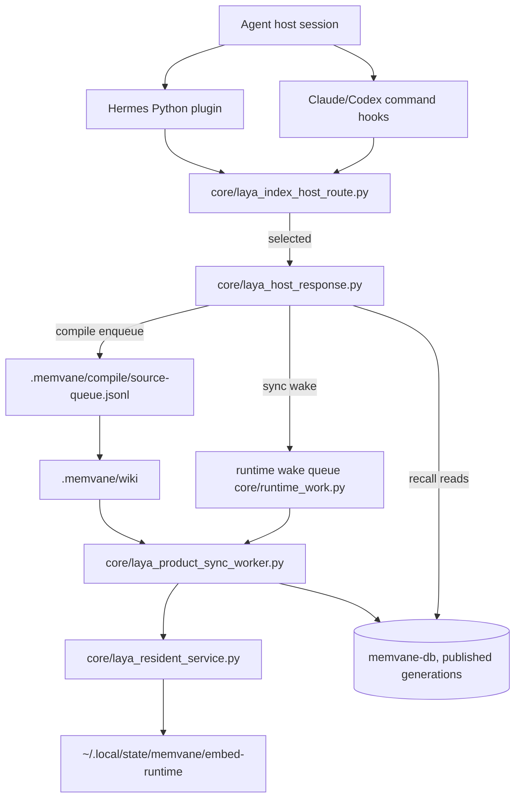

# MemVane Architecture

기능별 그림과 짧은 해설은 [아키텍처 흐름도 목차](architecture/flows/README.md)를 참고하세요.

This document describes the current runtime architecture of MemVane
(plugin id `memvane`).
It is meant for maintainers who need to change the plugin safely. For user-facing
setup and troubleshooting, start with `README.md`.

## Scope

MemVane is a host plugin that injects project-local wiki context
into agent conversations. Every hook action first classifies the event cwd's
memvane-db route; only a selected route does work. It coordinates:

- host hooks for Claude Code, Codex, and Hermes Agent;
- per-project memvane-db onboarding from minimal `.memvane/settings.json`;
- the Laya wiki index, its off-hook full-scan sync and the local embedding
  runtime;
- recall over the last published wiki index generation;
- optional wiki compile, verify, and dedup workflows.

The main architectural rule is:

> Domain behavior lives in `core/`. Host adapters stay thin and translate host
> events into the shared core JSON contract.

## Design Principles

- **Onboarded projects only.** A project is active only when it has a selected
  Laya route, published by the reviewed setup flow. A project without a route
  gets no recall, indexing, compile or learning work; SessionStart shows one
  onboarding notice (a user line and an agent command line) when it has
  `.memvane/settings.json`, unless the user skipped it for that session or
  declined it for that project.
- **Hooks are quiet.** Hook stdout is reserved for host hook payloads or deliberate
  one-time notices. Background work writes to logs.
- **Fail closed on a selected route.** A selected route whose proof fails exits 3;
  there is no fallback to another search path. Empty recall results stay a
  valid no-result state.
- **One core, many hosts.** Claude/Codex command hooks and Hermes Python hooks call
  the same `core/` route classifier and `core/laya_host_response.py`.
- **User-facing control is agent-mediated.** Public docs should guide users to
  ask the host agent in natural language or through exposed skills. Direct
  `core/` and `skills/` shell commands are maintainer/debugging interfaces
  unless a user explicitly asks for them.
- **Queue first, work later.** Hooks record durable wakes and queue rows; off-hook
  workers do embedding, sync, compile and verify.
- **Current state only.** This document describes the code paths that are
  true now. Plans under `docs/plans/` describe direction, not shipped behavior.

## Repository Map

```text
core/
  Platform-neutral behavior: route classification, selected-route host
  responses, memvane-db install/sync/upgrade, embedding runtime, runtime wake
  queue and resource admission, wiki compile/verify/dedup, extractor adapters,
  context learning, owner legacy cleanup.

hooks/
  Claude/Codex command hook manifests plus the shared dispatcher. The
  dispatcher accepts a `gemini` engine label, but AGY automatic hooks are
  disabled.

hermes_adapter/
  Hermes Agent Python plugin adapter. It maps Hermes callbacks to the same
  route classifier and selected-route responses used by command hooks.

locks/
  Pinned npm lock for the Laya embedding runtime (`locks/laya-embed-runtime`).

skills/
  Manual workflows (setup, query, update, wiki-compile, wiki-dedup, logs).

agents/
  Resolver prompt for wiki-dedup queue cleanup.

test/
  Deterministic node:test suites using fixtures and temporary projects.
```

## Runtime Components



## Host Adapter Layer

### Claude and Codex

Claude and Codex use command hook manifests:

- `hooks/hooks.json`
- `hooks/hooks-codex.json`
- `hooks/run-hook`

`hooks/run-hook` accepts:

```text
run-hook <action> <engine>
```

Actions: `recall`, `update`, `update-queued`, `gate`, `posttool`, `index`,
`compile`, `file-change-event`.

The dispatcher resolves the plugin root from its own location, applies
sandbox/headless no-op guards, and classifies the event cwd with
`core/laya_index_host_route.py classify-hook`:

| Route state | Behavior |
|---|---|
| `candidate`, `preview`, `worktree` | `exec core/laya_host_response.py serve-stdin` |
| `legacy` (no route) | No work, exit 0. On `update-queued` only, one short onboarding notice line for a project with `.memvane/settings.json` (Codex receives it as SessionStart JSON). A second `[memvane] onboarding-answer <JSON>` line gives the agent the exact `setup_entry.py onboarding-skip` (payload session id, kept 30 days) and `onboarding-never` commands as argv and shell strings; a recorded answer (`~/.local/state/memvane/onboarding/<sha256(canonical project root)>.json`, case aliases share one record) hides both lines. |
| `blocked` or lookup failure | exit 3, no fallback |

`worktree` is a linked git worktree of a selected main checkout; search serves
the main checkout's published index read-only, and sync, compile, wiki
lifecycle and learning run only from the main checkout.

### Hermes Agent

Hermes does not read Claude/Codex hook JSON. It uses:

- `plugin.yaml`
- `__init__.py`
- `hermes_adapter/plugin.py`
- `hermes_adapter/core_bridge.py`

Hermes mapping (each call goes through `laya_index_host_route.select_route`
and, on a selected route, `laya_host_response.serve_selected`):

| Hermes callback | Bridge function | Selected-route action |
|---|---|---|
| `pre_llm_call` | `recall_context` | `recall` |
| `on_session_start` | `session_update` | `update-queued` |
| `pre_tool_call` | `pre_edit_gate` | `gate` |
| `post_tool_call` | `post_edit_sync` | `posttool`, `index` |

Hermes `post_tool_call` is observer-only. It records a sync wake, but it must
not be documented as equivalent to Claude/Codex posttool context injection.

### Gemini / AGY

The shared dispatcher still has a `gemini` engine label and accepts Gemini-style
event aliases such as `AfterTool`. AGY automatic posttool/index/compile stays
disabled until there is a reliable payload adapter for edited file paths and
stdout behavior.

## Configuration Model

The project file is:

```text
.memvane/settings.json
```

A project that only has `.auto-context/` reads `.auto-context/settings.json`
(see [Project folder](#project-folder)).

Onboarding accepts only the minimal shape `{name, skipPaths}`; any other shape
refuses as `minimal_settings_required`. `core/config.py` expands it: the project
root is the raw collection `<slug>` (wiki generation input), `.memvane/wiki`
is the wiki collection `<slug>-wiki`, recall is wiki-only, compile runs the
host builtin extractor in `auto-wiki` mode, and context learning is on. A
selected route binds the resolved settings identity: editing `skipPaths` keeps
it selected, while changing `name` blocks the route as `route_settings_changed`.

Path safety for collection roots is checked by `core/resolve_paths.py`.
Post-edit collection selection is handled by `core/collection_match.py`, using a
longest-prefix rule so nested collection paths behave predictably. Field-level
details live in [settings](settings.md).

## Main Flows

### 1. SessionStart Update

```text
hooks/run-hook update-queued <engine>
  -> core/laya_index_host_route.py classify-hook
  -> core/laya_host_response.py serve-stdin
       -> record a laya-sync wake (runtime_work) and a session_start compile grant
       -> return one "update queued" notice
```

The hook records only a durable wake. The owner worker
(`core/laya_product_sync_worker.py`) performs resource admission, document
embedding through the resident service and the journal-fenced full-scan sync,
then discovers changed raw sources for wiki compile
(`core/laya_wiki_discovery.py`). When the host executes a different installed
plugin bundle, SessionStart instead asks `core/laya_bundle_upgrade.py` to move
the install to that bundle off the hook; until it finishes, recall serves the
last published index read-only and sync, compile and index wakes wait.
The same worker then moves an install still under the pre-rename state base
(see [State roots](#state-roots)); SessionStart names that move while it is
pending.

### State roots

Every install lives in `~/.local/state/memvane/<install id>`. An install
onboarded before the rename sits in `~/.local/state/laya/<install id>`; after
its bundle step, the upgrade worker (`core/laya_state_move.py`, called from
`laya_bundle_upgrade.run`) moves it with one same-volume `rename(2)` of the
whole directory. Every store keeps its inode, so the selection ledger's
`[st_dev, st_ino]` pins, SQLite `-wal`/`-shm` files, backups and receipts stay
valid. Only the records that name the directory are rewritten, each from bytes
computed before the rename and kept in `state-move-intent.json`: the project
route and selection marker, the reviewed route, the production attestation
(journal and socket paths), the selection ledger, the build record and wake
pointer, the incremental document store's candidate path, and the install
journal (`cas_relocate_state_root`: same bundle identity and provider files,
new route and attestation digests, `previous*` cleared so no rollback names
the old directory).

| Phase | Where | On a crash |
|---|---|---|
| prepare | old root, plus `memvane-state-move.json` in the project folder | intent discarded; recall never changed |
| move | `rename(old, new)` | resumed from the project pointer |
| switch | compare-and-replace writes, journal CAS, ledger, route, marker | replayed; each write accepts the already-new bytes |
| verify | marker classification, route selection, read-only journal proof, store counts | resumed |
| settle | pointer removed, intent archived as `state-move-<tag>-settled.json` | resumed |

The move holds the install lock, build owner, route operation lock, the
provider lane and the install's wiki discovery lock for its whole run, so no
selected writer runs; readers take no lock. A wiki grant writer that waited on
the discovery lock across the rename finds its lock path gone
(`state_dir_moved`) and writes once more through the re-selected route of the
same install. After the rename a move only goes forward and needs no bundle review,
network or model. A settled bundle-upgrade intent (it names the old root) is
archived before the rename; an unsettled upgrade defers the move. Before the
rename every rewritten path is checked: a target on another volume refuses
`state_move_cross_device`, and a provider socket path that would cross the
provider's 100-byte limit only because of the longer base refuses
`state_move_socket_path_too_long`; in both cases the install keeps working
where it is. A newly created base directory is fsynced into its parent before
the rename.

Recall during the move: between the rename and the route write (a few small
file writes) the route classifies `blocked`. For recall and SessionStart,
`laya_index_host_route.select_route_settled` re-reads it every 25 ms for up to
1.5 s while the project pointer is fresh; the hook entry's second route read
(`laya_host_response._reselect`) does the same and accepts exactly the
relocated route. A recall that proved the old route and then hits a vanished
path retries once (`_recall_retry_decision`), accepting only the same install,
scope, incarnation and project at `~/.local/state/memvane/<install id>` with
the same store basenames. If the worker dies inside that window, a recall gets
no context, names `state_root_move_pending` and requests the worker: a
`running` status whose worker no longer holds `bundle-auto-upgrade.lock` is due
at once (`laya_bundle_upgrade.worker_holds`), so the next prompt starts the
resume. A sealed provider manifest the provider cannot load no longer fails a
recall: it serves the lexical lists with
`selected_provider_manifest_<reason>`. The resident service re-proves each bound project, so it releases the
old socket binding and adopts the moved one; recall serves lexical results for
that gap, as on a bundle switch.

Shared pre-rename trees are retired at the end of a worker run once no
install is left under `~/.local/state/laya`:

- `embed-runtime` is removed when no install attestation under either base
  names a file in it and no live process executes from it (read from the
  process table; nothing is signalled);
- `service` is removed only by a holder of its lease (`service.lock`, taken
  non-blocking) and only when no pre-rename plugin copy is installed in
  Claude, Codex or Hermes and no pre-rename install is left: then nothing can
  open that lease again. The running MemVane service holds it (it excludes a
  pre-rename service), so that service removes the directory itself
  (`Service._retire_legacy`, checked every 10 minutes); with no service
  running, the worker's shared pass takes the lease and removes it;
- `auto-context` entries are renamed into `~/.local/state/memvane/auto-context`;
- an empty `initial-builds` and then the empty base are removed.

Removal walks directory descriptors from HOME without following links and
refuses a tree that contains a mount point (`core/safe_rmtree.py`). A kept tree
and its blockers are listed by:

```bash
python3 -B "$ROOT/core/setup_entry.py" state-root-status
python3 -B "$ROOT/core/setup_entry.py" move-state-roots
```

`move-state-roots` runs the worker for every project that still has an
install under the pre-rename base, an unfinished move intent under either
base, or a prepared local selector, then the shared pass; `state-root-status`
lists the first two.

After the install steps, every worker run moves the learning state once per
account (`~/Library/Application Support/qmd-auto-context/{live-selection,laya-inference}`
to `.../memvane`, `core/context_learning/state_move.py`) and heals the
project's prepared selector (`core/context_learning/selector_heal.py`); see
[continual learning](continual-learning.md#learning-state-location).

### Project folder

A project keeps its settings, wiki cards and per-machine runtime files (route
record, selection marker, locks, `compile/`, `file-changes/`) in one folder at
the project root, `.memvane/` (`core/project_dir.py`). A project that only has
`.auto-context/` is read from there: readers look in `.memvane/` first and fall
back to `.auto-context/` per file, and every writer uses one active folder
(`.memvane/` when it exists, else `.auto-context/`, else `.memvane/`). Settings
path values that start with either folder name follow the active folder.

The bundle upgrade worker (`core/laya_project_dir_move.py`, called from
`laya_bundle_upgrade.run`) moves each selected project once:

- `rename`: one `rename(2)` of `.auto-context` to `.memvane`; settings, cards
  and runtime files keep their inodes;
- `adopt`: git already brought `.memvane/settings.json` and `.memvane/wiki` (a
  pulled or checked-out rename) while the runtime files stay in
  `.auto-context/`; each runtime entry is renamed into `.memvane/` and the
  empty legacy folder is removed.

The intent `project-dir-move-intent.json` in the state root precomputes every
record, and the pointer `memvane-project-move.json` in the project folder
resumes a crash. The ledger is fenced (`upgrading`) before the move; a crash
before the fence discards the intent, after it the move only goes forward. The
index is rebound, not re-embedded: a clone generation of the published head is
bound to `<project>/.memvane/wiki` in a new binding store, and the catalog
keeps its scans while its `binding`/`roots` metadata is rewritten. While the
move runs, recall waits up to 1.5 s and retries once; search keeps serving.

| Layout (`project_dir.layout`) | Folders | Behavior |
|---|---|---|
| `none` | neither | writers create `.memvane/` |
| `legacy` | `.auto-context/` only | read from there; the worker renames it |
| `current` | `.memvane/` only | normal |
| `adopt` | `.memvane/` has the settings, `.auto-context/` only runtime files | the worker moves the runtime files |
| `split` | `.auto-context/` has the settings, `.memvane/` does not (an older branch checked out over a moved project) | `.memvane/` wins; index and wiki writers hold with `project_dir_split`, also mid-run (their route proof, `verify_selected_route_for_write`, refuses a split layout); recall and the edit gate continue (the untracked `.memvane/wiki/.memvane-root` keeps the bound wiki directory through the checkout); no second index; SessionStart prints a notice |
| `conflict` | both hold settings or wiki cards (an older branch merged) | `.memvane/` wins, `.auto-context/` is ignored; the notice says to `git mv` leftover cards |

Linked worktrees on either folder name share the main checkout's index. After
a move, SessionStart names the owner's commit,
`git add -A .memvane .auto-context`, and prints `.memvane/...` equivalents of
any `.auto-context` lines in the project's own `.gitignore`; nothing edits user
files.

### Bundle Adoption Trust Boundary

Adoption (`core/laya_product_bundle.py` `adopt_host_loaded_plugin`) proves
every installed plugin file against the selected commit in the host
marketplace clone: the exact file set, each blob's object id, the bytes, and
the executable bit (git executable iff the owner may execute). Seal metadata
(`.laya-product`) is never evidence for adoption; it pins inode, ctime and
mtime for the later per-request proofs. Metadata that no longer verifies, as
after a host re-extracts a version directory in place, is rewritten only after
that exact comparison passes. Git runs with replacement objects and grafts
disabled, so `refs/replace` cannot substitute a tree under an unchanged
commit id.

An in-place re-extraction leaves every install bound to that root with an
ownership digest the files no longer have. The bundle upgrade worker
re-adopts the root for selected, bound and inactive installs alike, through
each kind's own review and switch. A selected project's SessionStart asks for
the worker; an unselected build's SessionStart (the build-progress notice)
asks for it when the bound root is another plugin root or no longer proves.
A re-adopted inactive build has no old seal to restore to: a failed switch
stays fenced (`upgrading`) with its intent, and the next run finishes it
forward.

The exact comparison defends against stale or forged seal metadata and
accidental drift between the cache and the commit. A process running as the
same UID that can write the marketplace clone or the plugin cache is outside
the trust boundary: it can change the clone and the cache consistently. This
is the same limit as the accepted same-UID TOCTOU window between a final
check and use.

### Hook Budget and Detached Jobs

Every command in `hooks/hooks.json` and `hooks/hooks-codex.json` carries an
explicit host `timeout`: 22 seconds for `recall` and `posttool`, 5 seconds for
`update-queued`, `index`, `compile` and `file-change-event`, 3 seconds for
`gate`. Prompt injection
and the gate stay synchronous; maintenance hooks record a durable job and
return.

Python hook entrypoints share one absolute monotonic deadline from
`core/hook_budget.py` (SSOT). The default is 18 seconds;
`QMD_HOOK_TOTAL_SECONDS` accepts 2–20 seconds and falls back to the default
outside that range. The deadline is exported as `QMD_HOOK_DEADLINE_MONO`, so a
child process inherits it and never resets an exhausted parent budget.

`run-hook` replaces its shell with the selected-route Python process, so a host
timeout kills the work itself rather than a waiting shell.

### 2. UserPromptSubmit Recall

```text
hooks/run-hook recall <engine>
  -> core/laya_index_host_route.py classify-hook
  -> core/laya_host_response.py serve-stdin (recall)
```

Hermes reaches the same response through `recall_context`.

Recall verifies the installed route proof, pins one completed index
generation without model work in the hook, searches wiki-role rows only
(lexical and vector), verifies each returned row against the published
generation, and admits a card only when `wiki_card.is_auto_trusted_card`
holds (`status: verified`, `createdBy: memvane` or the earlier plugin name
`qmd-auto-context`, non-empty
`sourceRevisions`). It does not reread current source files; after a source
change, the last completed generation answers until the sync owner publishes a
new one. Details are in [flow 03](architecture/flows/03-wiki-index-search.md).

### 3. PreToolUse Gate

```text
hooks/run-hook gate <engine>
  -> core/laya_host_response.py serve-stdin (gate)
```

On a selected route the gate verifies the edit payload and the route proof and
answers `allow` (Hermes: `continue`). A project without a route gets no gate
work.

### 4. PostToolUse Posttool and Index

```text
hooks/run-hook posttool <engine>   -> verified edit, route proof, no hint
hooks/run-hook index <engine>      -> laya-sync wake for paths inside the project
hooks/run-hook file-change-event   -> laya-sync wake after a successful Bash
```

`posttool` is an explicit observer: it returns no context; the index owner
handles durable sync. `index` wakes the same full-scan owner as SessionStart for
edited paths inside the project. A path outside the project is not routed
anywhere; that project's own full-scan sync reconciles it.

### 5. PostToolUse Wiki Compile Enqueue

Goal: turn edited raw/session/source Markdown into durable generated wiki candidates
without storing raw transcript content in the hook path.

```text
hooks/run-hook compile <engine>
  -> core/laya_host_response.py serve-stdin (compile)
  -> core/wiki_compile_enqueue.py
  -> core/wiki_selected_laya.py request_compile
  -> core/wiki_compile_worker.py
```

`core/wiki_compile_enqueue.py` records metadata only:

- project root;
- source relative path;
- collection name;
- engine;
- trigger.

It only accepts Markdown files in `raw` or `session` role collections. Any path
with a hidden segment such as `.agents`, `.claude`, `.codex`, `.github`, or
`.memvane` is excluded.

`core/wiki_compile_worker.py` later reads the source file, gathers wiki
orientation context, optionally asks the selected memvane-db index for similar wiki pages, runs the
configured host extractor, and passes candidate JSON to `core/wiki_compile.py`.

The project wiki holds only cards. Orientation context is the bundled card-writing
rules (`core/wiki_card_rules/default.md`, or `novel.md` when the project root has a
numbered manuscript directory such as `04_Manuscript/`; a novel-preset wiki directory such
as `characters/` or a legacy `-manuscript`/`-plot` collection also selects it) plus recent
card writes (`wiki.logTail`, rendered as `- <ts> <action> <path> - <title>` from `wiki` events
only). The card catalog is the selected memvane-db index. Card creation, update, deletion and
retirement append one `wiki` event (outcome = action, `reason`, `path`, `title`) to the install
event log `<state root>/events.jsonl` (`core/wiki_activity_log.py` → `core/event_log.py`; see
[Event Log](#event-log)); a project without a selected route logs nothing. The plugin does
not create or read wiki-root `SCHEMA.md`, `index.md` or `log.md`; such files left by
earlier releases stay on disk, are never treated as cards or card targets, are never served
by search, and keep their existing index rows.

Extractor config is intentionally symbolic by default. The worker resolves
extractors in this order:

1. legacy `compile.extractor.argv`;
2. `compile.extractor.backends[engine]`;
3. symbolic `compile.extractor.builtins`;
4. `compile.extractor.default`.

Built-in adapters run in an isolated temporary cwd with `QMD_SANDBOX=1` so a
nested host CLI does not recursively trigger qmd hooks. Claude and Codex
adapters use no-tools/read-only style flags; Hermes uses its safest one-shot
mode, but may still leave host-local persistence if the host CLI has no
equivalent persistence-off flag.

`core/wiki_compile.py` is the deterministic writer. It:

- rejects unsafe paths and transcript-like content;
- resolves targets by explicit `targetPath`, then `canonicalKey`, `aliases`,
  `title`, and finally title slug;
- protects superseded and non-managed pages from silent overwrite;
- writes generated wiki files under `.memvane/wiki`;
- writes new or auto-updated cards as `status: generated` by default;
- refuses a card whose body does not fit the local selector budget
  (`core/wiki_card_budget.py`, below) and reports `split-required`;
- enqueues successful generated writes to the auto-verify queue;
- logs merge-needed or rejected candidates under `.memvane/compile`.

Compiler create/update, verifier stamp/delete, and the offline legacy-state
migration share one project `CARD_WRITE_LOCK`. Each holds it from the card state
read through the decision and atomic replace/unlink, so their individually
atomic writes cannot be composed from stale revisions.

The verify worker is the automatic second filter for generated cards, not a
human approval step. It rechecks the generated card against its source through
the configured host extractor:

- `pass` patches the card to `status: verified` with `verifiedBy` and
  `verifiedAt`;
- `fail` applies `compile.verify.onFail` (`delete` by default, or `contested` /
  `none`);
- missing CLIs, timeouts, stale jobs, or inconclusive verdicts preserve the
  queue item or leave the card as `generated` according to the worker contract.

Recall admits a wiki card only when it is `status: verified`, was created by
the plugin (`createdBy: memvane`, or the earlier plugin name `qmd-auto-context`), and has non-empty compiler-owned `sourceRevisions`. Source
freshness is the index owner's job: it compares source hashes, queues refresh
and regeneration, and publishes each document atomically; recall reads only
the published generation.

`generated`, `tentative`, `contested`, `discarded`, and `superseded` remain
excluded. A provenance-free legacy `verified` is `unknown` and drops. Explicit
offline release maintenance normalizes qmd-created legacy `reviewed`·`canon`·
`manual` cards, or cards with missing/invalid provenance, to `generated` and
removes `reviewed:` plus every verification proof field. It preserves foreign
cards byte-for-byte; they are never trusted or injected, even with
`recallVerifiedOnly: false`. There is no human wiki lifecycle: automatic cards
do not use `reviewed:` or human statuses, and no `wiki-review` UI, skill, or
agent exists. The `merge-needed.jsonl` ledger is only a bounded non-trusted
collision diagnostic: no candidate is auto-merged, trusted, or queued for human
approval.

P0 deliberately does not register `.env` as a source. Until a P1 structured-
evidence adapter exists, wiki output makes no repository-config claim from
`prod.env` and no runtime-current claim.

Verify and dedup workers are maintenance paths around this generated wiki state.
They are intentionally fail-open so wiki maintenance does not break normal agent
turns. After each wiki lifecycle run, the same child runs the retroactive dedup
scan (`core/wiki_dedup_scan.py`): it compares the stored memvane-db chunk-vector
centroids of the sealed head's wiki cards and queues pairs at cosine 0.9 or
above to `.memvane/compile/dedup-needed.jsonl` for the `wiki-dedup`
resolver. It makes no model or paid call.

#### Card Body Budget

The live local selector scores a (user request, card) pair with its checkpoint's
legacy input view, `max_len` 1024 tokens. It reads a card through
`context_learning.compact_input`: everything after the frontmatter (banner,
auto-block markers, summary, hand-written sections). The title and other
frontmatter never enter the pair. A longer pair does not fit the model whole.
`core/wiki_card_budget.py` measures the complete, untruncated body that `derive`
returns, so a card the compiler writes is scored whole:

| Part | Tokens |
|---|---|
| fixed question frame (`[CLS]`, question head, options, separators, `User request:` / `Wiki card body:` labels) | 38 |
| card body (`BODY_BUDGET`) | 700 |
| user request room (`QUERY_ROOM`) | 286 |

The request room is a reserve, not a guarantee: a selector request may be up to
2000 characters. Counting request and body apart is one token above the joint
tokenization the selector performs.

Measurement is exact. The body is counted with a selector checkpoint's
`tokenizer/tokenizer.json` through that selector runtime's `tokenizers` library
(`method: tokenizer`). Candidates are the project's own live selector first, then
every other live selector under the user's learning state
(`<learning state>/live-selection/*/live-selector.json`, the same checkpoint
family), so counting works wherever the learning runtime and a selector model
exist. A candidate whose runtime fails (import error, corrupt file, timeout)
yields to the next. A body `derive` refuses as oversized (over 16 KiB) is over the
budget without counting (`method: derive_limit`). A per-character estimate is
never used for a decision: byte-fallback characters (rare Hangul syllables, rare
CJK) cost the tokenizer up to one token per UTF-8 byte. The estimate only sizes
the summary room the extractor prompt states.

The budget is best effort. New and updated cards target it, the extractor gets
one split attempt per compile of a source revision, and the attempt never loses
content: when the split cannot be written whole, the original card is written
(except when the writer itself fails on I/O or its lock, which keeps the
existing `partialCompile` retry).
A card still over the budget is written and the selector scores it by its leading
part (truncated at scoring).

`core/wiki_compile.py` measures the complete file it would write, after lint and
mode checks and before the paid duplicate judge for a new card, and the composed
card (with hand-written sections) for an update. An over-budget card is held back
once: nothing is written, and the candidate ledger row and stdout carry
`split-required` with `size`, `budget`, `method` and `reason`. The reason is
`manual_section_over_budget` when the hand-written sections with an empty summary
already exceed the budget, otherwise `over_budget`. The caller's trusted final
pass, the `--budget-final REASON` flag (a candidate field never requests it),
writes the card anyway and logs `wiki.card` `over_budget_written` (`reason` = why
it is final, `overflow`, `size`, `budget`, `method`). A card no selector runtime
can count is written with `wiki.card` `measure_failed`, and on a machine with no
selector tokenizer at all with `unmeasured`. `--check` predicts the outcome a real
compile would reach (`written`, `candidate`, `merge-needed`, `rejected`,
`suppressed`, `tombstoned`) with no side effect at all: no directory, lock or
ledger is created or touched, so a read-only project can be checked. The paid
duplicate judge and the selected-route pending-replacement checks do not run in a
check. Longer cards are not split
retroactively; their updates follow the same best-effort rule, and verify stamps
and retirement apply as before. The `wiki-compile` skill makes the split itself
and then runs once more with `--budget-final` (its wrapper's only pass-through
flag). The verify worker and source retirement patch frontmatter only, and
pending replacement publishes a page this gate already measured.

The compile worker states the budget in the extractor prompt (`payload.cardBudget`:
body 700, summary about 597 after the scaffold). A card held back as
`manual_section_over_budget` is written at once on the final pass (no split can
fix it). For `over_budget` cards the worker re-prompts the same extractor once
with a `split` request naming them; the replacements are split by topic or
category, each with its own `canonicalKey` and the sibling keys in `related`
(frontmatter list, outside the body budget). The re-prompt is one paid
extraction counted against the run's extractor budget. The split is all or
nothing: its parts are written on the final pass only when they fit the
`compile.budget.cardsPerSource` slots the first answer left and `--check`
predicts for every part the outcome it predicts for the original (`written`;
`merge-needed`, `rejected` and `conflict` never qualify, and a guarded-mode part
below `high` confidence that would only become a `candidate` does not match). A
part still over the budget is then written too. Otherwise the original cards are
written on the final pass with the reason (`split_exceeds_slots`,
`split_not_writable`, or, when the split cannot run, `extractor_budget_exhausted`,
`cards_per_source_cap`, the extractor failure such as `resource_deferred`,
`missing_candidates`, `split_empty`). A part whose real write ends otherwise than
predicted (the duplicate judge's `merge-needed`, a write failure) also writes the
original. The worker logs `wiki.card` `split` or `split_unavailable`
(`requested`, `parts`, `written`, `reason`), and the budget path itself is never
retried: one compile costs at most two extractor calls and ends with the cards
stored, so its pending refresh resolves and an initial backfill revision settles
on real cards, except when the writer itself fails on I/O or its lock, which
keeps the existing `partialCompile` retry (and re-extracts on the next run, as
for any card write).

`core/wiki_dedup_resolve.py` refuses a `merge` whose keeper is over the budget:
the loser stays, the pair is recorded as skipped and the CLI returns
`kept_separate`. The resolver agent measures with
`python3 core/wiki_card_budget.py --cwd <project> <keeper> <loser>` before folding.

## Laya Runtime and Embedding

`core/laya_resident_service.py` is one per-user process that owns the local
embedding worker for each vector profile and serves every adopted
install through that install's sealed socket (`<state>/runtime/laya-embed.sock`).
Hooks never load a model.

The embedding runtime lives in `~/.local/state/memvane/embed-runtime`
(`core/laya_embed_runtime.py`): `active.json`, `previous.json` and immutable
generations holding Node, node-llama-cpp, the native build and the GGUF model.
A generation comes from an install attestation written by the bundle upgrade
worker or, on a new machine, from an explicit provisioning action. Maintainer
commands (`ROOT` is the installed plugin root):

```bash
python3 -B "$ROOT/core/setup_entry.py" index-runtime-status
python3 -B "$ROOT/core/setup_entry.py" provision-index-runtime --approve-index-runtime-download [--provider-model-file <gguf>]
python3 -B "$ROOT/core/setup_entry.py" gc-index-runtime [--approve-index-runtime-gc]
```

Provisioning takes Node from `PATH` first, then mise, fnm, nvm, volta, asdf,
Homebrew and system installs, accepting only real binaries (not shims) of
major 22, 24 or 26. It runs `npm ci --ignore-scripts` on
`locks/laya-embed-runtime` (node-llama-cpp 3.18.1 and the prebuilt
`@node-llama-cpp/mac-arm64-metal`) and downloads
`https://huggingface.co/ggml-org/embeddinggemma-300M-GGUF/resolve/main/embeddinggemma-300M-Q8_0.gguf`,
accepted only with sha256
`f470220f84b6235197541352d22f10bf00098a8242c18eaacea9c8a4add557bc`.
`--provider-model-file` uses a local copy of that exact file instead. GC lists
generations and, with approval, removes those that are neither active, previous,
nor named by any `production-provider-attestation.json` under `~/.local/state/memvane/*/` or the pre-rename `~/.local/state/laya/*/`
(historical `profileDependencyClosure` rows are ignored). `generations` must be a
real private directory of the user inside the runtime, and GC enumerates and
deletes through its directory descriptor without following links. A generation
that fails (a mount point inside it, a permission error) is reported in
`failed` with `status: partial`, and the generations already removed stay in
the report.

### Retired QMD backend cleanup

`core/legacy_cleanup.py` is an owner-run, one-time removal of the retired QMD
backend; no hook, worker or plugin update runs it.

```bash
python3 -B "$ROOT/core/setup_entry.py" plan-legacy-cleanup --include-user-qmd-data
python3 -B "$ROOT/core/setup_entry.py" apply-legacy-cleanup --approve-legacy-cleanup --include-user-qmd-data
```

The plan is read only. It lists the QMD daemon pid files under
`~/Library/Application Support/qmd-auto-context/backend/daemon-*.pid` (and the
port-less legacy `daemon.pid`) with whether each names a verified live daemon, the LaunchAgents carrying
`managed-by: qmd-auto-context` (`com.qmd-mcp-daemon`, `com.qmd-keepalive`,
`com.qmd-logrotate`, `com.qmd-index-worker`; `.bak` copies stay), every target
tree with its size, and blockers. Apply sends `SIGTERM` only to a daemon whose
exact command line is
`<node> <plugin QMD runtime>/generations/g-<id>/qmd-native.mjs mcp --http --port <port of its pid file>`
(for `daemon.pid`, the port its process carries),
re-read right before the signal (no `SIGKILL`, no pattern kill), boots out and
deletes only marker-bearing plists, and removes
`~/Library/Application Support/qmd-auto-context/{runtimes/qmd,shared-qmd,backend}`.
`~/.cache/qmd` and `~/.config/qmd` also hold the user's own QMD index,
configuration and model cache, so they are removed only with
`--include-user-qmd-data`. Other trees under
`~/Library/Application Support/qmd-auto-context` (`learning`, `laya-inference`,
`live-selection`, `runtimes/laya`) are kept: an account whose learning runtime
lives there keeps using that group (see [continual learning](continual-learning.md)).

Both actions refuse while an install attestation still names a file inside a
target, and with `older_host_bundle_bound` while any
`~/.local/state/memvane/*/reviewed-route.json` `pluginRoot` points at a bundle that
still contains `core/backend_manager.sh` (that bundle would recreate
`~/.cache/qmd` and `~/.config/qmd`). They also refuse with
`qmd_daemon_unverified` while a live node process (from a pid file or the
read-only process table) runs an executable or script inside a plugin target
without passing that exact identity; a process that only mentions a target
path (an editor, a `backend-backup` copy) does not count. They refuse with
`legacy_cleanup_target_unsafe` when a directory between HOME and an in-scope
target is a link or not the user's. User QMD data outside the approval is
`preserved` and never inspected, so a user-managed `~/.config` link does not
block. Removal walks directory descriptors from HOME without following links
and refuses a target that contains a mount point (device change or mount table
entry) before deleting anything in it. A target that fails is reported in
`failed` with `status: partial` (exit 1); the targets already removed stay in
`completed`.

Known limits: these checks guard against accidents (dotfile links, mounted
volumes, stale layouts, reused pids), not against another process of the same
user. Such a process can rename directories between the checks and the
deletes, and on macOS (no pidfd) a pid can be reused between the last identity
read and `SIGTERM`.

Run the cleanup only after both host
caches (Claude and Codex) load this release, every install has moved to it
through the SessionStart bundle upgrade, and every install is re-attested onto
the Laya embedding runtime.

## Concurrency and Isolation

The runtime uses multiple short-lived processes, so the architecture depends on
clear isolation and lock ownership.

### Host State Isolation

Host adapters pass only normalized JSON payloads, `cwd`, and an engine label into
`core/`. Core scripts must not rely on a host's private in-memory state. Host
differences belong at the adapter boundary:

- command hook dispatch and sandbox guards in `hooks/run-hook`;
- Hermes callback mapping and observer-only caveats in `hermes_adapter/`;
- engine-specific extractor selection in wiki compile worker configuration.

`QMD_ENGINE` is a label for logging, extractor dispatch, and diagnostics. It
must not become a branch point for unrelated domain behavior unless the host
protocol itself requires different handling.

### Lock Ownership

| Surface | Owner | Purpose |
|---|---|---|
| runtime worker lease | `core/runtime_work.py` (`runtime-worker.lock`) | One UID-global wake dispatcher; it holds only its dispatch lease while waiting. |
| card write lock | `CARD_WRITE_LOCK` (`core/compile_paths.py`) | Serializes compiler writes, verifier stamp/delete and offline card migration per project. |
| installer operation lock | `laya-qmd-cutover-operation.lock` (`core/laya_ledger_common.py`) | Serializes installer ledger operations; older installed bundles lock the same file. |

A failed or deferred sync attempt leaves its wake for the dispatcher to retry
rather than dropping it.

### Optional Workflow Isolation

Wiki compile, verify, and dedup are optional maintenance workflows. They
must remain fail-open relative to normal recall and indexing. A failed extractor,
missing host CLI, stale verify job, or dedup queue issue should leave an audit
record and preserve or drop only the relevant queue item according to that
worker's contract.

Cards start as `generated`; automatic source-consistency verification promotes
good cards to `verified`. Ambiguous collisions are recorded passively in
`merge-needed.jsonl` and never become a promotion or human-review state.

## Release Surface

Version and host metadata changes span more than one manifest. Keep these files
aligned when changing release identity or marketplace behavior:

- `package.json`;
- `plugin.json`;
- `plugin.yaml`;
- `.claude-plugin/plugin.json`;
- `.codex-plugin/plugin.json`;
- `.claude-plugin/marketplace.json`;
- `.agents/plugins/marketplace.json`.

`test/plugin-manifest.test.mjs` checks that manifests carry a description and a
version; it does not pin the exact version. Before release, run `npm test`.

## Manual Skills

| Skill | Path |
|---|---|
| `setup` | `core/setup_entry.py` (onboarding, embedding runtime, learning profile, owner legacy cleanup) |
| `query` | `skills/query/scripts/query.sh` → selected-route recall |
| `update` | `skills/update/scripts/update.sh` → full-scan laya-sync wake |
| `wiki-compile` | `core/wiki_extract.py` and `core/wiki_compile.py` (selected route only) |
| `wiki-dedup` | `core/wiki_dedup_resolve.py` via resolver workflow |
| `logs` | `skills/logs/scripts/logs.py` (read-only views of the install event log) |

`query` and `update` act only on a selected route; a project that is not
onboarded exits 1 with an onboarding notice, and a selected route whose proof
fails exits 3. Manual skills may print diagnostics. Hook paths should stay
quiet.

## Failure Behavior

Expected empty-output cases:

- sandbox or headless mode;
- no selected route (`legacy`), apart from the one SessionStart notice;
- no results after filters;
- edit outside the project's collection paths;
- compile disabled or source outside raw/session/source Markdown scope.

A selected route whose proof fails, a blocked route, or a failed route lookup
exits 3 instead.

To see why a recall was empty or degraded, read the install event log
(below) through the `logs` skill:

```bash
python3 -B skills/logs/scripts/logs.py --cwd "$PWD" recalls --limit 10
```

### Event Log

`core/event_log.py` appends one JSON line per event to `<state root>/events.jsonl`,
where the state root is the directory of the selected route's install journal
(`journalPath`'s parent; a worktree uses its main route). A project without a
selected route writes nothing, and nothing is written under the project or a
per-user directory.

- **Path safety.** The state root is reached one component at a time from `/`
  without following symlinks; every ancestor is owned by the user or root and
  is not group/world-writable unless sticky, and the state root is owned by the
  user with mode `0700`. The file is opened relative to that directory with
  `O_NOFOLLOW`, created `0600`, and must be a regular file owned by the user.
- **Cost.** One `O_APPEND` write per line, lines capped at 4096 bytes (an
  oversized line halves `cards` and `notes`, then drops `prompt.text`, then
  keeps the envelope alone, and is marked `truncated: true`), no fsync. Past
  4 MiB the file rotates to `events.jsonl.1` and `.2`. `events.lock`
  coordinates writers (shared, from open through write) and rotation
  (exclusive), so rotation never moves a file mid-append. Every lock is
  non-blocking: rotation waits for a later write when a writer holds the
  lock, a writer retries a few times within ~2 ms and then drops the line,
  and a busy refusal counter drops its increment. While rotation cannot get
  the lock, the live file grows at most to twice the rotation size; past that,
  lines are dropped and counted until a writer rotates. A process reuses its
  proven state-root fd after one `fstat` and one `lstat` (the path must still
  name that directory). Files open with
  `O_NONBLOCK|O_NOFOLLOW` and are used only as regular, user-owned files.
- **Reading.** Readers take at most the newest 8 MiB (counting every byte
  read) and skip lines with malformed envelopes. The extractor `wiki.logTail` renders only `wiki` events
  with a known outcome (`created`, `updated`, `deleted`, `retired`), a
  relative path without Unicode control, format or separator characters
  (`Cc`, `Cf`, `Cs`, `Zl`, `Zp`), and a title with those characters replaced
  and capped at 200 characters.
- **Failure.** Writes are best-effort and never raise, print or block a hook.
  A write refused after the state root is proven (symlinked, foreign or
  non-regular `events.jsonl`, failed write) increments `events.refused.json`
  beside it, and the process carries its unwritten count as `dropped` on its
  next written line. A state root that fails the path walk is reported by the
  `logs` skill, so an empty log is always explained.
- **Privacy.** Prompt text and document bodies are not written by default; a
  prompt is `{sha256, chars}`. `MEMVANE_EVENT_LOG_PROMPTS=1` adds the first
  1000 prompt characters (and the extractor stderr tail) as `text`. Keys naming
  secrets (token, password, secret, credential, api key, authorization,
  cookie) are dropped. See [privacy.md](privacy.md#event-log).

Line envelope (`v` 1): `{ts, v, install, host, session, event, outcome, reason,
ms, ...}`, with `host` one of `claude`, `codex`, `hermes`, `worker`.

| Event | Written by | Outcome / fields |
|---|---|---|
| `recall`, `gate`, `posttool`, `update`, `update-queued`, `index`, `compile`, `file-change-event` | selected-route hook actions (`core/laya_host_response.py`) | `ok` / `refused` (`recall`: `served` / `empty` / `refused`); `reason` is a fixed refusal code or a final code such as `sync_requested` or `bundle_upgrade_pending` |
| `hook.error` | `core/hook_main.py` | exception class and `file:line`, never the message |
| `learning.capture` | context learning capture | capture status |
| `wiki` | compile, verify, dedup, pending publish, lifecycle, source retirement | `created` / `updated` / `deleted` / `retired`; `reason` (`compile`, `pending_publish`, `verify_retire`, `dedup`, `lifecycle:<code>`, `source_deleted`), `path`, `title` |
| `wake.sync`, `wake.compile` | off-hook dispatcher (`core/laya_runtime_dispatch.py`) | dispatcher outcome, `generation`, `previousGeneration` |
| `index.publish` | off-hook dispatcher | `generation`, `previousGeneration`, `epoch` |
| `resident.adopt`, `resident.drain`, `resident.forced_exit` | `core/laya_resident_service.py` | `adopted`; drain `started` / `stopped`; `exited` (`cold_load_hung`) |
| `bundle.upgrade`, `journal.v4` | `core/laya_bundle_upgrade.py` | `started` / `busy_wait` / final status, from→to plugin root name, `fromCommit`, `reason`; journal conversion status |
| `state.move` | `core/laya_bundle_upgrade.py` | `state_move_complete` / `busy_wait` / `deferred` / `refused` / `failed`, `reason`, new `stateRoot` |
| `learning.state`, `learning.prepare`, `learning.warm` | `core/laya_bundle_upgrade.py` | learning state `moved` / `deferred`; selector heal `started` / `selector_ready` / `selector_prepared` / `failed`, `reason`, `rebound`; selector warm-up `selector_warm` / `selector_warm_busy` / `selector_warm_current` / `failed`, `reason`, `ms` |
| `wiki.card` | `core/wiki_compile.py`, `core/wiki_compile_worker.py`, `core/wiki_dedup_resolve.py` | `over_budget` (held back for the split; `reason`, `path`, `title`, `size`, `budget`, `method`); `over_budget_written` (written after the split attempt; `reason`, `overflow`, same fields); `unmeasured` (no selector tokenizer, written); `measure_failed` (every selector runtime failed, written; `runtimes`); `split` / `split_unavailable` (source `path`, `reason`, `requested`, `parts`, `written`); `merge_kept_separate` (keeper `path`, `kept`, `size`, `budget`, `method`) |
| `compile.extractor`, `compile.verify_pass` | `core/wiki_compile_worker.py` | extractor stderr as `{sha256, chars}`; verify-pass exception class and frame |

A `recall` event's `reason` is the final outcome (`selected`,
`no_results_after_filter`, `no_candidates`, or a refusal code) and `notes` lists
the diagnostic codes on the way (`laya_vector_*`, `laya_selector_*`,
`laya_recall_proof_retry`, `laya_wiki_rows_filtered`,
`laya_selector_selected_zero`, `laya_exclusion_candidate_capped`, ...). It also
carries `cards` (`[{path, sha}]`, exactly the injected cards), `count`,
`candidates`, `selection`, `selection_fallback`, `vector_fallback`, `degraded`
(`bundle_drift` or `worktree`), `drift`, `retry`, `generation`,
`filtered_count`/`filtered_reasons` and `prompt` (`{sha256, chars}`).

The only code path that reads the log back is the compile worker's
`wiki.logTail`, which renders `wiki` events alone. The bundle upgrade status
file `bundle-auto-upgrade.json` sits beside the log.

### Log Files

| Log | Location |
|---|---|
| install event log | `<state root>/events.jsonl` (+ `.1`, `.2`) |
| wiki lifecycle | `~/.local/state/memvane/auto-context/logs/wiki-lifecycle.log` (`QMD_WIKI_LIFECYCLE_LOG`) |
| wiki dedup scan | `~/.local/state/memvane/auto-context/logs/wiki-dedup.log` (`QMD_WIKI_DEDUP_LOG`) |
| compile ledgers | `.memvane/compile/` (`candidates.jsonl`, `verify-log.jsonl`, `merge-needed.jsonl`, `verify-deleted.jsonl`, `dedup-deleted.jsonl`, `discard-ledger.jsonl`, queues) |
| context learning jobs | per-user learning state `job-telemetry.jsonl`, `worker.log` |

## Test Strategy

The default test command is:

```bash
npm test
```

Tests are deterministic and run through `scripts/development_guard.py` with
file concurrency 1. They use fixtures, temporary projects and route records,
and sandbox env guards. Useful focused tests:

```bash
npm run test:focused -- test/laya-index-host-route.test.mjs
npm run test:focused -- test/laya-embed-runtime.test.mjs
npm run test:focused -- test/laya-runtime-provision.test.mjs
npm run test:focused -- test/wiki-compile-worker.test.mjs
npm run test:focused -- test/hermes-plugin-adapter.test.mjs
```

## Change Checklist

When changing architecture-sensitive code, check these boundaries:

- Does the change keep host adapters thin and `core/` as the source of truth?
- Does it preserve quiet hook stdout?
- Does sandbox/headless mode exit before side effects?
- Does a project without a selected route still get no work apart from the one
  SessionStart notice, and does a failed selected proof still exit 3?
- Do Claude, Codex, and Hermes still map to equivalent core behavior where the
  host protocol allows it?
- Does the hook still record only durable wakes and leave model work to the
  off-hook owner?
- If wiki compile changes, are `raw`/`session`/`source` scope, hidden-path rejection,
  cooldown, queue preservation, and protected-page behavior covered?
- Are manual skills still wrappers over core paths rather than alternate
  implementations?
