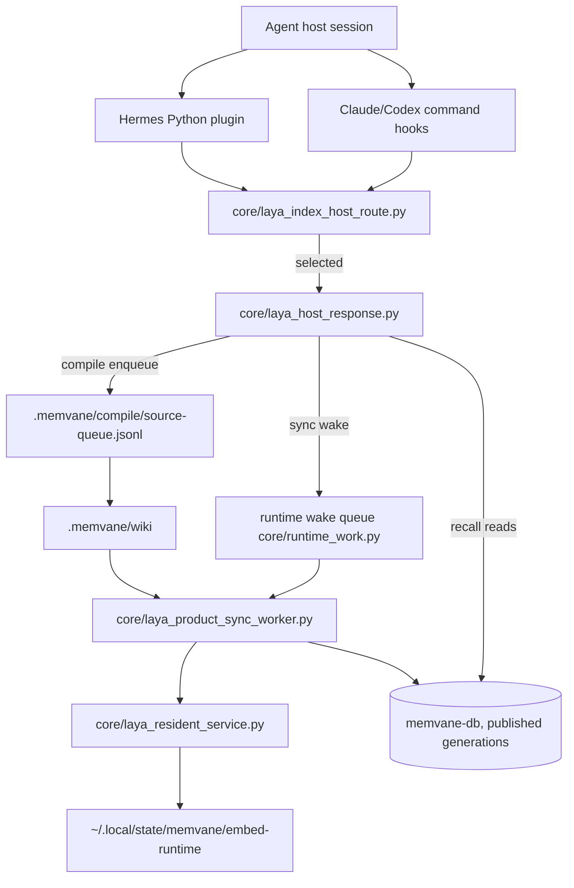

# MemVane Architecture

기능별 그림과 짧은 해설은 [아키텍처 흐름도 목차](architecture/flows/README.md)를 참고하세요.

This document describes the current runtime architecture of MemVane
(plugin id `memvane`).
It is meant for maintainers who need to change the plugin safely. For user-facing
setup and troubleshooting, start with `README.md`.

## Scope

MemVane is a host plugin that injects project-local wiki context
into agent conversations. Every hook action first classifies the event cwd's
memvane-db route; only a selected route does work. It coordinates:

- host hooks for Claude Code, Codex, and Hermes Agent;
- per-project memvane-db onboarding from minimal `.memvane/settings.json`;
- the Laya wiki index, its off-hook full-scan sync and the local embedding
  runtime;
- recall over the last published wiki index generation;
- optional wiki compile, verify, and dedup workflows.

The main architectural rule is:

> Domain behavior lives in `core/`. Host adapters stay thin and translate host
> events into the shared core JSON contract.

## Design Principles

- **Onboarded projects only.** A project is active only when it has a selected
  Laya route, published by the reviewed setup flow. A project without a route
  gets no recall, indexing, compile or learning work; SessionStart shows one
  onboarding notice (a user line and an agent command line) when it has
  `.memvane/settings.json`, unless the user skipped it for that session or
  declined it for that project.
- **Hooks are quiet.** Hook stdout is reserved for host hook payloads or deliberate
  one-time notices. Background work writes to logs.
- **Fail closed on a selected route.** A selected route whose proof fails exits 3;
  there is no fallback to another search path. Empty recall results stay a
  valid no-result state.
- **One core, many hosts.** Claude/Codex command hooks and Hermes Python hooks call
  the same `core/` route classifier and `core/laya_host_response.py`.
- **User-facing control is agent-mediated.** Public docs should guide users to
  ask the host agent in natural language or through exposed skills. Direct
  `core/` and `skills/` shell commands are maintainer/debugging interfaces
  unless a user explicitly asks for them.
- **Queue first, work later.** Hooks record durable wakes and queue rows; off-hook
  workers do embedding, sync, compile and verify.
- **Current state only.** This document describes the code paths that are
  true now. The design under `docs/plans/` (the memvane-db Git-blob model, with
  PR8–PR10 still open) describes remaining work, not shipped behavior.

## Repository Map

```text
core/
  Platform-neutral behavior: route classification, selected-route host
  responses, memvane-db install/sync/upgrade, embedding runtime, runtime wake
  queue and resource admission, wiki compile/verify/dedup, extractor adapters,
  context learning, owner legacy cleanup.

hooks/
  Claude/Codex command hook manifests plus the shared dispatcher. The
  dispatcher accepts a `gemini` engine label, but AGY automatic hooks are
  disabled.

hermes_adapter/
  Hermes Agent Python plugin adapter. It maps Hermes callbacks to the same
  route classifier and selected-route responses used by command hooks.

locks/
  Pinned npm lock for the Laya embedding runtime (`locks/laya-embed-runtime`).

skills/
  Manual workflows (setup, query, update, wiki-compile, wiki-dedup, logs).

agents/
  Resolver prompt for wiki-dedup queue cleanup.

test/
  Deterministic node:test suites using fixtures and temporary projects.
```

## Runtime Components



## Host Adapter Layer

### Claude and Codex

Claude and Codex use command hook manifests:

- `hooks/hooks.json`
- `hooks/hooks-codex.json`
- `hooks/run-hook`

`hooks/run-hook` accepts:

```text
run-hook <action> <engine>
```

Actions: `recall`, `update`, `update-queued`, `gate`, `posttool`, `index`,
`compile`, `file-change-event`.

The dispatcher resolves the plugin root from its own location, applies
sandbox/headless no-op guards, and classifies the event cwd with
`core/laya_index_host_route.py classify-hook`:

| Route state | Behavior |
|---|---|
| `candidate`, `preview`, `worktree` | `exec core/laya_host_response.py serve-stdin` |
| `legacy` (no route) | No work, exit 0. On `update-queued` only, one short onboarding notice line for a project with `.memvane/settings.json` (Codex receives it as SessionStart JSON). A second `[memvane] onboarding-answer <JSON>` line gives the agent the exact `setup_entry.py onboarding-skip` (payload session id, kept 30 days) and `onboarding-never` commands as argv and shell strings; a recorded answer (`~/.local/state/memvane/onboarding/<sha256(canonical project root)>.json`, case aliases share one record) hides both lines. |
| `blocked` or lookup failure | exit 3, no fallback |
| `upgrading` (recall only) | A fenced recall exits 0 without context; route or proof transition errors in the 30-second transition window do the same. Other proof errors remain exit 3. |

A linked worktree reads its own published view. With no published head it
returns `view_preparing` without context or fallback to another view.
SessionStart and successful edits request the main checkout's sync; recall
does not record a wake. The main owner publishes the main view and then up
to 16 linked worktree views per pass.

### Hermes Agent

Hermes does not read Claude/Codex hook JSON. It uses:

- `plugin.yaml`
- `__init__.py`
- `hermes_adapter/plugin.py`
- `hermes_adapter/core_bridge.py`

Hermes mapping (each call goes through `laya_index_host_route.select_route`
and, on a selected route, `laya_host_response.serve_selected`):

| Hermes callback | Bridge function | Selected-route action |
|---|---|---|
| `pre_llm_call` | `recall_context` | `recall` |
| `on_session_start` | `session_update` | `update-queued` |
| `pre_tool_call` | `pre_edit_gate` | `gate` |
| `post_tool_call` | `post_edit_sync` | `posttool`, `index` |

Hermes `post_tool_call` is observer-only. It records a sync wake, but it must
not be documented as equivalent to Claude/Codex posttool context injection.

### Gemini / AGY

The shared dispatcher still has a `gemini` engine label and accepts Gemini-style
event aliases such as `AfterTool`. AGY automatic posttool/index/compile stays
disabled until there is a reliable payload adapter for edited file paths and
stdout behavior.

## Configuration Model

The project file is:

```text
.memvane/settings.json
```

A project uses `.memvane/settings.json`
(see [Project folder](#project-folder)).

Onboarding accepts only the minimal shape `{name, skipPaths}`; any other shape
refuses as `minimal_settings_required`. `core/config.py` expands it: the project
root is the raw collection `<slug>` (wiki generation input), `.memvane/wiki`
is the wiki collection `<slug>-wiki`, recall is wiki-only, compile runs the
host builtin extractor in `auto-wiki` mode, and context learning is on. A
selected route binds the resolved settings identity: editing `skipPaths` keeps
it selected, while changing `name` blocks the route as `route_settings_changed`.

Path safety for collection roots is checked by `core/resolve_paths.py`.
Post-edit collection selection is handled by `core/collection_match.py`, using a
longest-prefix rule so nested collection paths behave predictably. Field-level
details live in [settings](settings.md).

## Main Flows

### 1. SessionStart Update

```text
hooks/run-hook update-queued <engine>
  -> core/laya_index_host_route.py classify-hook
  -> core/laya_host_response.py serve-stdin
       -> record a laya-sync wake (runtime_work) and a session_start compile grant
       -> return one "update queued" notice
```

The hook records only a durable wake. The owner worker
(`core/laya_product_sync_worker.py`) performs resource admission, document
embedding through the resident service and the journal-fenced full-scan sync,
then discovers changed raw sources for wiki compile
(`core/laya_wiki_discovery.py`).
### State roots

User-owned paths are resolved by `core/memvane_paths.py`. Installation identity,
route proof and the selected store are bound to the installation state.

### Project folder

Project settings, wiki cards and runtime files live under `.memvane/`.

### Bundle trust boundary

A selected installation verifies the running plugin bundle and its attestation
before opening the store. Bundle drift permits only a separately proved
read-only route.

### Hook Budget and Detached Jobs

Every command in `hooks/hooks.json` and `hooks/hooks-codex.json` carries an
explicit host `timeout`: 22 seconds for `recall` and `posttool`, 5 seconds for
`update-queued`, `index`, `compile` and `file-change-event`, 3 seconds for
`gate`. Prompt injection
and the gate stay synchronous; maintenance hooks record a durable job and
return.

Python hook entrypoints share one absolute monotonic deadline from
`core/hook_budget.py` (SSOT). The default is 18 seconds;
`QMD_HOOK_TOTAL_SECONDS` accepts 2–20 seconds and falls back to the default
outside that range. The deadline is exported as `QMD_HOOK_DEADLINE_MONO`, so a
child process inherits it and never resets an exhausted parent budget.

`run-hook` replaces its shell with the selected-route Python process, so a host
timeout kills the work itself rather than a waiting shell.

### 2. UserPromptSubmit Recall

```text
hooks/run-hook recall <engine>
  -> core/laya_index_host_route.py classify-hook
  -> core/laya_host_response.py serve-stdin (recall)
```

Hermes reaches the same response through `recall_context`.

Recall verifies the installed route proof, pins one completed index
generation without model work in the hook, searches wiki-role rows only
(lexical and vector), verifies each returned row against the published
generation, and admits a card only when `wiki_card.is_auto_trusted_card`
holds (`status: verified`, `createdBy: memvane` or the earlier plugin name
`qmd-auto-context`, non-empty
`sourceRevisions`). It does not reread current source files; after a source
change, the last completed generation answers until the sync owner publishes a
new one. Details are in [flow 03](architecture/flows/03-wiki-index-search.md).

#### Reader and store identity

Persisted file and directory identities bind by canonical path, inode and
recorded content and metadata. APFS `st_dev` is boot-local and is not compared
across processes. Sync publishes the main view, then linked worktree views;
it publishes lexical data first and vector data after fill completes.

### 3. PreToolUse Gate

```text
hooks/run-hook gate <engine>
  -> core/laya_host_response.py serve-stdin (gate)
```

On a selected route the gate verifies the edit payload and the route proof and
answers `allow` (Hermes: `continue`). A project without a route gets no gate
work.

### 4. PostToolUse Posttool and Index

```text
hooks/run-hook posttool <engine>   -> verified edit, route proof, no hint
hooks/run-hook index <engine>      -> laya-sync wake for paths inside the project
hooks/run-hook file-change-event   -> laya-sync wake after a successful Bash
```

`posttool` is an explicit observer: it returns no context; the index owner
handles durable sync. `index` wakes the same full-scan owner as SessionStart for
edited paths inside the project. A path outside the project is not routed
anywhere; that project's own full-scan sync reconciles it.

### 5. PostToolUse Wiki Compile Enqueue

Goal: turn edited raw/session/source Markdown into durable generated wiki candidates
without storing raw transcript content in the hook path.

```text
hooks/run-hook compile <engine>
  -> core/laya_host_response.py serve-stdin (compile)
  -> core/wiki_compile_enqueue.py
  -> core/wiki_selected_laya.py request_compile
  -> core/wiki_compile_worker.py
```

`core/wiki_compile_enqueue.py` records metadata only:

- project root;
- source relative path;
- collection name;
- engine;
- trigger.

It only accepts Markdown files in `raw`, `session` or `source` role collections. Any path
with a hidden segment such as `.agents`, `.claude`, `.codex`, `.github`, or
`.memvane` is excluded.

`core/wiki_compile_worker.py` later reads the source file, gathers wiki
orientation context, optionally asks the selected memvane-db index for similar wiki pages, runs the
configured host extractor, and passes candidate JSON to `core/wiki_compile.py`.

The project wiki holds only cards. Orientation context is the bundled card-writing
rules (`core/wiki_card_rules/default.md`, or `novel.md` when the project root has a
numbered manuscript directory such as `04_Manuscript/`; a novel-preset wiki directory such
as `characters/` or a legacy `-manuscript`/`-plot` collection also selects it) plus recent
card writes (`wiki.logTail`, rendered as `- <ts> <action> <path> - <title>` from `wiki` events
only). The card catalog is the selected memvane-db index. Card creation, update, deletion and
retirement append one `wiki` event (outcome = action, `reason`, `path`, `title`) to the install
event log `<state root>/events.jsonl` (`core/wiki_activity_log.py` → `core/event_log.py`; see
[Event Log](#event-log)); a project without a selected route logs nothing. The plugin does
not create or read wiki-root `SCHEMA.md`, `index.md` or `log.md`; such files left by
earlier releases stay on disk, are never treated as cards or card targets, are never served
by search, and keep their existing index rows.

Extractor config is intentionally symbolic by default. The worker resolves
extractors in this order:

1. legacy `compile.extractor.argv`;
2. `compile.extractor.backends[engine]`;
3. symbolic `compile.extractor.builtins`;
4. `compile.extractor.default`.

Built-in adapters run in an isolated temporary cwd with `QMD_SANDBOX=1` so a
nested host CLI does not recursively trigger qmd hooks. Claude and Codex
adapters use no-tools/read-only style flags; Hermes uses its safest one-shot
mode, but may still leave host-local persistence if the host CLI has no
equivalent persistence-off flag.

`core/wiki_compile.py` is the deterministic writer. It:

- rejects unsafe paths and transcript-like content;
- resolves targets by explicit `targetPath`, then `canonicalKey`, `aliases`,
  `title`, and finally title slug;
- protects superseded and non-managed pages from silent overwrite;
- writes generated wiki files under `.memvane/wiki`;
- writes new or auto-updated cards as `status: generated` by default;
- refuses a card whose body does not fit the local selector budget
  (`core/wiki_card_budget.py`, below) and reports `split-required`;
- enqueues successful generated writes to the auto-verify queue;
- logs merge-needed or rejected candidates under `.memvane/compile`.

Compiler create/update, verifier stamp/delete, source retirement, dedup merge
and the project-folder move share one project `CARD_WRITE_LOCK`. Each holds it
from the card state read through the decision and atomic replace/unlink, so
their individually atomic writes cannot be composed from stale revisions.

The verify worker is the automatic second filter for generated cards, not a
human approval step. It rechecks the generated card against its source through
the configured host extractor:

- `pass` patches the card to `status: verified` with `verifiedBy`,
  `verifiedAt`, `verifiedMode` and `verifiedBodyHash`;
- `fail` applies `compile.verify.onFail` (`delete` by default, or `contested` /
  `none`);
- `inconclusive` applies `compile.verify.onInconclusive` (same values, `delete`
  by default);
- missing CLIs, timeouts or stale jobs preserve the queue item or leave the card
  as `generated` according to the worker contract.

Recall admits a wiki card only when it is `status: verified`, was created by
the plugin (`createdBy: memvane`, or the earlier plugin name `qmd-auto-context`), and has non-empty compiler-owned `sourceRevisions`. Source
freshness is the index owner's job: it compares source hashes, queues refresh
and regeneration, and publishes each document atomically; recall reads only
the published generation.

`generated`, `tentative`, `contested`, `discarded`, and `superseded` remain
excluded. A provenance-free legacy `verified` is `unknown` and drops. Foreign
cards are never trusted or injected, even with `recallVerifiedOnly: false`.
There is no human wiki lifecycle: automatic cards
do not use `reviewed:` or human statuses, and no `wiki-review` UI, skill, or
agent exists. The `merge-needed.jsonl` ledger is only a bounded non-trusted
collision diagnostic: no candidate is auto-merged, trusted, or queued for human
approval.

`.env` files are not registered as a source. Wiki output makes no
repository-config claim from `prod.env` and no runtime-current claim.

Verify and dedup workers are maintenance paths around this generated wiki state.
They are intentionally fail-open so wiki maintenance does not break normal agent
turns. After each wiki lifecycle run, the same child runs the retroactive dedup
scan (`core/wiki_dedup_scan.py`): it compares the stored memvane-db chunk-vector
centroids of the sealed head's wiki cards and queues pairs at cosine 0.9 or
above to `.memvane/compile/dedup-needed.jsonl` for the `wiki-dedup`
resolver. It makes no model or paid call.

#### Card Body Budget

The live local selector scores a (user request, card) pair with its checkpoint's
legacy input view, `max_len` 1024 tokens. It reads a card through
`context_learning.compact_input`: everything after the frontmatter (banner,
auto-block markers, summary, hand-written sections). The title and other
frontmatter never enter the pair. A longer pair does not fit the model whole.
`core/wiki_card_budget.py` measures the complete, untruncated body that `derive`
returns, so a card the compiler writes is scored whole:

| Part | Tokens |
|---|---|
| fixed question frame (`[CLS]`, question head, options, separators, `User request:` / `Wiki card body:` labels) | 38 |
| card body (`BODY_BUDGET`) | 700 |
| user request room (`QUERY_ROOM`) | 286 |

The request room is a reserve, not a guarantee: a selector request may be up to
2000 characters. Counting request and body apart is one token above the joint
tokenization the selector performs.

Measurement is exact. The body is counted with a selector checkpoint's
`tokenizer/tokenizer.json` through that selector runtime's `tokenizers` library
(`method: tokenizer`). Candidates are the project's own live selector first, then
every other live selector under the user's learning state
(`<learning state>/live-selection/*/live-selector.json`, the same checkpoint
family), so counting works wherever the learning runtime and a selector model
exist. A candidate whose runtime fails (import error, corrupt file, timeout)
yields to the next. A body `derive` refuses as oversized (over 16 KiB) is over the
budget without counting (`method: derive_limit`). A per-character estimate is
never used for a decision: byte-fallback characters (rare Hangul syllables, rare
CJK) cost the tokenizer up to one token per UTF-8 byte. The estimate only sizes
the summary room the extractor prompt states.

The budget is best effort. New and updated cards target it, the extractor gets
one split attempt per compile of a source revision, and the attempt never loses
content: when the split cannot be written whole, the original card is written
(except when the writer itself fails on I/O or its lock, which keeps the
existing `partialCompile` retry).
A card still over the budget is written and the selector scores it by its leading
part (truncated at scoring).

`core/wiki_compile.py` measures the complete file it would write, after lint and
mode checks and before the paid duplicate judge for a new card, and the composed
card (with hand-written sections) for an update. An over-budget card is held back
once: nothing is written, and the candidate ledger row and stdout carry
`split-required` with `size`, `budget`, `method` and `reason`. The reason is
`manual_section_over_budget` when the hand-written sections with an empty summary
already exceed the budget, otherwise `over_budget`. The caller's trusted final
pass, the `--budget-final REASON` flag (a candidate field never requests it),
writes the card anyway and logs `wiki.card` `over_budget_written` (`reason` = why
it is final, `overflow`, `size`, `budget`, `method`). A card no selector runtime
can count is written with `wiki.card` `measure_failed`, and on a machine with no
selector tokenizer at all with `unmeasured`. `--check` predicts the outcome a real
compile would reach (`written`, `candidate`, `merge-needed`, `rejected`,
`suppressed`, `tombstoned`) with no side effect at all: no directory, lock or
ledger is created or touched, so a read-only project can be checked. The paid
duplicate judge and the selected-route pending-replacement checks do not run in a
check. Longer cards are not split
retroactively; their updates follow the same best-effort rule, and verify stamps
and retirement apply unchanged. The `wiki-compile` skill makes the split itself
and then runs once more with `--budget-final` (its wrapper's only pass-through
flag). The verify worker and source retirement patch frontmatter only, and
pending replacement publishes a page this gate already measured.

The compile worker states the budget in the extractor prompt (`payload.cardBudget`:
body 700, summary about 597 after the scaffold). A card held back as
`manual_section_over_budget` is written at once on the final pass (no split can
fix it). For `over_budget` cards the worker re-prompts the same extractor once
with a `split` request naming them; the replacements are split by topic or
category, each with its own `canonicalKey` and the sibling keys in `related`
(frontmatter list, outside the body budget). The re-prompt is one paid
extraction counted against the run's extractor budget. The split is all or
nothing: its parts are written on the final pass only when they fit the
`compile.budget.cardsPerSource` slots the first answer left and `--check`
predicts for every part the outcome it predicts for the original (`written`;
`merge-needed`, `rejected` and `conflict` never qualify, and a guarded-mode part
below `high` confidence that would only become a `candidate` does not match). A
part still over the budget is then written too. Otherwise the original cards are
written on the final pass with the reason (`split_exceeds_slots`,
`split_not_writable`, or, when the split cannot run, `extractor_budget_exhausted`,
`cards_per_source_cap`, the extractor failure such as `resource_deferred`,
`missing_candidates`, `split_empty`). A part whose real write ends otherwise than
predicted (the duplicate judge's `merge-needed`, a write failure) also writes the
original. The worker logs `wiki.card` `split` or `split_unavailable`
(`requested`, `parts`, `written`, `reason`), and the budget path itself is never
retried: one compile costs at most two extractor calls and ends with the cards
stored, so its pending refresh resolves and an initial backfill revision settles
on real cards, except when the writer itself fails on I/O or its lock, which
keeps the existing `partialCompile` retry (and re-extracts on the next run, as
for any card write).

`core/wiki_dedup_resolve.py` refuses a `merge` whose keeper is over the budget:
the loser stays, the pair is recorded as skipped and the CLI returns
`kept_separate`. The resolver agent measures with
`python3 core/wiki_card_budget.py --cwd <project> <keeper> <loser>` before folding.

## Laya Runtime and Embedding

`core/laya_resident_service.py` is one per-user process that owns the local
embedding worker for each vector profile and serves every adopted
install through that install's sealed socket (`<state>/runtime/laya-embed.sock`).
Hooks never load a model.

The embedding runtime lives in `~/.local/state/memvane/embed-runtime`
(`core/laya_embed_runtime.py`): `active.json`, `previous.json` and immutable
generations holding Node, node-llama-cpp, the native build and the GGUF model.
A generation comes from an explicit provisioning action. Maintainer
commands (`ROOT` is the installed plugin root):

```bash
python3 -B "$ROOT/core/setup_entry.py" index-runtime-status
python3 -B "$ROOT/core/setup_entry.py" provision-index-runtime --approve-index-runtime-download [--provider-model-file <gguf>]
python3 -B "$ROOT/core/setup_entry.py" gc-index-runtime [--approve-index-runtime-gc]
```

Provisioning takes Node from `PATH` first, then mise, fnm, nvm, volta, asdf,
Homebrew and system installs, accepting only real binaries (not shims) of
major 22, 24 or 26. It runs `npm ci --ignore-scripts` on
`locks/laya-embed-runtime` (node-llama-cpp 3.18.1 and the prebuilt
`@node-llama-cpp/mac-arm64-metal`) and downloads
`https://huggingface.co/ggml-org/embeddinggemma-300M-GGUF/resolve/main/embeddinggemma-300M-Q8_0.gguf`,
accepted only with sha256
`f470220f84b6235197541352d22f10bf00098a8242c18eaacea9c8a4add557bc`.
`--provider-model-file` uses a local copy of that exact file instead. GC lists
generations and, with approval, removes those that are neither active, previous,
nor named by any `production-provider-attestation.json` under `~/.local/state/memvane/*/` or the pre-rename `~/.local/state/laya/*/`
(historical `profileDependencyClosure` rows are ignored). `generations` must be a
real private directory of the user inside the runtime, and GC enumerates and
deletes through its directory descriptor without following links. A generation
that fails (a mount point inside it, a permission error) is reported in
`failed` with `status: partial`, and the generations already removed stay in
the report.

## Concurrency and Isolation

The runtime uses multiple short-lived processes, so the architecture depends on
clear isolation and lock ownership.

### Host State Isolation

Host adapters pass only normalized JSON payloads, `cwd`, and an engine label into
`core/`. Core scripts must not rely on a host's private in-memory state. Host
differences belong at the adapter boundary:

- command hook dispatch and sandbox guards in `hooks/run-hook`;
- Hermes callback mapping and observer-only caveats in `hermes_adapter/`;
- engine-specific extractor selection in wiki compile worker configuration.

`QMD_ENGINE` is a label for logging, extractor dispatch, and diagnostics. It
must not become a branch point for unrelated domain behavior unless the host
protocol itself requires different handling.

### Lock Ownership

| Surface | Owner | Purpose |
|---|---|---|
| runtime worker lease | `core/runtime_work.py` (`runtime-worker.lock`) | One UID-global wake dispatcher; it holds only its dispatch lease while waiting. |
| card write lock | `CARD_WRITE_LOCK` (`core/compile_paths.py`) | Serializes compiler writes, verifier stamp/delete, source retirement, dedup merge and the project-folder move per project. |
| installer operation lock | `laya-qmd-cutover-operation.lock` (`core/laya_ledger_common.py`) | Serializes installer ledger operations; older installed bundles lock the same file. |

A failed or deferred sync attempt leaves its wake for the dispatcher to retry
rather than dropping it.

### Optional Workflow Isolation

Wiki compile, verify, and dedup are optional maintenance workflows. They
must remain fail-open relative to normal recall and indexing. A failed extractor,
missing host CLI, stale verify job, or dedup queue issue should leave an audit
record and preserve or drop only the relevant queue item according to that
worker's contract.

Cards start as `generated`; automatic source-consistency verification promotes
good cards to `verified`. Ambiguous collisions are recorded passively in
`merge-needed.jsonl` and never become a promotion or human-review state.

## Release Surface

Version and host metadata changes span more than one manifest. Keep these files
aligned when changing release identity or marketplace behavior:

- `package.json`;
- `plugin.json`;
- `plugin.yaml`;
- `.claude-plugin/plugin.json`;
- `.codex-plugin/plugin.json`;
- `.claude-plugin/marketplace.json`;
- `.agents/plugins/marketplace.json`.

`test/plugin-manifest.test.mjs` checks that manifests carry a description and a
version; it does not pin the exact version. Before release, run `npm test`.

## Manual Skills

| Skill | Path |
|---|---|
| `setup` | `core/setup_entry.py` (onboarding, embedding runtime, learning profile, owner legacy cleanup) |
| `query` | `skills/query/scripts/query.sh` → selected-route recall |
| `update` | `skills/update/scripts/update.sh` → full-scan laya-sync wake |
| `wiki-compile` | `core/wiki_extract.py` and `core/wiki_compile.py` (selected route only) |
| `wiki-dedup` | `core/wiki_dedup_resolve.py` via resolver workflow |
| `logs` | `skills/logs/scripts/logs.py` (read-only views of the install event log) |

`query` and `update` act only on a selected route; a project that is not
onboarded exits 1 with an onboarding notice, and a selected route whose proof
fails exits 3. Manual skills may print diagnostics. Hook paths should stay
quiet.

## Failure Behavior

Expected empty-output cases:

- sandbox or headless mode;
- no selected route (`legacy`), apart from the one SessionStart notice;
- no results after filters;
- edit outside the project's collection paths;
- compile disabled or source outside raw/session/source Markdown scope.

A selected route whose proof fails, a blocked route, or a failed route lookup
exits 3 instead.

To see why a recall was empty or degraded, read the install event log
(below) through the `logs` skill:

```bash
python3 -B skills/logs/scripts/logs.py --cwd "$PWD" recalls --limit 10
```

### Event Log

`core/event_log.py` appends one JSON line per event to `<state root>/events.jsonl`,
where the state root is the directory of the selected route's install journal
(`journalPath`'s parent; a worktree uses its main route). A project without a
selected route writes nothing, and nothing is written under the project or a
per-user directory.

- **Path safety.** The state root is reached one component at a time from `/`
  without following symlinks; every ancestor is owned by the user or root and
  is not group/world-writable unless sticky, and the state root is owned by the
  user with mode `0700`. The file is opened relative to that directory with
  `O_NOFOLLOW`, created `0600`, and must be a regular file owned by the user.
- **Cost.** One `O_APPEND` write per line, lines capped at 4096 bytes (an
  oversized line halves `cards` and `notes`, then drops `prompt.text`, then
  keeps the envelope alone, and is marked `truncated: true`), no fsync. Past
  4 MiB the file rotates to `events.jsonl.1` and `.2`. `events.lock`
  coordinates writers (shared, from open through write) and rotation
  (exclusive), so rotation never moves a file mid-append. Every lock is
  non-blocking: rotation waits for a later write when a writer holds the
  lock, a writer retries a few times within ~2 ms and then drops the line,
  and a busy refusal counter drops its increment. While rotation cannot get
  the lock, the live file grows at most to twice the rotation size; past that,
  lines are dropped and counted until a writer rotates. A process reuses its
  proven state-root fd after one `fstat` and one `lstat` (the path must still
  name that directory). Files open with
  `O_NONBLOCK|O_NOFOLLOW` and are used only as regular, user-owned files.
- **Reading.** Readers take at most the newest 8 MiB (counting every byte
  read) and skip lines with malformed envelopes. The extractor `wiki.logTail` renders only `wiki` events
  with a known outcome (`created`, `updated`, `deleted`, `retired`), a
  relative path without Unicode control, format or separator characters
  (`Cc`, `Cf`, `Cs`, `Zl`, `Zp`), and a title with those characters replaced
  and capped at 200 characters.
- **Failure.** Writes are best-effort and never raise, print or block a hook.
  A write refused after the state root is proven (symlinked, foreign or
  non-regular `events.jsonl`, failed write) increments `events.refused.json`
  beside it, and the process carries its unwritten count as `dropped` on its
  next written line. A state root that fails the path walk is reported by the
  `logs` skill, so an empty log is always explained.
- **Privacy.** Prompt text and document bodies are not written; a prompt is
  `{sha256, chars}`, as is the bounded extractor stderr tail. Keys naming
  secrets (token, password, secret, credential, api key, authorization,
  cookie) are dropped. See [privacy.md](privacy.md#event-log).

Line envelope (`v` 1): `{ts, v, install, host, session, event, outcome, reason,
ms, ...}`, with `host` one of `claude`, `codex`, `hermes`, `worker`.

### Detailed diagnostics

`core/diagnostic_trace.py` records optional raw failure detail into the same
`events.jsonl`. It is off unless the proved route's project settings carry
`diagnostics.enabled: true` (JSON boolean only; see
[settings](settings.md#diagnostics--상세-진단-동의-opt-in)). Consent is re-read on
every capture, checked before formatting and again right before the first write;
turning it off stops new captures but deletes nothing already written. A
capture already past its final consent check may still finish. Only
failure paths that call `capture` record detail; not every failure path does.

When on, the raw text can include exception messages, which may contain
secrets. It is written only to the user-private, rotated install event log
described above.

Kinds:

- `exception` — a Python exception chain (`traceback.TracebackException`, at
  most 64 frames, no locals, shortened frame paths), including its message.
- `origin_stack` — for a warning with no exception: the caller's stack at the
  point the failure was noticed, without this module's own frames.
- `child_stderr_tail` — the last 4096 UTF-8 bytes of a child process's stderr.
  It is a bounded tail, not the child's complete stack; the start of the
  child's output may be missing.

Fragment format: text is capped at 16 KiB, written as up to 96
`diagnostic.part` rows (base64, 180 raw bytes each) and then one
`diagnostic.header` row (`diagnostic_id`, `kind`, `parts`, `bytes`, `sha256`,
`truncated`). The header is written last. A diagnostic whose parts are missing,
rotated away, or fail the length/hash check reassembles as
`incomplete`; a part without a header is never shown.

Reading (`skills/logs/scripts/logs.py`):

- Default text and `--json` never print `diagnostic.part` rows or stored legacy
  `prompt.text`; a `diagnostic.header` shows only its ID and fixed metadata.
- `--details` is the explicit opt-in that reassembles each shown header into
  its raw text (or reports `incomplete` / `unavailable`). Every printed string
  is terminal-escaped (control and format characters become `\xNN`-style
  text); stored bytes are not changed.
- `--register PROJECT` (repeatable) is the tool's only write: it adds the
  project's canonical root and current install ID to the owner-private
  registry `$XDG_CONFIG_HOME/memvane/log-targets.json` (`~/.config` when unset;
  user-owned `memvane` directory without group/other bits, `0600` single-link
  file, `flock` on the file itself; at most 64 targets). It stores no event
  content. Each request reports its own outcome.
- `--all` reads every registered target, re-verifying each against its current
  route (`stale_route` when the install ID changed), and merges lines in UTC
  order under one 16 MiB read budget split equally between readable targets.
  A target that cannot be read is listed with its fixed reason (`missing`,
  `not_onboarded`, `stale_route`, registry refusals), never shown as empty.

| Boundary | Available detail |
|---|---|
| Selected recall hook | Exception chain, or origin stack for the instrumented selector and vector fallback warnings |
| Sync/compile dispatcher | Dispatcher exception; a failed child has at most its stderr tail and a `trace_unavailable` marker |
| Compile verify pass | Exception chain when the selected route still matches the bound install |
| Hermes selected recall adapter | Exception chain if the core has not already logged it and a selected route is available |
| Resident service internals | Existing fixed event codes only when an exception has already been swallowed; no reconstructed cause stack |
| Other hook and adapter boundaries | Existing event codes where available; detailed exception capture is not guaranteed |

| Event | Written by | Outcome / fields |
|---|---|---|
| `recall`, `gate`, `posttool`, `update`, `update-queued`, `index`, `compile`, `file-change-event` | selected-route hook actions (`core/laya_host_response.py`) | `ok` / `refused` (`recall`: `served` / `empty` / `refused`); `reason` is a fixed refusal code or a final code such as `sync_requested` |
| `hook.error` | `core/hook_main.py` | exception class and `file:line`, never the message |
| `learning.capture` | context learning capture | capture status |
| `wiki` | compile, verify, dedup, pending publish, lifecycle, source retirement | `created` / `updated` / `deleted` / `retired`; `reason` (`compile`, `pending_publish`, `verify_retire`, `dedup`, `lifecycle:<code>`, `source_deleted`), `path`, `title` |
| `wake.sync`, `wake.compile` | off-hook dispatcher (`core/laya_runtime_dispatch.py`) | dispatcher outcome, `generation`, `previousGeneration` |
| `index.publish` | off-hook dispatcher | `generation`, `previousGeneration`, `epoch` |
| `resident.adopt`, `resident.drain`, `resident.forced_exit` | `core/laya_resident_service.py` | `adopted`; drain `started` / `stopped`; `exited` (`cold_load_hung`) |
| `wiki.card` | `core/wiki_compile.py`, `core/wiki_compile_worker.py`, `core/wiki_dedup_resolve.py` | `over_budget` (held back for the split; `reason`, `path`, `title`, `size`, `budget`, `method`); `over_budget_written` (written after the split attempt; `reason`, `overflow`, same fields); `unmeasured` (no selector tokenizer, written); `measure_failed` (every selector runtime failed, written; `runtimes`); `split` / `split_unavailable` (source `path`, `reason`, `requested`, `parts`, `written`); `merge_kept_separate` (keeper `path`, `kept`, `size`, `budget`, `method`) |
| `compile.extractor`, `compile.verify_pass` | `core/wiki_compile_worker.py` | extractor stderr as `{sha256, chars}`; verify-pass exception class and frame |

A `recall` event's `reason` is the final outcome (`selected`,
`no_results_after_filter`, `no_candidates`, or a refusal code) and `notes` lists
the diagnostic codes on the way (`laya_vector_*`, `laya_selector_*`,
`laya_recall_proof_retry`, `laya_wiki_rows_filtered`,
`laya_selector_selected_zero`, `laya_exclusion_candidate_capped`, ...). It also
carries `cards` (`[{path, sha}]`, exactly the injected cards), `count`,
`candidates`, `selection`, `selection_fallback`, `vector_fallback`, `degraded`
(`bundle_drift`, `worktree`, `reader_endpoint` or `preview`), `store_format` and
`reader_endpoint` (a recall the schema3 reader served), `drift`, `retry`, `generation`,
`filtered_count`/`filtered_reasons` and `prompt` (`{sha256, chars}`).

The only code path that reads the log back is the compile worker's
`wiki.logTail`, which renders `wiki` events alone.

### Log Files

| Log | Location |
|---|---|
| install event log | `<state root>/events.jsonl` (+ `.1`, `.2`) |
| wiki lifecycle | `~/.local/state/memvane/auto-context/logs/wiki-lifecycle.log` (`QMD_WIKI_LIFECYCLE_LOG`) |
| wiki dedup scan | `~/.local/state/memvane/auto-context/logs/wiki-dedup.log` (`QMD_WIKI_DEDUP_LOG`) |
| compile ledgers | `.memvane/compile/` (`candidates.jsonl`, `verify-log.jsonl`, `merge-needed.jsonl`, `verify-deleted.jsonl`, `dedup-deleted.jsonl`, `discard-ledger.jsonl`, queues) |
| context learning jobs | per-user learning state `job-telemetry.jsonl`, `worker.log` |

## Test Strategy

The default test command is:

```bash
npm test
```

Tests are deterministic and run through `scripts/development_guard.py` with
file concurrency 1. They use fixtures, temporary projects and route records,
and sandbox env guards. Useful focused tests:

```bash
npm run test:focused -- test/laya-index-host-route.test.mjs
npm run test:focused -- test/laya-embed-runtime.test.mjs
npm run test:focused -- test/laya-runtime-provision.test.mjs
npm run test:focused -- test/wiki-compile-worker.test.mjs
npm run test:focused -- test/hermes-plugin-adapter.test.mjs
```

## Change Checklist

When changing architecture-sensitive code, check these boundaries:

- Does the change keep host adapters thin and `core/` as the source of truth?
- Does it preserve quiet hook stdout?
- Does sandbox/headless mode exit before side effects?
- Does a project without a selected route still get no work apart from the one
  SessionStart notice, and does a failed selected proof still exit 3?
- Do Claude, Codex, and Hermes still map to equivalent core behavior where the
  host protocol allows it?
- Does the hook still record only durable wakes and leave model work to the
  off-hook owner?
- If wiki compile changes, are `raw`/`session`/`source` scope, hidden-path rejection,
  cooldown, queue preservation, and protected-page behavior covered?
- Are manual skills still wrappers over core paths rather than alternate
  implementations?
