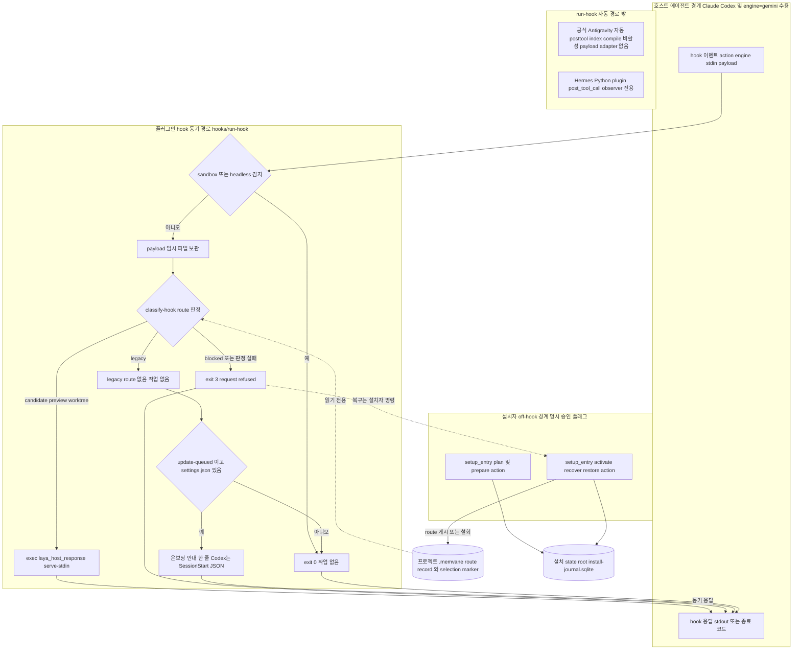

# 01 설치와 호스트 hook 경로

호스트 에이전트의 hook 이벤트는 `hooks/run-hook`으로 들어옵니다. 여기서 가장 먼저 sandbox·headless 가드와 route 판정을 거칩니다. route가 선택된 상태(`candidate`·`preview`·`worktree`)이면 셸이 동기 Laya 응답 프로세스로 교체됩니다. `blocked`이거나 판정이 실패하면 `request refused`와 종료 코드 3으로 거부됩니다. route가 없는 `legacy` 프로젝트는 색인·recall·compile·학습 작업을 하지 않습니다. SessionStart(`update-queued`)에서만 `.memvane/settings.json`(없으면 `.auto-context/settings.json`)이 있는 프로젝트에 setup 스킬로 온보딩하라는 안내 한 줄을 출력합니다(Codex는 SessionStart JSON으로 감쌉니다). route 기록과 selection marker는 hook이 바꾸지 않습니다. 이를 변경하는 것은 off-hook 설치자 명령(`core/setup_entry.py`의 action)이며, 명시 승인 플래그가 필요합니다.

엔진 범위에는 제한이 있습니다.

- `hooks/run-hook`은 `engine=gemini`를 받아들입니다. 그렇다고 Gemini·Antigravity 자동 coverage가 보장되는 것은 아닙니다.
- 공식 Antigravity의 자동 posttool·index·compile은 공식 payload adapter가 생길 때까지 **비활성**입니다.
- Hermes는 `run-hook`을 거치지 않는 별도 Python plugin입니다. `post_tool_call`을 관찰만(observer-only) 합니다.

## Implementation and evidence

### 현재 구현

- [`hooks/run-hook:21-34`](../../../hooks/run-hook#L21-L34): `--sandbox`나 `QMD_SANDBOX`, 또는 엔진별 sandbox·headless 변수가 있으면 plugin root 파일 처리와 모든 hook 작업보다 먼저 종료합니다. Codex의 `gate` action은 편집 차단을 유지해야 하므로 이 가드에서 제외됩니다.
- [`hooks/run-hook:47-93`](../../../hooks/run-hook#L47-L93): payload를 임시 파일에 보관한 뒤 `core/laya_index_host_route.py classify-hook`으로 `legacy`·`candidate`·`preview`·`worktree`·`blocked`를 판정합니다. `candidate`·`preview`·`worktree`이면 `exec`로 셸을 `core/laya_host_response.py serve-stdin`에 넘깁니다. 그래서 호스트 timeout이 대기 중인 셸이 아니라 작업 자체를 종료합니다. `blocked`와 그 밖의 결과는 `request refused`와 함께 `exit 3`입니다.
- [`hooks/run-hook:55-75`](../../../hooks/run-hook#L55-L75): `legacy`는 작업 없이 exit 0입니다. `update-queued`에서만 `context_learning_host_ack.py`로 소유자가 요청한 history cutover를 확인하고(실패는 무시, history를 선택하거나 프로젝트 콘텐츠를 건드리지 않음), `laya_index_host_route.py onboarding-notice`가 돌려준 안내 한 줄을 출력합니다. Codex에는 `hookSpecificOutput` SessionStart JSON으로 감싸 출력합니다.
- [`hooks/run-hook`](../../../hooks/run-hook): `engine=gemini`를 받아들입니다. 하지만 공식 Antigravity의 자동 posttool·index·compile은 공식 payload adapter가 생길 때까지 비활성입니다.
- Hermes: 별도 Python plugin으로, `post_tool_call`을 관찰만 합니다. 이 문서의 `run-hook` route·enqueue·compile 경로에는 속하지 않습니다.
- [`core/setup_entry.py:56-106`](../../../core/setup_entry.py#L56-L106): 설치자 action 목록과 `--approve-*` 승인 플래그입니다. `index-runtime-status`·`provision-index-runtime`·`gc-index-runtime`·`plan-legacy-cleanup`·`apply-legacy-cleanup`은 `--project` 없이 실행합니다.
- [`core/setup_entry.py:131-279`](../../../core/setup_entry.py#L131-L279): index-origin 계열 action을 `laya_product_install`에 위임합니다.
- `core/laya_product_install.py` `plan_fresh_wiki_origin`: 프로젝트 활성 폴더(`.memvane`, 옮기기 전 프로젝트는 `.auto-context`) 아래에 route record나 selection marker가 이미 있으면 계획을 거부합니다.
- [`core/laya_product_install.py:565-566`](../../../core/laya_product_install.py#L565-L566): 설치 state root 아래의 `install-journal.sqlite`와 `runtime/laya-embed.sock`입니다.
- `core/laya_fresh_wiki_origin.py`: ledger(`fresh-wiki-cutover.json`, state root)·marker(`laya-index-selection.json`)·route(`laya-index-route.json`, 둘 다 프로젝트 폴더 `.memvane/`) 파일 이름입니다.

### QA 증거와 미검증

- f89b141에서 통과가 확인된 것은 source-level CI입니다. synthetic QA 증거는 [release-agent-qa.md](../../release-agent-qa.md)에 있습니다. 다만 synthetic 증거가 있다고 해서 실제 호스트의 route 선택이 통과한 것은 아닙니다.
- `candidate` 경로를 실제 Claude·Codex·Gemini 호스트에서 확인하는 QA는 통과하지 않았습니다.
- 공식 Antigravity 자동 경로는 payload adapter가 생기기 전까지 구현 범위 밖입니다.
- 설치자 action을 호출하는 실제 명령 형태(래퍼와 인자 조합)는 발췌에 없어 표기하지 않았습니다.
