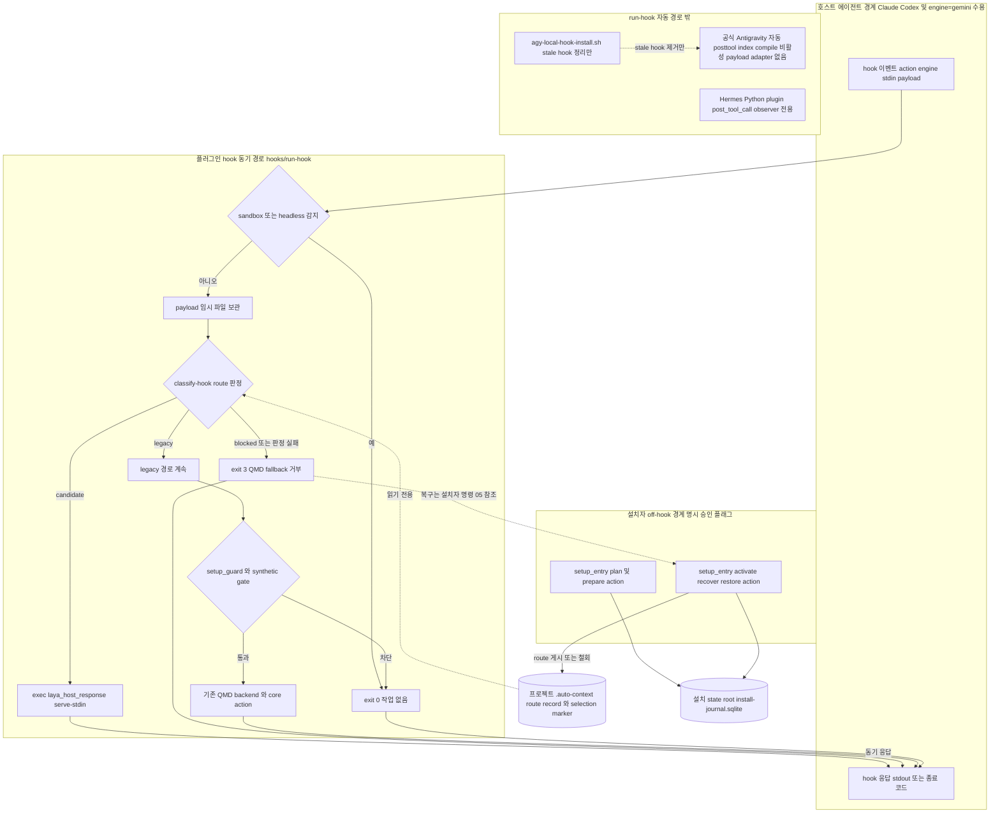

# 01 설치와 호스트 hook 경로

호스트 에이전트의 hook 이벤트는 `hooks/run-hook`으로 들어옵니다. 여기서 가장 먼저 sandbox·headless 가드와 route 판정을 거칩니다. route가 `candidate`이면 셸이 동기 Laya 응답 프로세스로 교체됩니다. `blocked`이거나 판정이 실패하면 QMD fallback 없이 종료 코드 3으로 거부됩니다. `legacy`일 때만 기존 QMD 경로의 setup·synthetic 가드로 진행합니다. route 기록과 selection marker는 hook이 바꾸지 않습니다. 이를 변경하는 것은 off-hook 설치자 명령(`core/setup_entry.py`의 action)이며, 명시 승인 플래그가 필요합니다.

엔진 범위에는 제한이 있습니다.

- `hooks/run-hook`은 `engine=gemini`를 받아들입니다. 그렇다고 Gemini·Antigravity 자동 coverage가 보장되는 것은 아닙니다.
- 공식 Antigravity의 자동 posttool·index·compile은 공식 payload adapter가 생길 때까지 **비활성**입니다.
- `scripts/agy-local-hook-install.sh`는 현재 stale hook을 정리하기만 하고, 자동 hook을 설치하지 않습니다.
- Hermes는 `run-hook`을 거치지 않는 별도 Python plugin입니다. `post_tool_call`을 관찰만(observer-only) 합니다.

## Implementation and evidence

### 현재 구현 (커밋 f89b141)

- [`hooks/run-hook:19-33`](../../../hooks/run-hook#L19-L33): `--sandbox`나 `QMD_SANDBOX`, 또는 엔진별 sandbox·headless 변수가 있으면 plugin root 파일 처리와 모든 hook 작업보다 먼저 종료합니다. 이때 `topical-stop`은 빈 JSON 객체를 출력합니다. Codex의 `gate` action은 편집 차단을 유지해야 하므로 이 가드에서 제외됩니다.
- [`hooks/run-hook:46-83`](../../../hooks/run-hook#L46-L83): payload를 임시 파일에 보관한 뒤 `core/laya_index_host_route.py classify-hook`으로 `legacy`·`candidate`·`blocked`를 판정합니다. `candidate`이면 `exec`로 셸을 `core/laya_host_response.py serve-stdin`에 넘깁니다. 그래서 호스트 timeout이 대기 중인 셸이 아니라 작업 자체를 종료합니다. `blocked`와 그 밖의 결과는 `exit 3`이며 QMD fallback을 거부합니다.
- [`hooks/run-hook:85-90`](../../../hooks/run-hook#L85-L90): `update-queued`는 `context_learning_host_ack.py`로 소유자가 요청한 history cutover를 확인만 합니다. 실패는 무시합니다. history를 선택하거나 프로젝트 콘텐츠를 건드리지 않습니다.
- [`hooks/run-hook:92-106`](../../../hooks/run-hook#L92-L106): local trial marker가 있으면 `QMD_AUTO_COMPILE_DISABLED`를 export합니다. runtime env 파일에서는 검증된 대입만 export합니다.
- [`hooks/run-hook:108-135`](../../../hooks/run-hook#L108-L135): `update-queued`를 제외한 legacy action은 `setup_guard.py`와 `synthetic_invocation_gate.py`를 통과해야 backend로 진행합니다. 발췌가 135행에서 끝나므로 그 이후의 dispatch는 도표에서 노드 하나로만 표시했습니다.
- [`hooks/run-hook`](../../../hooks/run-hook): `engine=gemini`를 받아들입니다. 하지만 공식 Antigravity의 자동 posttool·index·compile은 공식 payload adapter가 생길 때까지 비활성입니다.
- [`scripts/agy-local-hook-install.sh`](../../../scripts/agy-local-hook-install.sh): 현재 stale hook 정리만 수행합니다.
- Hermes: 별도 Python plugin으로, `post_tool_call`을 관찰만 합니다. 이 문서의 `run-hook` route·enqueue·compile 경로에는 속하지 않습니다.
- [`core/setup_entry.py:388-455`](../../../core/setup_entry.py#L388-L455): 설치자 action 목록과 `--approve-*` 승인 플래그입니다.
- [`core/setup_entry.py:456-492`](../../../core/setup_entry.py#L456-L492): index-origin 계열 action을 `laya_product_install`에 위임합니다.
- [`core/laya_product_install.py:219-227`](../../../core/laya_product_install.py#L219-L227): `.auto-context` 아래에 route record나 QMD selection marker가 이미 있으면 계획을 거부합니다.
- [`core/laya_product_install.py:876-880`](../../../core/laya_product_install.py#L876-L880): 설치 state root 아래의 `install-journal.sqlite`와 `runtime/laya-embed.sock`입니다.
- [`core/laya_qmd_cutover.py:41-47`](../../../core/laya_qmd_cutover.py#L41-L47): ledger·marker·route 파일 이름입니다. 이 파일들이 놓이는 디렉터리는 발췌만으로 확정되지 않아, 도표에는 일반 이름으로 표기했습니다.

### QA 증거와 미검증

- f89b141에서 통과가 확인된 것은 source-level CI입니다. synthetic QA 증거는 [release-agent-qa.md](../../release-agent-qa.md)에 있습니다. 다만 synthetic 증거가 있다고 해서 실제 호스트의 route 선택이 통과한 것은 아닙니다.
- `candidate` 경로를 실제 Claude·Codex·Gemini 호스트에서 확인하는 QA는 통과하지 않았습니다.
- 공식 Antigravity 자동 경로는 payload adapter가 생기기 전까지 구현 범위 밖입니다.
- 설치자 action을 호출하는 실제 명령 형태(래퍼와 인자 조합)는 발췌에 없어 표기하지 않았습니다.
