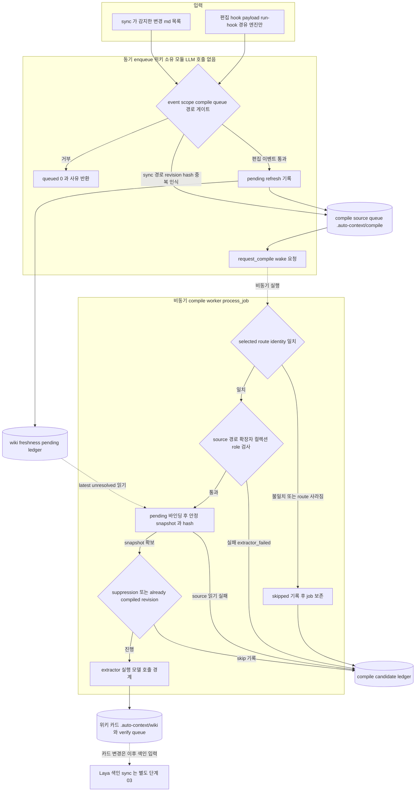

# 02 원본 소스에서 위키 카드까지

원본(raw) Markdown의 변경은 두 입력을 통해 위키 source queue에 들어갑니다.

- 편집 hook 이벤트(`enqueue_payload`)
- sync가 감지한 변경 목록(`enqueue_changed_sources`)

두 경우 모두 메타데이터만 append하며 LLM을 호출하지 않습니다. 이후 비동기 worker `process_job`이 route identity·경로 범위·안정 snapshot·비용 가드를 통과한 job에 대해서만 extractor(모델 호출 경계)를 실행합니다. 그 결과로 위키 카드와 verify 대상이 만들어집니다.

이 과정에서 raw는 카드 생성 입력과 path·hash freshness 메타데이터로만 쓰입니다. 카드 compile이 끝났다고 해서 Laya 색인 sync까지 끝난 것은 아닙니다(03 참조). 공식 Antigravity의 자동 편집 이벤트는 현재 이 경로로 들어오지 않습니다(01 참조).

## Implementation and evidence

### 현재 구현 (커밋 f89b141)

- [`core/wiki_compile_enqueue.py:147-168`](../../../core/wiki_compile_enqueue.py#L147-L168): sync 경로입니다. docstring에 따르면 LLM을 호출하지 않고 메타데이터만 append합니다. `compile_gate`·`_safe_queue_path`·후보 산출 단계 중 하나에서 걸리면 사유만 반환합니다.
- [`core/wiki_compile_enqueue.py:169-185`](../../../core/wiki_compile_enqueue.py#L169-L185): 수동 sync는 이번 wake 대상 행에 대해서만 revision hash를 계산합니다. 덕분에 enqueue 후 snapshot을 기록하기 전에 실패했다가 재시도하더라도 같은 revision의 행을 알아봅니다. hash가 없는 legacy 행은 억제하지 않고 유지합니다.
- [`core/wiki_compile_enqueue.py:186-190`](../../../core/wiki_compile_enqueue.py#L186-L190): 기록된 행이나 대기 중인 wake가 있으면 `wiki_selected_laya.request_compile`을 호출합니다.
- [`core/wiki_compile_enqueue.py:424-477`](../../../core/wiki_compile_enqueue.py#L424-L477): 편집 이벤트 경로입니다. 이벤트 종류, `postToolUse` 설정, compile gate, queue 경로를 차례로 검사합니다. `wiki_freshness.record_pending_refresh`가 None을 반환하면 enqueue하지 않습니다.
- [`core/wiki_compile_enqueue.py:480-491`](../../../core/wiki_compile_enqueue.py#L480-L491): sandbox이면 즉시 0을 반환합니다. 비어 있거나 잘못된 JSON 입력은 무시합니다.
- [`core/wiki_compile_worker.py:859-878`](../../../core/wiki_compile_worker.py#L859-L878): 반환값에 verify 대상 카드 목록이 포함됩니다. selected route identity가 바뀌었거나 route가 사라졌으면 `skipped`로 기록하고 job을 보존합니다.
- [`core/wiki_compile_worker.py:879-908`](../../../core/wiki_compile_worker.py#L879-L908): 다음 경우를 `extractor_failed`로 기록합니다: 경로 탈출, `.md`가 아닌 파일, 숨김 경로, 컬렉션 불일치, compile source role이 아닌 파일.
- [`core/wiki_compile_worker.py:909-929`](../../../core/wiki_compile_worker.py#L909-L929): 최신 미해결 pending을 바인딩한 다음 안정 snapshot을 뜨고, `maxSourceChars` 한도 안에서 decode합니다.
- [`core/wiki_compile_worker.py:930-952`](../../../core/wiki_compile_worker.py#L930-L952): extractor를 띄우기 전에 두 가지 비용 가드를 적용합니다. 하나는 verify inconclusive suppression이고, 다른 하나는 selected route에서 이미 compile된 revision입니다. 두 번째 가드는 pending이 없고 `partialCompile`이 아닐 때만 적용됩니다.

### QA 증거와 미검증

- synthetic QA 증거는 [release-agent-qa.md](../../release-agent-qa.md)에 있습니다. 다만 synthetic 증거는 selected route의 end-to-end compile이 통과했다는 뜻이 아닙니다. 해당 호스트 QA는 통과하지 않았습니다.
- extractor 실행 이후의 카드 기록(`wiki_compile`)과 verify 처리 코드는 발췌 범위 밖입니다. 그래서 도표에서는 노드 하나로 요약했습니다.
- compile 완료는 위키 카드가 생성되었다는 뜻일 뿐입니다. Laya index generation 게시와 recall 반영은 별개 단계입니다.
- 아키텍처 지도에 기록된 위험이 아직 남아 있습니다. enqueue와 snapshot 기록 사이에서 실패하면 중복 재시도가 일어날 수 있습니다.
