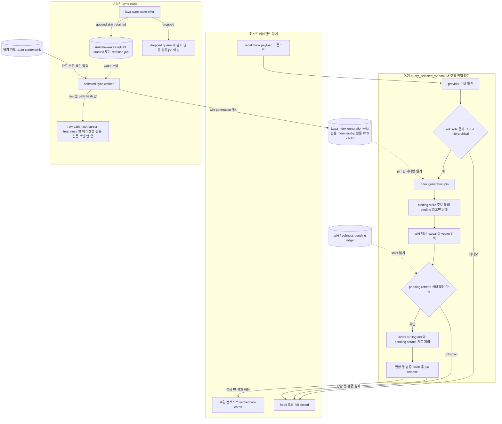

# 03 위키 색인과 검색 주입

선택된 Laya v2 route의 recall은 hook 안에서 모델 작업 없이 index generation 하나를 pin합니다. 그런 다음 wiki role 컬렉션 루트만 검색해 검증된 위키 카드를 반환합니다. 반환하기 전에 `index.md`·`log.md`와, pending refresh가 남은 source의 카드는 제외합니다. pending 상태를 알 수 없거나 반환 행 검증이 실패하면 결과를 줄여서 내보내지 않고 실패(fail closed)합니다.

Laya의 membership·본문·FTS·vector·검색은 **위키 카드만** 대상으로 합니다. raw source에 대해서는 path·hash cursor만 남고, 이는 freshness 판단과 위키 생성에만 쓰입니다. raw 본문은 색인되지 않습니다. 일반 위키 카드 안의 인용과 source locator 링크는 유효한 출력입니다.

색인 갱신은 runtime wake queue를 통해 비동기 sync worker가 맡습니다. offer 결과가 `queued`·`retained`이면 job이 queue에 남지만, `dropped`이면 queue에 남지 않습니다. 따라서 `dropped`를 성공한 job으로 보지 않습니다.

## Implementation and evidence

### 현재 구현 (커밋 f89b141)

- [`core/laya_host_response.py:735-743`](../../../core/laya_host_response.py#L735-L743): 한 pin에서 검증된 위키 카드만 반환합니다. hook 안에서는 모델 작업을 하지 않습니다. `source_locations`에는 반환된 wiki 행의 검증된 span locator만 담깁니다.
- [`core/laya_host_response.py:744-751`](../../../core/laya_host_response.py#L744-L751): provider 준비를 확인한 뒤 `wiki_index_roots`로 루트를 정합니다. wiki role이 없거나 `hierarchical`이 아니면 실패합니다.
- [`core/laya_host_response.py:752-759`](../../../core/laya_host_response.py#L752-L759): generation을 pin합니다. binding store가 있는데 pin된 generation에 binding이 없으면 fail closed로 처리합니다.
- [`core/laya_host_response.py:761-793`](../../../core/laya_host_response.py#L761-L793): pending refresh 상태를 알 수 없으면 `wiki_pending_refresh_unknown`으로 실패합니다. `index.md`·`log.md`를 뺀 뒤 `_verified_wiki_row`로 필터하고, `require_returned_verified`와 `finish`를 거칩니다. 마지막에는 pin을 반드시 release합니다.
- [`core/laya_index_host_route.py:163-174`](../../../core/laya_index_host_route.py#L163-L174): 현재 다중 source 정책은 raw 컬렉션 1개와 wiki 컬렉션 1개, `hierarchical`, score cutoff 0입니다. raw 컬렉션은 freshness와 위키 생성용이며, 검색 대상이 아닙니다.
- [`core/laya_wiki_discovery.py:519-539`](../../../core/laya_wiki_discovery.py#L519-L539): raw 루트 스캔은 이름과 hash만 반환합니다. raw 본문을 Laya membership에 추가하지 않습니다.
- [`core/laya_index_source_port.py:301-351`](../../../core/laya_index_source_port.py#L301-L351): 명시된 루트만 symlink를 따라가지 않고 스캔해 path·sha256 manifest를 만듭니다.
- [`core/runtime_work.py:1-5`](../../../core/runtime_work.py#L1-L5), [`core/runtime_work.py:84-122`](../../../core/runtime_work.py#L84-L122): `runtime-wakes.sqlite3` wake queue입니다. offer 결과는 `queued`·`retained`·`dropped` 중 하나입니다. `dropped`는 queue에 남은 job이 아닙니다. 대기 중인 waiter는 dispatch lease만 잡습니다.
- [`core/laya_product_install.py:2022-2023`](../../../core/laya_product_install.py#L2022-L2023): 활성화 직후 `laya-sync` wake를 한 번 요청합니다. 그 결과는 보고만 하고 재시도하지 않으므로, `dropped`이면 이 요청만으로는 sync가 보장되지 않습니다.
- [`core/laya_product_install.py:839-843`](../../../core/laya_product_install.py#L839-L843): capacity store가 생긴 뒤에는 worker가 첫 bound generation을 게시할 때까지 recall이 아무것도 제공하지 않습니다.

### 범위 구분

- Laya membership·본문·FTS·vector·검색은 위키 카드만 대상으로 합니다.
- raw source의 path·hash cursor는 freshness 판단과 위키 생성을 위해서만 존재합니다. raw 본문은 색인되지 않으며 자동 컨텍스트가 되지 않습니다.
- 일반 위키 카드에 담긴 인용(발췌)과 source locator 링크는 유효한 출력입니다. 호스트 에이전트가 링크를 따라 raw 파일을 직접 읽을지는 호스트의 선택이며, 플러그인 성공 기준에 포함되지 않습니다.

### QA 증거와 미검증

- synthetic QA 증거는 [release-agent-qa.md](../../release-agent-qa.md)에 있습니다. 다만 synthetic 증거는 실제 호스트의 route 선택이나 recall 주입이 통과했다는 뜻이 아닙니다. 해당 QA는 통과하지 않았습니다.
- sync worker가 generation을 게시하는 내부 단계와, 위키 카드가 바뀔 때 wake를 보내는 주체는 발췌로 일부만 확인했습니다. 그래서 도표에서는 일반 노드로 표시했습니다.
