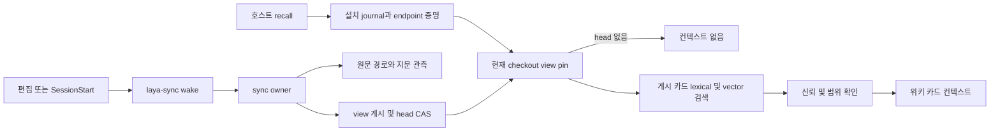

# 03 위키 색인과 검색 주입

선택된 프로젝트의 recall은 설치 journal과 reader endpoint를 확인하고 현재 checkout의 view에 게시된 세대 하나를 pin합니다. view가 아직 게시되지 않았다면 컨텍스트 없이 끝납니다. 연결 worktree는 자기 view만 읽고 main이나 다른 worktree의 view로 폴백하지 않습니다.

검색 대상은 위키 카드입니다. 카드 본문·FTS·vector는 게시된 store에서 읽으며 검색 시 원문 파일이나 pending refresh 원장을 다시 읽지 않습니다. 원문 변경 뒤 위키 생성과 색인 게시가 끝나기 전에는 마지막 완료본이 검색됩니다. 세대 봉인이나 선택 증명이 실패하면 fail closed로 처리합니다. 카드의 source locator는 저장된 출처 정보에서 만듭니다.

색인 갱신은 runtime wake queue와 sync owner가 처리합니다. raw source는 위키 생성과 freshness 판정에 쓰며 raw 본문은 검색 색인에 넣지 않습니다. wake offer의 `dropped`는 큐에 작업이 남지 않았음을 뜻합니다.

구현은 `memvane/host/host_response.py`, `memvane/journal/journal_reader.py`, `memvane/recall/reader_dispatch.py`, `memvane/store/view/view_reader.py`, `memvane/sync/product_sync_worker.py`와 `memvane/runtime/runtime_work.py`에 있습니다. 저장 계약은 [view store 계약](../../development-view-candidate.md)을 참고합니다.
