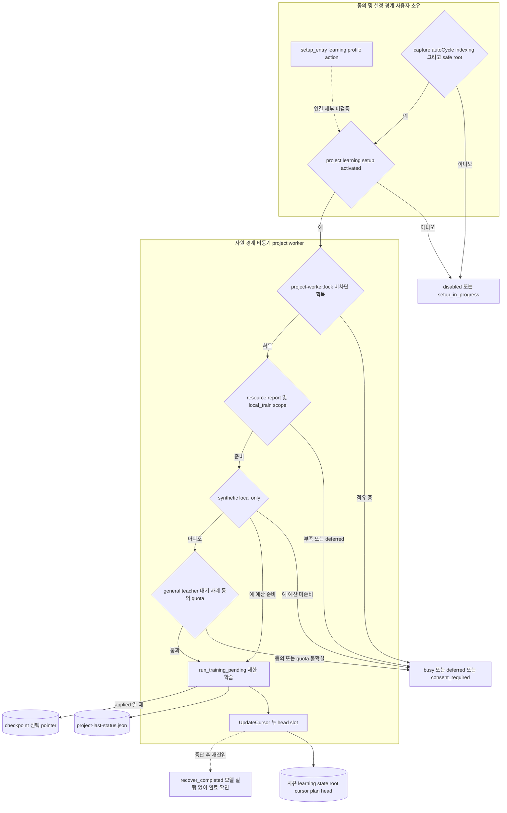

# 04 학습 파이프라인

학습은 색인·검색과 분리된 두 경계 안에서 실행됩니다.

- **동의 경계**: 설정 플래그, learning setup, teacher 동의
- **자원 경계**: project worker lock, resource report, quota

명시적으로 등록된 프로젝트에 한해, 한 번에 제한된 양만 실행합니다. 설정·준비·자원·동의·quota 중 하나라도 불확실하면 학습을 시작하지 않습니다. 대신 `disabled`·`setup_in_progress`·`busy`·`deferred_*`·`consent_required` 같은 상태를 반환합니다. 진행 중이던 학습은 두 head slot cursor로 재개합니다.

아래 내용은 구현된 코드 경로를 설명합니다. 학습 실행이 검증되었다는 뜻은 아닙니다. 실제 학습은 QA에서 실행하지 않았습니다.

## Implementation and evidence

### 현재 구현 (커밋 f89b141)

- [`core/context_learning/project_worker.py:1`](../../../core/context_learning/project_worker.py#L1): 명시적으로 등록된 프로젝트용 bounded worker이며, login service가 아닙니다.
- [`core/context_learning/project_worker.py:7-12`](../../../core/context_learning/project_worker.py#L7-L12): `project-learning-setup.json`의 phase가 `activated`가 아니면 준비되지 않은 것으로 봅니다.
- [`core/context_learning/project_worker.py:15-24`](../../../core/context_learning/project_worker.py#L15-L24): `contextLearning.capture`·`autoCycle`, `indexing`, safe root를 검사합니다. 하나라도 실패하면 `disabled` 또는 `setup_in_progress`를 반환합니다.
- [`core/context_learning/project_worker.py:27-38`](../../../core/context_learning/project_worker.py#L27-L38): 먼저 `project-worker.lock`을 비차단으로 잡고, 이어서 resource report와 `local_train` scope를 확인합니다. 실패하면 `busy` 또는 `deferred_resource`를 반환합니다.
- [`core/context_learning/project_worker.py:39-57`](../../../core/context_learning/project_worker.py#L39-L57): synthetic local-only이면 예산을 확인합니다. 그렇지 않으면 teacher 대기 사례와 weekly quota를 확인합니다. 동의나 quota가 불확실하면 새 로컬 모델 호출로 넘어가지 않습니다.
- [`core/context_learning/project_worker.py:58-65`](../../../core/context_learning/project_worker.py#L58-L65): `run_training_pending`을 실행하고 `project-last-status.json`을 기록합니다. `activeCheckpointChanged`는 상태가 `applied`·`already_applied`일 때만 참입니다.
- [`core/context_learning/training_cursor.py:13-33`](../../../core/context_learning/training_cursor.py#L13-L33): request·artifact hash에 고정된 완료 영수증입니다. publish 작업은 아닙니다.
- [`core/context_learning/training_cursor.py:49-111`](../../../core/context_learning/training_cursor.py#L49-L111): 두 head slot과 `group-plan.json`·`cursor.json`을 사용합니다. 그래서 쓰기가 중단되어도 커밋된 head를 덮어쓰지 않습니다.
- [`core/context_learning/training_cursor.py:114-115`](../../../core/context_learning/training_cursor.py#L114-L115): 완전히 커밋된 cursor만 모델 실행 없이 완료로 처리합니다.
- [`core/setup_entry.py:395`](../../../core/setup_entry.py#L395), [`core/setup_entry.py:435-439`](../../../core/setup_entry.py#L435-L439): learning profile action과 `--learning-choice`(`preserve`·`local-auto-apply`·`local-staged`·`off`)입니다.
- [`core/runtime_work.py:37-57`](../../../core/runtime_work.py#L37-L57): coordinator의 실제 구현은 `context_learning.resource_coordination`에 있습니다. foreground demand 표시는 compute lock을 잡지 않습니다.
- [`hooks/run-hook:85-90`](../../../hooks/run-hook#L85-L90): SessionStart는 소유자가 요청한 history cutover를 확인만 합니다. history를 선택하지는 않습니다.

### QA 증거와 미검증

- QA 기록은 [release-agent-qa.md](../../release-agent-qa.md)에 있습니다. 실제 학습은 실행하지 않았으므로, 학습 training이 통과했다고 볼 수 없습니다. 학습 결과가 recall에 반영되는지도 검증하지 않았습니다.
- checkpoint 선택 pointer(`live_select`) 코드는 발췌 범위 밖입니다. 그래서 도표의 해당 노드는 아키텍처 지도를 근거로 표기했습니다.
- learning profile action과 `project-learning-setup.json`이 어떻게 연결되는지는 발췌로 확인하지 못했습니다. 그래서 도표에서 점선으로 표시했습니다.
