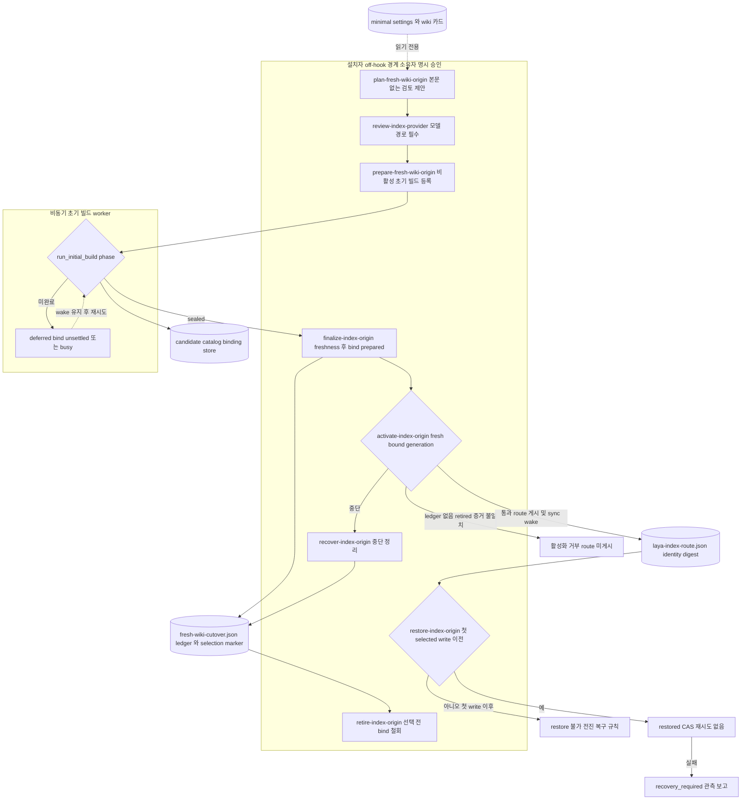

# 05 온보딩·전환·복구

새 프로젝트를 Laya 색인으로 옮기는 일은 hook이 아니라 설치자 명령으로만 진행됩니다. 입력은 minimal settings(`{name, skipPaths}`)와 `.auto-context/wiki`의 카드입니다. 순서는 다음과 같습니다.

1. 계획: `plan-fresh-wiki-origin`이 settings에서 raw(프로젝트 루트)·wiki(`.auto-context/wiki`) 컬렉션을 유도해 본문 없는 검토 제안을 만듭니다.
2. provider 검토: `review-index-provider`가 모델 파일·차원과 실행 파일 closure를 제안합니다. 모델 경로는 필수입니다.
3. 비활성 초기 빌드 등록: `prepare-fresh-wiki-origin`이 저장소·reviewed route·attestation·journal(`candidate_ready`)·빌드 기록을 만들고 wake를 하나 요청합니다.
4. 비동기 빌드: `laya-sync` wake가 bounded 단계로 위키 카드를 임베딩해 `sealed`까지 진행합니다.
5. finalize bind: 첫 호출은 freshness를 요청하고, 그 뒤 다시 seal된 세대를 `fresh-wiki-cutover.json`(`prepared`)과 selection marker에 묶습니다.
6. 명시 승인 활성화: `activate-index-origin`이 route를 게시하고 journal을 `active`로 바꾼 뒤 selected sync wake를 하나 요청합니다.

route는 settings 파일 바이트가 아니라 해석된 settings identity(`settings_identity_digest`: 프로젝트 루트와 각 컬렉션의 이름·역할·루트)를 묶습니다. `skipPaths` 편집은 route를 유지하고, 이름 변경은 `route_settings_changed`로 막습니다.

restore는 첫 selected write 이전에만 가능하며, 이 선택이 게시한 route 파일만 철회합니다. 첫 selected write 이후에는 전진(forward) 복구만 적용됩니다. bind된 뒤 활성화하지 않을 빌드는 `retire-index-origin`으로 ledger를 `retired`로 옮기고 marker와 빌드 pointer만 놓아 줍니다. 저장소와 journal은 지우지 않습니다.

state root에 QMD-origin ledger(`qmd-cutover.json`)가 남아 있거나 프로젝트 marker가 QMD-origin schema이면, 선택기는 `blocked`(`qmd_origin_detach_required`)로 분류하고 활성화·복구·번들 업그레이드는 같은 사유로 거절합니다.

## Implementation and evidence

함수 이름으로 찾으세요.

- `core/setup_entry.py`: index-origin action 목록과 활성화·restore·retire·abandon 승인 플래그입니다.
- `core/laya_product_install.py` `plan_fresh_wiki_origin`: 기존 route·marker가 있거나, settings가 canonical이 아니거나, raw가 프로젝트 루트·wiki가 `.auto-context/wiki`가 아니면 거부합니다.
- `core/laya_product_install.py` `prepare_fresh_wiki_origin` / `_register_initial_build`: 활성화 없이 비활성 초기 빌드만 등록합니다. 검토한 plan·provider digest가 바뀌었으면 거부합니다.
- `core/laya_product_sync_worker.py` `run_initial_build`: 초기 빌드는 route를 선택하지 않습니다. bind가 정착되지 않았거나 owner가 busy이면 `deferred`로 두고 wake를 유지합니다.
- `core/laya_product_install.py` `finalize_initial_build`, `activate_origin_selection`, `recover_origin_selection`, `restore_origin_selection`, `retire_drifted_origin`: 위 순서의 설치자 단계입니다.
- `core/laya_fresh_wiki_origin.py`: ledger phase는 `prepared`·`switching`·`active`·`upgrading`·`restoring`·`restored`·`retired`입니다.
- `core/laya_ledger_common.py` `refuse_qmd_origin`: QMD-origin ledger 거절입니다.

### QA 증거

- `test/fixtures/laya-fresh-onboarding-e2e-checks.py`: minimal settings에서 plan·prepare·빌드·finalize·activate·선택기·read-only route proof·selected recall까지 실제 저장소와 sqlite journal로 이어서 검증합니다. 호스트 설치·모델만 합성입니다.
- `test/fixtures/laya-fresh-bundle-upgrade-checks.py`: bound·selected 설치의 번들 교체와 호스트 간 캐시 교체를 실제 ledger·marker·저장소로 검증합니다.
- 합성 증거가 운영 활성화·복구를 증명하지는 않습니다. 운영 적용은 [release-agent-qa.md](../../release-agent-qa.md)의 절차를 따릅니다.
