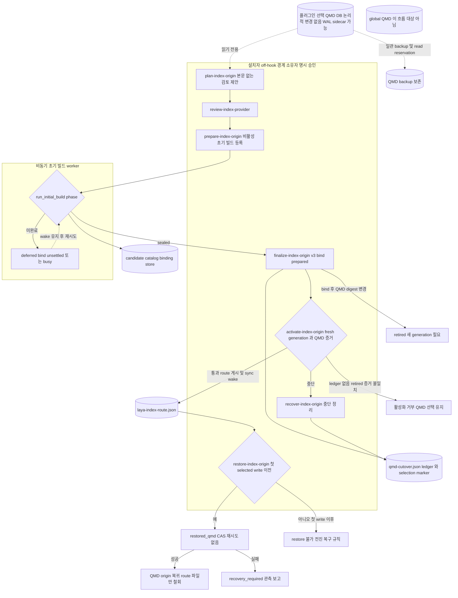

# 05 QMD 이관과 복구

QMD에서 Laya로의 이관은 hook이 아니라 설치자 명령으로만 진행됩니다. 순서는 다음과 같습니다.

1. 계획: 본문 없는 검토 제안
2. provider 검토
3. 비활성 초기 빌드 등록
4. 비동기 빌드 sealed
5. finalize bind
6. 명시 승인 활성화

이관은 QMD source를 논리적으로 변경하지 않습니다. 다만 일관된 backup이나 읽기 reservation을 수행할 때 SQLite WAL sidecar(`-wal`·`-shm`) 파일이 생길 수 있습니다. 원본과 backup은 삭제되지 않습니다. 별도로 설치된 global QMD도 이 흐름의 대상이 아닙니다.

restore는 첫 selected write 이전에만 가능하며, 해당 cutover가 게시한 route 파일만 철회합니다. 첫 selected write 이후에는 QMD로 되돌리지 않습니다. 이때는 전진(forward) 복구 규칙이 그대로 적용됩니다.

위 흐름은 구현된 코드 경로입니다. 운영 환경에서의 cutover와 복구는 검증되지 않았습니다. 플러그인 소유 QMD runtime을 ownership manifest로 정리하는 작업은 아직 계획 단계입니다.

0.36.2의 경로 변경은 raw 루트가 프로젝트 루트이고 wiki 루트가 그 안의 `.auto-context/wiki`인 경우만 허용합니다. 이때 동기 전체 루트 스캔 대신 wiki 전용 background 빌드를 사용합니다. **새 위키 전용 설치 계약을 추가한 것은 아닙니다.** 현재 `plan-index-origin`과 finalize/activate/restore는 계속 플러그인이 선택한 QMD 원본 DB, 해당 컬렉션, 백업·cutover 원장을 요구합니다. 옛 벡터를 재사용하지 않고 별도 Laya 세대를 만드는 설치·복구 경로는 후속 구현이며, 이 변경만으로 운영 프로젝트 이관을 완료했다고 판정할 수 없습니다.

0.36.3에는 `plan-fresh-wiki-origin`·`prepare-fresh-wiki-origin`을 QMD 원본 이관과 구별된 명시적 경로로 추가합니다. 이 경로는 모델 파일·차원·provider와 새 private wiki 색인의 증거를 요구하며, 기존 QMD DB·설정·원문은 변경하지 않습니다. 독립 `fresh-wiki-cutover.json` 원장이 준비·활성화·중단 복구·첫 selected write 이전 철회를 추적하고, 그 이후에는 전진 복구만 허용합니다. 원본 QMD 벡터의 과거 모델을 증명하거나 재사용했다고 주장하지 않습니다. 코드 경로의 존재만으로 운영 이관이나 구 Codex 호환 검사가 통과한 것은 아닙니다. 실제 운영 적용 전에는 합성 설치·중단/재개·복원 검증과 기존 상태 백업 무결성 확인이 필요합니다.

## Implementation and evidence

### 현재 구현 (커밋 f89b141)

- [`core/setup_entry.py:390-403`](../../../core/setup_entry.py#L390-L403), [`core/setup_entry.py:449-453`](../../../core/setup_entry.py#L449-L453): index-origin action 목록과, 활성화·restore·retire·abandon 승인 플래그입니다.
- [`core/laya_product_install.py:188-207`](../../../core/laya_product_install.py#L188-L207): 계획에는 원고 본문이 포함되지 않으며, 모델·backup·candidate·plugin cache도 건드리지 않습니다. background 계획 동안에는 QMD가 선택된 상태로 남아 계속 색인합니다.
- [`core/laya_product_install.py:219-255`](../../../core/laya_product_install.py#L219-L255): 다음 경우 계획을 거부합니다: 기존 selection이 있음, settings가 canonical이 아님, raw+wiki 구성이 아님, 루트가 겹침, QMD가 managed·selected 상태가 아님.
- [`core/laya_product_install.py:827-848`](../../../core/laya_product_install.py#L827-L848), [`core/laya_product_install.py:866-890`](../../../core/laya_product_install.py#L866-L890): prepare는 활성화를 하지 않고 비활성 초기 빌드만 등록합니다. 검토한 plan·provider hash가 바뀌었으면 거부합니다.
- [`core/laya_product_sync_worker.py:542-608`](../../../core/laya_product_sync_worker.py#L542-L608): 초기 빌드는 route를 선택하지 않습니다. bind가 정착되지 않았거나 owner가 busy이면 `deferred`로 두고 wake를 유지합니다. 프로젝트가 이미 선택된 상태이면 오류를 냅니다.
- [`core/laya_qmd_cutover.py:1-14`](../../../core/laya_qmd_cutover.py#L1-L14): QMD를 읽기 전용으로 열며, 원본 DB와 backup을 제거하지 않습니다. 논리적 변경은 없지만 일관 backup이나 read reservation 과정에서 SQLite WAL sidecar가 생길 수 있습니다. marker는 중단된 selected route가 legacy로 조용히 넘어가지 않도록 막습니다.
- [`core/laya_qmd_cutover.py:41-83`](../../../core/laya_qmd_cutover.py#L41-L83): phase는 `prepared`·`switching`·`active`·`restoring`·`restored`·`retired`입니다. QMD digest가 바뀌면 다시 bind하지 않고 새 generation을 요구합니다.
- [`core/laya_product_install.py:2001-2035`](../../../core/laya_product_install.py#L2001-L2035): 활성화는 ledger와 fresh bound generation을 확인한 뒤 sync wake를 한 번 요청합니다. 활성화 이후의 QMD 변경은 `qmdChangedAfterActivation`으로 보고만 합니다.
- [`core/laya_product_install.py:2038-2044`](../../../core/laya_product_install.py#L2038-L2044): recover는 중단된 cutover를 정리합니다. 결과가 `active`이면 sync wake를 요청합니다.
- [`core/laya_product_install.py:2047-2065`](../../../core/laya_product_install.py#L2047-L2065): restore는 selected write가 없을 때만 `restored_qmd`로 CAS를 수행하며, 재시도하지 않습니다. 첫 selected write 이후에는 전진 복구 규칙이 적용됩니다. 실패하면 `recovery_required`를 보고하고, QMD·backup·candidate·ledger·marker는 그대로 보존합니다.
- [`core/laya_wiki_discovery.py:541-569`](../../../core/laya_wiki_discovery.py#L541-L569): route를 게시하기 전에 raw baseline을 seed합니다. baseline이 바뀌면 재계획을 요구합니다.

### QA 증거와 미검증

- f89b141에서 통과한 것은 source-level CI입니다. synthetic QA 증거는 [release-agent-qa.md](../../release-agent-qa.md)에 있습니다. 다만 synthetic 증거가 있다고 해서 운영 cutover·활성화·recover·restore나 실제 route 선택이 통과한 것은 아닙니다. 운영 cutover는 검증되지 않았습니다.
- 플러그인 소유 QMD runtime을 ownership manifest로 정리하는 작업과 데이터 이전 계획은 아키텍처 지도에 적힌 계획일 뿐, 현재 구현의 근거가 아닙니다. 지도에도 운영 경로 변경은 아직 없다고 기록되어 있습니다.
- global QMD와 원본 source·backup은 이 흐름에서 변경 대상이 아닙니다. 예외는 WAL sidecar가 생길 수 있다는 점뿐입니다.
- ledger·marker·route 파일의 정확한 디렉터리 위치는 발췌로 확정되지 않아 파일 이름으로만 표기했습니다.
