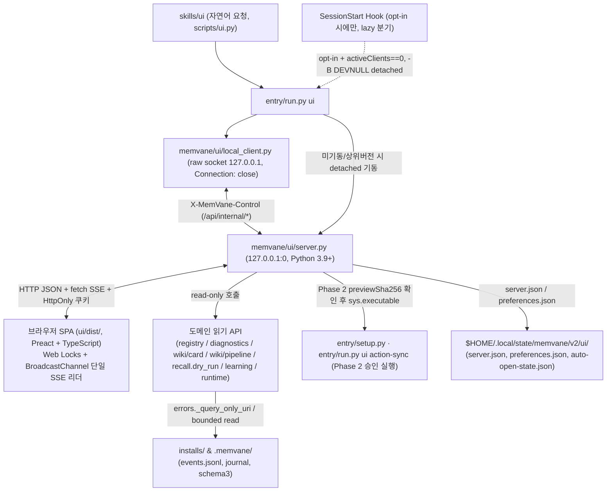

# MemVane 로컬 웹 대시보드(UI) 설계

- **상태**: 5차 개정 (v1.1.4 `stateFormat` 2 · 위키 파이프라인 SQLite 원장 정합)
- **대상 버전**: `1.1.x` 이후 (1.x 영속 계약 무변경 원칙 준수)
- **관련 문서**: [architecture.md](architecture.md), [privacy.md](privacy.md), [project-registry.md](project-registry.md), [ROADMAP.md](ROADMAP.md), [release.md](dev/contexts/release.md), [working-rules.md](dev/contexts/working-rules.md), [UI 가안 프로토타입](mockups/local-web-ui-prototype.html)

---

## 1. 배경 · 목표 · 비목표

### 1.1 배경
MemVane은 현재 CLI/스킬(`logs`, `query`, `update`, `setup`, `wiki-compile`, `wiki-dedup`) 중심의 텍스트 인터페이스를 제공한다. 실제 운영·개발 과정에서는 다음 가시성과 탐색 한계가 존재한다([ROADMAP.md](ROADMAP.md) `1.0.x-8` 운영 가시성 및 recall 순위·학습 관측 요구).

- 백그라운드 sync, 초기 빌드, wiki backfill, 학습 유지보수(`learning.cycle`), resident 상태가 멈추거나 지연될 때 사용자가 로그 명령을 수동으로 조합해야 원인을 알 수 있다.
- Recall 결과의 `lexical` vs `semantic` vs `selector` 단계별 순위 변화와 세션 중복 제외(`sessionExcluded`)를 한눈에 대조하기 어렵다.
- `.memvane/wiki/` 카드의 검증 상태(`verified` / `generated` / `pending`), `sourceRevisions`·`sourceSpans`와 원문 파일의 나란히 대조가 CLI 텍스트 출력으로는 불편하다.

### 1.2 목표
1. **단일 크로스 플랫폼 UI 본체**: 장기적으로 **macOS · Linux · Windows(네이티브 및 WSL) · 원격 SSH(포트포워딩)** 환경을 단일 웹 UI 코드베이스로 지원한다.
   - **단계별 플랫폼 검증 범위**: Phase 1~3의 실행·검증 대상은 현재 코어가 지원하는 **Apple Silicon macOS · Linux · WSL(Linux 백엔드 + Windows 브라우저)**이다. 네이티브 Windows에서의 백엔드 실행은 하위 도메인(`event_log`, `runtime`, `resident`, `learning`, `kernel`)의 POSIX 의존(`fcntl`, `pwd`, `os.getuid()`, `AF_UNIX`) 제거가 선행 조건이며, `memvane/ui/` 자체는 처음부터 Windows 호환 규칙(§8)을 지켜 포팅 시 재작성을 피한다.
2. **전역 단일 통합 대시보드 (오르카 스타일 프로젝트·워크트리 트리)**: 프로젝트별로 별도 창을 띄우지 않고, **사용자 머신에 온보딩된 모든 프로젝트(Claude Code · Codex · Hermes)와 하위 연결 git worktree를 한 창에서 아울러 보고 선택해 전환하는 통합 대시보드**를 제공한다.
3. **TypeScript(Preact + Vite) 프론트엔드 + 무설치 마켓플레이스 배포**: UI 소스는 TypeScript(`strict: true`)로 개발하되, 플러그인에는 사전 빌드된 정적 산출물(`ui/dist/`)만 포함해 사용자 머신에서 `npm install`·빌드·Node 실행 없이 즉시 서빙한다.
4. **제로 상시 오버헤드**: 임베딩/학습 resident 프로세스와 분리된 온디맨드 서버로 동작하며, 대시보드를 열지 않은 평소 세션에서는 메모리·CPU·hook 지연 고정비가 0이다.
5. **1.x 영속 계약 및 정적 구조 가드 준수**: [release.md](dev/contexts/release.md)의 1.x 불변 계약과 [static.test.mjs](../tests/structure/static.test.mjs), [v1_guard.py](../tests/structure/v1_guard.py), [manual-skills.test.mjs](../tests/manual-skills.test.mjs), [doc-links.test.mjs](../tests/structure/doc-links.test.mjs), [memvane-naming-guard.test.mjs](../tests/memvane-naming-guard.test.mjs)를 준수한다.

### 1.3 비목표
- Electron · Tauri · SwiftUI 메뉴바 앱 등 OS 네이티브 데스크톱 패키징 (추후 트레이 래퍼가 필요해지더라도 본체 웹 UI를 여는 얇은 선택 도구로만 검토).
- `1.x` 영속 계약 변경: SQLite store·journal DDL, `.memvane/settings.json` 허용 키 5개(`name`, `skipPaths`, `diagnostics`, `contextLearning`, `sharedLearning`), 기존 lock·wake kind·hook action 추가는 하지 않는다.
- 원격 다중 사용자 웹 서비스 노출(`127.0.0.1` loopback 외 바인딩 금지).
- [privacy.md](privacy.md)가 제한하는 프롬프트 원문 저장 확대 또는 raw `diagnostic.part` 기본 노출.

---

## 2. 전체 아키텍처와 디렉터리 배치

### 2.1 2분할 구조 (`ui/` + `memvane/ui/`)

프론트엔드는 저장소 최상위 `ui/`에 두고, 로컬 HTTP/SSE API 서버와 도메인 어댑터는 `memvane/ui/`에 둔다.

```text
<plugin-root>/
├── ui/                         # Preact + TypeScript 프론트엔드 전용 (memvane/ 밖)
│   ├── package.json            # 루트 package.json과 격리된 프론트엔드 개발·빌드 설정
│   ├── package-lock.json       # 다중 플랫폼 optional deps 포함
│   ├── tsconfig.json
│   ├── vite.config.ts          # legalComments: 'none', 고정 파일명
│   ├── src/
│   │   ├── api/                # DTO 타입 계약 (types.ts), fetch 클라이언트, Web Locks SSE 리더
│   │   ├── components/         # 공용 레이아웃, 프로젝트/워크트리 트리, 안전 마크다운 렌더러, 모달
│   │   └── pages/              # Overview, Recall/Playground, Wiki Browser, Runtime/Learning
│   └── dist/                   # 사전 빌드된 정적 번들 (플러그인 배포물 포함, 고정 파일명, LF 고정)
├── memvane/ui/                 # Python 3.9+ 로컬 백엔드 도메인 (G5·G6·G9 준수)
│   ├── README.md               # G5 필수 도메인 문서
│   ├── __init__.py
│   ├── api.py                  # 공개 API (G5: 속성 30개 미만)
│   ├── types.py                # 상태 경로·targetId·요청/응답 값 타입 (IO 금지 G7)
│   ├── cli.py                  # entry/run.py ui 진입점 디스패처
│   ├── server.py               # ThreadingHTTPServer (allow_reuse_address=False) + 라우터 + 정적 서빙
│   ├── auth.py                 # 1회성 code 교환, 다중 탭 세션 LRU, Host/Origin/Sec-Fetch-Site/CSRF
│   ├── sse.py                  # SSE 브로드캐스트 & activeClients/grace 추적 & inode 기반 파일 감시
│   ├── lifecycle.py            # 싱글톤 server.json/lock, detached 기동, 버전 비교 교체, 유휴 종료
│   ├── preferences.py          # $HOME/.local/state/memvane/v2/ui/preferences.json & auto-open-state.json
│   ├── platform_io.py          # UI 전용 OS 추상화 (브라우저 오픈, PID 생존, server.lock, 디스크 경로)
│   ├── local_client.py         # raw socket 기반 127.0.0.1 HTTP/1.1 제어 클라이언트 (Connection: close)
│   ├── read_adapters.py        # registry/diagnostics/wiki/recall/learning/runtime 읽기 DTO 조합
│   └── tests/                  # run.test.mjs + unit/ + integration/ (parts.mjs 규약 준수)
├── entry/run.py                # 'ui' 진입점 추가 (open/status/stop/serve/pref/action-sync)
└── skills/ui/                  # 자연어 요청 스킬 (SKILL.md + scripts/ui.py 얇은 Python 포워더)
```

#### 왜 프론트엔드를 `memvane/` 밖에 두는가
1. **다운로더/네트워크 정적 가드 충돌 회피**: [static.test.mjs](../tests/structure/static.test.mjs#L225-L241)의 `productFiles()`와 `every call that can download is a listed, pinned call`([static.test.mjs](../tests/structure/static.test.mjs#L487-L501))는 `hooks/`, `entry/`, `hermes_adapter/`, `memvane/`, `skills/*/scripts/` 아래 `.js`/`.mjs` 파일의 `fetch(` 호출 자체를 금지한다. 프론트엔드를 `ui/`로 분리해야 브라우저 `/api/...` 호출 `fetch`와 충돌하지 않는다.
2. **Python 구조 가드 분리**: [v1_guard.py](../tests/structure/v1_guard.py), `import_all.py`, `free_names.py`는 `memvane/`를 Python 도메인으로만 스캔한다.
3. **루트 `package.json` 무오염**: 루트 [package.json](../package.json)은 외부 npm 의존성 없이 `node --test`만 실행한다. 프론트엔드 toolchain(`typescript`, `preact`, `vite`)을 `ui/package.json`에 격리하고 `ui/node_modules/`는 `.gitignore` 처리해 플러그인 캐시·테스트 러너와 충돌하지 않는다.
4. **대체 정적 가드**: `ui/`가 `productFiles()` 밖으로 분리되는 대신, [static.test.mjs](../tests/structure/static.test.mjs)에 `ui/src/`·`ui/dist/` 대상 **외부 URL/CDN 로드 및 위험 DOM/동적 실행 금지** 전용 검사를 추가한다(§9.2.2).

#### 왜 로컬 백엔드는 Node/TypeScript가 아니라 Python(`memvane/ui/`)인가
- MemVane의 모든 코어 도메인(`registry`, `diagnostics`, `recall`, `wiki/card`, `journal`, `resident`, `learning`, `install`, `settings`, `kernel`)이 Python으로 구현되어 있다.
- Python `http.server.ThreadingHTTPServer` + stdlib으로 백엔드를 구성하면 외부 Python 패키지 의존성 0, SQLite read-only URI(`errors._query_only_uri`) 및 기존 도메인 파사드 직접 호출이 가능하며, Phase 2 쓰기 액션만 `sys.executable`로 `entry/setup.py`·`entry/run.py`에 위임할 수 있다.

### 2.2 `tests/structure/context-map.json` 계층 및 가드 준수 설계

[context-map.json](../tests/structure/context-map.json)에서 `ui`는 최상위 presentation 계층으로 배치한다.

- **계층 번호**: `ui: 12` (하위 모든 도메인보다 상위 계층. `app: 11`과 순환 없이 `entry/run.py`와 `memvane/ui/cli.py`만 연결).
- **G1 / G2 (단방향 공개 API 경계)**: `memvane/ui/`는 하위 도메인의 공개 `api.py`·`types.py`와 `memvane/kernel/`만 import한다.
- **G3 (`memvane/kernel/` 한도 0여유 회피)**: `memvane/kernel/`은 이미 **14개 모듈 / 1,489줄**(한도 14개 / 1,500줄, [v1_guard.py](../tests/structure/v1_guard.py#L1154-L1162))에 도달했다. 따라서 UI 전용 OS 추상화(브라우저 오픈, 프로세스 생존 확인, `server.lock`, OS별 `Application Support`/XDG 경로 계산)는 `memvane/kernel/`에 1줄도 추가하지 않고 **`memvane/ui/platform_io.py`에 격리**한다.
- **G5 (필수 파일 & 속성 30개 한도 & 핀 고정 도메인 대응)**:
  - `memvane/ui/`는 필수 파일 3종(`README.md`, `api.py`, `types.py`)을 갖추고 `ui/api.py` 공개 속성을 30개 미만(목표 ≤ 10개)으로 유지한다.
  - **한도 포화 도메인 읽기 접근 계약**:
    - **`memvane/learning/api.py` (30/30) & `shared.py` (2,319/2,319줄, 여유 0)**: `shared.py`는 G4 한도에 여유가 0줄이고 `learning/api.py`는 30/30에 도달했다. 새 읽기 어댑터 구현은 `shared.py`가 아닌 별도 adapter 모듈(`memvane/learning/project_inspection.py` — `context-map.json` `learning` adapter 등록 및 `/usr/bin/python3` import 확인 필수)에 두어 `invariants.project_counts`·`read_private_json`·`errors._query_only_uri`로 학습 상태를 읽는다. `learning/api.py`에서 `inspect_project(project_root, *, check_invariants=False)` 1슬롯을 확보할 때는 기존 테스트에서 `mock.patch`되는 `learning_runtime_needs_activation`·`learning_runtime_proof_failed`·`learning_worker_step`·`wake_after_index`·`due_selector_maintenance`·`run_selector_maintenance`·`learning_profile_*`·`card_prompt_budget` 등을 **제외**하고, mock이 0건인 무mock 단일 호출처(예: `card_budget_failure_fields` 또는 `inference_version`/`retire_stale_inference`) 통합으로 슬롯을 확보해 G1/G5/G8/G9를 모두 준수한다.
    - **`memvane/runtime/api.py` (42/42 핀 고정) & `WakeQueue` 쓰기 문제 (`N-04` 반영)**: `WakeQueue.__init__`은 `require_cached_plugin_for_live_write()`를 강제해 개발 체크아웃에서 실패하고, `WakeQueue.pending()`은 `O_CREAT|O_RDWR` 테이블 생성·`_drop_retired`/`_promote_overflow` 쓰기를 수행한다([runtime_work.py](../memvane/runtime/runtime_work.py#L127-L203)). 또한 `runtime/api.py`는 42개로 핀 고정되어 있고([static.test.mjs](../tests/structure/static.test.mjs#L197)), `wake_queue(root=None)`는 테스트에서 `lambda root=None:`으로 mock된다. 이를 회피하기 위해 기존 `runtime.api.runtime_main(['snapshot-readonly', ...], execute=collector)` 경로를 사용한다:
      - `runtime_main`은 기존 계약([runtime_work.py](../memvane/runtime/runtime_work.py#L739-L759), [entry/run.py](../entry/run.py#L50-L54))대로 **항상 `int` 종료코드(`0`/`2`)만 반환**하고, 스냅샷 결과 `dict`는 `execute(snapshot_dict)` 콜백 인자로 전달한다(stdout 미오염으로 `ThreadingHTTPServer` thread-safe 보장; `entry_commands.py` CLI 분기에서는 `collector`로 받아 JSON 출력 가능).
      - 내부 구현은 반드시 `service_root(create=False)`를 사용해 디렉터리를 생성(`mkdir 0700`)하지 않으며, `QMD_SETUP_GUARD_FIXTURE=1` 가드(실계정 홈 차단) 및 `errors._query_only_uri` + `PRAGMA query_only=ON`으로 `wakes`·`wake_overflow`·`wake_meta`와 보조 JSON(`runtime-wake-failures.json`·`drops`·`overflow`·`preparing`·`deferred`)만 읽는다. (`runtime_work.py`는 759줄로 G4 여유 충분, `runtime/api.py` 핀 42개 및 `wake_queue` 시그니처 100% 유지.)
    - **`memvane/resident/api.py` (7/30, 여유 23)**: 공유 worker 실패(`w-<24 hex>.sock.resident.state`)와 설치별 증명 실패(`.resident.state.proof-<ino>-<mtime_ns>`, 1시간 뒤 자동 재증명 `_ATTESTATION_RETRY_SECONDS = 3600`)가 분리되어 있다. 기존 `failure_decision()`은 `attempts >= 3`일 때 `_write_state(..., 'worker_exited', terminal=True)` 파일 쓰기 부작용이 있고 `installation=True` 인자도 노출하지 않으므로 UI에서 직접 호출하지 않고, `resident/api.py`에 **순수 read-only 상태 스냅샷 파사드**(예: `inspect_owner_state(manifest)`) 1개를 신설한다(8/30).
    - **`memvane/wiki/pipeline/api.py` (20/30, 여유 10)**: 위키 컴파일·검수·게시·dedup·억제 상태는 `.memvane/compile/wiki-pipeline.sqlite3`(`compile_jobs`·`verify_jobs`·`publish_txns`·`refresh_events`·`dedup_pairs`·`suppressions`·`audit_events`)와 훅 inbox `.memvane/compile/edit-inbox.jsonl`에 저장된다. UI가 원장 테이블을 직접 SQL로 읽지 않도록 `wiki/pipeline/api.py`에 read-only 요약 파사드(예: `pipeline_summary(project_root)`) 1개를 신설한다(21/30; 내부에서 `open_pipeline(project_root, readonly=True)`로 `errors._query_only_uri` + `PRAGMA query_only=ON`을 사용). 원장 판정/요약 코드는 [working-rules.md](dev/contexts/working-rules.md#L77-L80) 규정에 따라 구현 전 상태 조합표와 실제 writer 출력 기반 회귀 시험을 선행한다.
- **G6 (Hook Isolation / `hook_closures`)**:
  - `memvane/host/`(계층 10) 및 `hermes_adapter/`는 `memvane/ui/`를 **절대 import하지 않는다**.
  - SessionStart opt-in 게이트(`host_response.py`)는 `action == 'update-queued'` 처리 경로 **함수 본문 내부에서만** `subprocess`·`json`·경량 헬퍼를 지연(lazy) import해, [v1-baseline.json](../tests/structure/v1-baseline.json)의 `hook-classify`·`hook-serve` top-level `hook_closures`가 단 1모듈도 늘어나지 않게 유지한다.
- **G9 (SQLite 소유 경계 & `sqlite_read_uri_guard.py`)**:
  - `memvane/ui/`는 다른 도메인의 SQLite 테이블을 직접 SQL로 읽지 않는다.
  - UI 또는 각 도메인 read 어댑터가 여는 모든 읽기 전용 SQLite 연결은 `memvane.kernel.errors._query_only_uri` + `PRAGMA query_only=ON`을 사용하며 `?mode=ro` 리터럴을 쓰지 않는다.
- **`static.test.mjs` (`DOWNLOADERS` / `ADDRESSES`) 충돌 제거 (`N-09` 반영)**:
  - 로컬 loopback 제어 클라이언트는 `http.client`/`urllib.request` 대신 `socket.create_connection(('127.0.0.1', port), timeout=...)` 기반 원시 HTTP/1.1 클라이언트(**`memvane/ui/local_client.py`**)로 구현해 `DOWNLOADERS` 접촉을 원천 제거한다. 요청 시 `Connection: close`, `/api/internal/*` 응답 시 `Content-Length` + `Connection: close`를 명시해 `keep-alive` 행(hang)을 차단한다.
  - [static.test.mjs](../tests/structure/static.test.mjs#L402-L423)의 `ADDRESSES` 검사에 걸리지 않도록 Python 파일(`memvane/ui/*.py`)에는 주석·docstring 포함 `https://`와 `http://[::1]` 문자열 리터럴을 일절 쓰지 않는다(링크 스킴 검증은 `ui/src/` TypeScript에서만 수행).
- **Python 3.9 하한**: 모든 `.py` 파일 최상단에 `from __future__ import annotations`를 두고, 3.10+ 문법(`match`/`except*`) 및 런타임 평가형 `X | Y` 표현을 금지한다.

#### 공유 로직: `skills/logs/scripts/logs.py` · `logs_slo.py`의 `memvane/diagnostics/` 승격
현재 이벤트 로그 요약/재조립([logs.py](../skills/logs/scripts/logs.py))과 SLO 계산([logs_slo.py](../skills/logs/scripts/logs_slo.py))은 `skills/` 아래에 있어 G1상 `memvane/ui/`가 직접 import할 수 없다.

- **권장안 (계층 분리형 승격)**:
  - `logs_slo.py`의 `install_size`는 `<state_root>/route.json`과 `sourceRoot`만 읽고 상위 도메인을 import하지 않으므로 `memvane/diagnostics/`의 **adapter 계층 모듈**(예: `event_queries.py`, `slo.py` — `types.py`/`domain/` 금지로 `G7` 준수)로 옮겨도 G2에 걸리지 않는다.
  - `logs.py`의 `--all` 다중 타깃 해석(`log_targets.resolve`)은 `registry`(계층 5) 의존이므로 `diagnostics`(계층 1)로 옮기지 않고 `skills/logs/`와 `memvane/ui/`에 각각 남긴다.
  - `logs.py`의 **구형 `prompt['text']` 제거**([logs.py](../skills/logs/scripts/logs.py#L148-L153)), `diagnostic.part` 숨김, 제어문자/Bidi 정규화 로직과 `logs_slo.py`의 집계(`SEMANTIC_USED = ('complete', 'partial')`, `full_coverage(row)`, `fullCoverage`, `arenaFullCoverage`, `partial` 건수, `vectorSource == 'arena'` 요약)를 함께 승격한다.
  - `memvane/diagnostics/api.py`는 현재 **20/30** 속성이므로 파사드 4개(`query_events`, `summarize_events`, `slo_lines`, `reassemble_diagnostic`)만 추가해도 **24/30**으로 `G5` 한도를 안전하게 준수한다.

### 2.3 아키텍처 흐름도



---

## 3. TypeScript 프론트엔드 아키텍처 · 빌드 · 배포 전략

### 3.1 프론트엔드 스택 확정: **Preact + TypeScript + Vite + 순수 CSS**
- **스택**: `Preact` + `TypeScript` (`strict: true`) + `Vite` + 자체 CSS(CSS Variables, 다크/라이트 테마).
- **선정 근거**:
  - `ui/dist/`가 git 저장소와 3개 호스트 플러그인 캐시에 포함되므로, 최종 번들 크기가 React 대비 절반 이하인 **~25~40 KB gzip**(상한 100 KB gzip)으로 가볍다.
  - React 호환 JSX/Hooks(`preact/hooks`)와 텍스트 자동 이스케이프 모델을 그대로 활용하면서 외부 UI 프레임워크(Tailwind 런타임, Google Fonts, CDN 아이콘)를 0으로 유지한다.
- **`ui/tsconfig.json`**: `"strict": true`, `"noUncheckedIndexedAccess": true`, `"exactOptionalPropertyTypes": true`, `"isolatedModules": true`, `"target": "ES2022"`, `"moduleResolution": "bundler"`, `"jsx": "react-jsx"`, `"jsxImportSource": "preact"`.
- **타입 계약 SSOT (`ui/src/api/types.ts`)**: 모든 REST/SSE 페이로드와 상태 enum을 discriminated union으로 정의하고, 백엔드 DTO 테스트의 골든 JSON 출력과 정합성을 맞춘다.

### 3.2 빌드 · 배포 · 결정성 계약
1. **사전 빌드 커밋 (`ui/dist/`)**:
   - Claude · Codex · Hermes 마켓플레이스 설치는 저장소 스냅샷 복사 방식이며 post-install 빌드 훅이 없다. 따라서 `ui/dist/`를 사전 빌드해 커밋하고, 사용자 런타임은 `ui/dist/`만 정적 서빙한다(런타임 `npm`/`vite`/Node 실행 0).
2. **결정적 빌드 (`vite.config.ts` + `.gitattributes`, `N-09` 반영)**:
   - `base: './'`, `sourcemap: false`, `cssCodeSplit: false`, **`esbuild: { legalComments: 'none' }`**(서드파티 라이선스 주석 내 `https://` URL이 번들에 남아 정적 가드를 오탐 실패시키는 것을 방지), Rollup `entryFileNames: 'assets/app.js'`, `chunkFileNames: 'assets/[name].js'`, `assetFileNames: 'assets/[name][extname]'`로 해시 변동 없는 고정 파일명을 강제한다.
   - `index.html`에도 외부 `modulepreload`/favicon URL 등 외부 참조가 없음을 확인한다.
   - `.gitattributes`에 `ui/dist/** text eol=lf`를 지정해 macOS/Linux/Windows 간 개행 차이로 `git diff --exit-code ui/dist`가 흔들리지 않게 한다.
3. **lockfile 및 멀티 OS CI 검증**:
   - `ui/package-lock.json`은 exact version + `sha512` integrity를 유지하고, Linux(`ubuntu-latest`)와 macOS(`macos-15`) CI에서 모두 `npm --prefix ui ci --ignore-scripts && npm --prefix ui run typecheck && npm --prefix ui run build && git diff --exit-code ui/dist`를 검증해 `esbuild`/`rollup` optional deps 누락을 차단한다.
   - `ui/`가 개발 시 빌드 전용 패키지임은 [static.test.mjs](../tests/structure/static.test.mjs) 정책 및 문서에 명확히 구분한다.

### 3.3 XSS · 마크다운 렌더링 · CSP 준수
- **금지**: `dangerouslySetInnerHTML`, `innerHTML`, `eval(`, `new Function(`, HTML 인라인 `style="..."` 속성(§7.3 `style-src 'self'` CSP 준수를 위해 CSS 클래스 또는 JS `el.style.setProperty`만 사용; SVG는 기하 속성만 사용).
- **안전 마크다운 렌더러**:
  - raw HTML을 비활성화한 경량 TypeScript 토크나이저/AST 렌더러가 직접 Preact VNode를 생성한다.
  - `<a href>`는 `https://`(외부 링크 아이콘 + `rel="noopener noreferrer"`)와 앱 내부 카드 경로(`#wiki?target=...&card=...`)만 허용하고, `javascript:`·`data:`·`vbscript:` 스킴은 렌더링 단계에서 폐기한다.
  - 제어문자 및 Bidi override 문자(`U+202A..U+202E`, `U+2066..U+2069`)는 가시 이스케이프하거나 제거해 표시한다.

---

## 4. 기능 및 화면 설계

### 4.1 체크아웃 식별 모델: `targetId` (멀티 프로젝트 + 연결 Git Worktree) (`N-06` 반영)
`memvane_registry`에서 연결 git worktree 행은 부모 main checkout과 **동일한 `install_id`**를 공유하며 `target_root`만 다르다([memvane_registry.py](../memvane/registry/memvane_registry.py#L492-L527)). 따라서 `installId` 단독 키를 폐기하고 두 식별자를 구분한다.

- **`installId`**: 32자리 hex(`[0-9a-f]{32}`). 설치 state root(`events.jsonl`, `learning`, `.memvane/compile/*.jsonl`, 설치 단위 SLO)의 키.
- **`targetId`**: 개별 체크아웃(main 또는 linked worktree)의 불투명 API 키.
  - Main checkout: `<installId>`
  - Linked git worktree: `<installId>:<wtHash12>` (`wtHash12` = canonical `target_root` UTF-8 SHA-256 앞 12 hex)
- **2단계 역조회 및 증명 절차**: `<installId>:<wtHash12>`는 단방향 해시이므로, 서버는 매 `/api/targets/<targetId>/*` 요청마다 ① `registry.snapshot(reconcile=False)`에서 `installId`와 `wtHash12`에 매칭되는 후보 `target_root`를 찾은 뒤, ② `memvane.journal.api.select_route(target_root)`를 직접 호출해 route 상태(`candidate`/`worktree`/`preview`), `installId`, `scopeId` 일치를 재증명한다.

### 4.2 공통 레이아웃 (전역 통합 셸 & 오르카 스타일 트리)
- **좌측 사이드바 (`S1-sidebar-tree`, 오르카 스타일 프로젝트·워크트리 트리)**:
  - 최상단 고정 항목: **`All Projects` (전체 현황판)**
  - 검색 필터 입력(프로젝트명/워크트리/브랜치).
  - **온보딩된 프로젝트 그룹(`main` checkout 단위)** → 프로젝트 이름과 함께 **현재 체크아웃의 git 브랜치명**을 2행 서브라인으로 명시한다(`main` checkout도 작업 중 다른 브랜치나 detached HEAD로 전환될 수 있으므로 고정 라벨로 가정하지 않는다). 그룹을 펼치면 하위 **연결 git worktree 목록**(디렉터리/표시명, **현재 git 브랜치명**, `linked` view 준비 상태 배지)이 트리 노드로 표시된다.
  - *(사용자 피드백 반영)* 미활성·원격 초기 빌드 섹션(`Initial Builds`)은 좌측 사이드바에 별도 고정 항목으로 두지 않는다(로컬에서 진행 중인 초기 빌드가 관측되면 Overview 상단 알림으로만 선택 표시).
  - 사용자가 사이드바에서 `All Projects`, 특정 프로젝트(main), 또는 특정 worktree 노드를 클릭하면 URL hash(`#tab?target=<targetId>`)가 갱신되고, 4개 탭이 해당 컨텍스트에 맞춰 즉시 전환된다.
- **상단 글로벌 상태바 (`T1-topbar`) & 경고 배너 (`O1-alert-banner`)**:
  - 선택된 컨텍스트 브레드크럼에 체크아웃 역할(`main` / `worktree`)과 별도로 **현재 git 브랜치명**을 함께 표시하며, SSE 연결 상태(`Leader`/`Follower`/`Reconnecting`/`Draining`), 현재 서버 버전(`bundleVersion`), 체크아웃 실행 모드 배지(개발 체크아웃 실행 시 `Read-Only (Dev Checkout)` 표시), 유휴 타이머 남은 시간을 표시한다.
  - **상단 경고 배너(전체/선택 대상 요약)**:
    - `registry.snapshot()` 이상 상태(`absent` / `busy` / `recovery_required` / `stale`)
    - `needs_extractor`, `candidate_storage_full`, `selected_recall_settings_changed` / `reader_settings_resealing`
    - `laya_vector_*` / `laya_vector_selected_provider_start_failed`(lexical 폴백) / CPU 폴백 / `inconsistent` vector cache, `sync consecutive failed passes`
    - `worker_attestation_unavailable`(provider 파일 일시 읽기 불가), 설치별 `attestation_invalid`(1시간 뒤 자동 재증명 카운트다운)
    - 대량 삭제 가드 보류, `view_preparing` cold worktree view, 구버전 resident 잔존

### 4.3 Phase 1: 읽기 전용 관측 MVP (4개 화면 전체 출시 목표)

1차 출시 목표에 아래 **4개 화면 전부**를 포함한다.

#### 1) Overview — 멀티 프로젝트 통합 현황판
- **데이터 원천**: `memvane.registry.api.snapshot(reconcile=False)` + 설치별 최근 `events.jsonl` 요약. (기본 조회는 `reconcile=False`로 git 실행 없이 즉시 응답하고, `"상태 재스캔"` 버튼 클릭 시에만 `POST /api/overview/reconcile` 호출. `MAX_ROWS` 절단 여부와 `stale`/`complete` 상태를 명시 표시)
  - **체크아웃 현재 브랜치명 해석**: 기본 조회(`reconcile=False`)의 무-git 프로세스 원칙을 유지하기 위해 각 proved `target_root`의 `<gitdir>/HEAD` 파일을 `O_NOFOLLOW` · 4 KiB 상한으로 경량 read-only 읽기한다(`ref: refs/heads/<name>` → `<name>`, commit SHA → `detached@<short7>`, `.git` 없음 → `non-git`, 읽기 불가 → `unknown`).
- **내용**:
  - 전체 온보딩 프로젝트 및 하위 worktree 상태 그리드(카드 `verified`/`generated`/`pending` 수, 마지막 `wake.sync` 게시 시각, 24h recall 건수, p50/p95 지연, SLO 판정 `ok`/`over`/`no-data`).
  - `installId` 단위 통합/개별 에러 요약(기본은 메타만, `"상세 오류 로드"` 클릭 시 `diagnostic.part` 재조립).

#### 2) Recall 인스펙터 & 라이브 Query Playground
- **최근 Recall 타임라인 (`installId` 기준 필터링 + `targetId` worktree 구분)**:
  - `events.jsonl`의 `recall` · `recall.edit` 이벤트 시간 역순 뷰(호스트, 세션 ID, `outcome`/`reason`/`notes`, `semantic` 상태 `complete`/`partial`/`lexical_only`/`provider_absent`, `vectorCoveredMembers`/`vectorEligibleMembers`, `fullCoverage`·`arenaFullCoverage` SLO, `laya_vector_selected_provider_start_failed`, `store_format`, `degraded: worktree|reader_endpoint`, `sessionExcluded`/`sessionState`, `injectedCosine`, `semanticOnlyInjected`).
  - 단계별 지연 분해 바(`pinMs`, `lexicalMs`, `stillCurrentMs`, `checkoutMs`, `queryEmbeddingMs`, `semanticMs`, `selectorResidentSeconds`)와 SLO 기준선 대비.
  - 주입된 카드 경로 클릭 시 `Wiki Browser` 탭의 해당 카드로 즉시 이동. 프롬프트는 `sha256`·`chars`만 표시([privacy.md](privacy.md)).
- **라이브 Query Playground (전용 무오염 `dry_run_recall` 경로, `N-03` 반영)**:
  - 기존 `serve_endpoint_recall` / `query_endpoint`는 중간 lexical/RRF 점수를 버리고(`_fuse_verified_lists`가 `1/rank`로 덮어씀, `ReaderResult` 8슬롯 고정), `_wake_provider`·`ensure_running`·`ensure_service`·전역 `hook_budget._deadline`·`sys.stderr` 출력을 유발하므로 재사용하지 않는다.
  - 대신 `memvane/recall/api.py`(17/30, 13슬롯 여유)에 전용 **`dry_run_recall(target_root, prompt, *, deadline, use_semantic=True, use_selector=False)`** 진입점과 `DryRunRecallResult`(`memvane/recall/types.py`, `v1_guard.py:_VALUE_SOURCES` 등재)를 신설한다:
    1. **Route 분기**: `select_route(target_root, action='recall')`의 `'candidate'`, `'worktree'`(`mainRoute` + `linked=decision`), `'preview'` 상태를 명시 처리한다.
    2. **4단계 + 부분 vector 결과 반환**: Lexical(FTS5 원본 점수·순위) / Semantic(코사인 · arena hit 여부, `semanticStatus: 'complete' | 'partial' | 'lexical_only' | 'provider_absent'`, `vectorCoveredMembers`/`vectorEligibleMembers`) / Hybrid(RRF 점수·순위) / Selector 최종 3장(`selectorCheckpoint` · 선택/탈락 사유). 특히 lexical-first view(`vector_profile is None`)에서도 승인된 provider가 응답하면 `_proved_search_spec(..., partial=...)` + `store.search_exact(..., partial_recipe_id=...)` 경로로 일치 set을 채점해 `partial` 결과를 반환한다.
    3. **완전한 무스폰·무오염 가드**: `_recall_sync_wake`, `_wake_provider`, `ensure_running`, `edit-recall-sessions/`, `learning.capture`, `events.jsonl`, `sys.stderr`, 전역 `hook_budget`을 전혀 건드리지 않는다. provider 기동이 terminal 실패 상태면 프롬프트 recall과 동일하게 lexical 결과 + `laya_vector_selected_provider_start_failed`로 폴백하고, 응답 정체성 불일치/소켓 교체(`QUERY_IDENTITY_ERRORS`)는 즉시 거절(`selected_provider_identity_transition`)한다. 특히 `use_selector=True`일 때도 `ensure_service=None`만으로는 전역 `_SERVICE_STARTER`·`service_root(create=True)`([inference_service.py](../memvane/learning/context_learning/inference_service.py#L499-L501)) 및 `VerifiedLayaTrainer` 스폰([live_select.py](../memvane/learning/context_learning/live_select.py#L156-L163))이 막히지 않으므로, 호출 전 **추론 소켓 가용성(`inference_version` 등) 및 `admit()` 캐시 존재를 사전 확인**해 cold 상태면 `select_published`를 부르지 않고 즉시 `selector_not_warm`/`selector_not_prepared`를 반환하며, 호출 시에도 `ensure_service`에 no-op reject 콜백을 명시 전달한다.

#### 3) Wiki 카드 브라우저 & 출처 검증 뷰어 (`targetId` 컨텍스트, `N-06` 반영)
- **소유권 구분 (Main vs Linked Worktree)**:
  - **체크아웃(`targetId`) 단위 읽기**: `.memvane/wiki/*.md`, 원문 파일(`wiki/source`), schema3 view 상태는 선택된 main 또는 worktree 체크아웃 자체의 디렉터리에서 읽는다.
  - **설치(`installId`) 단위 읽기**: `.memvane/compile/wiki-pipeline.sqlite3`·`edit-inbox.jsonl`, `wiki.backfill`, `wiki.card` 이벤트는 main checkout(`installId`)에만 존재하므로([host_response.py](../memvane/host/host_response.py) `_serve_worktree`, [.gitignore](../.gitignore#L17)), worktree 선택 시 UI 배지로 `"Compile·Backfill·위키 원장 기록은 main checkout 기준"`임을 명확히 안내하고 main에서 조회한다. `wiki/pipeline/api.py` read-only 요약 파사드로 `compile_jobs`·`verify_jobs`·`publish_txns`·`refresh_events`·`dedup_pairs` 집계를 조회한다.
- **목록 & 필터**: `verified` / `generated` / 검수·교체 대기(`verify_jobs` · 진행 중 `publish_txns`) / 원문 불일치(`stale`) / `skipPaths` 숨김 / `over_budget`(700토큰 목표 초과) 필터 및 전문 검색.
- **카드 상세 + 원문 나란히 대조**:
  - Frontmatter(`status`, `createdBy`, `sourceRevisions`, `sourceSpans`, `related`, `aliases`), 안전 마크다운 렌더, auto 블록(`<!-- qmd:auto:start -->` ~ `<!-- qmd:auto:end -->`)과 수동 보존 블록 시각 구분, `related` 카드 인라인 링크.
  - **원문 파일 나란히 보기(On-demand)**: `"원문 보기"` 버튼 클릭 시에만 서버가 안전 경계 검증(§7.3) 후 원문 내용과 `sourceSpans` 줄 범위 하이라이트를 반환한다.

#### 4) 런타임 · 학습 · 디스크 모니터 (사용자 UI 피드백 2·3번 반영)
- **Resident & Wake 큐 (`L1-resident-and-wakes`)**:
  - 임베딩/학습 resident 상태(실행 여부, PID, 번들 버전, 중립 `accelerator`, socket 가용 상태)와 **`resident/api.py` 순수 read-only 스냅샷 파사드**를 통한 공유 Embed Worker 상태(`w-<24 hex>.sock.resident.state`) vs 설치별 provider 증명 상태(`.resident.state` + `.proof-*`, `attestation_invalid` 시 1시간 자동 재증명 남은 시간) 분리 표시(`failure_decision` 쓰기 부작용 회피).
  - `runtime-wakes.sqlite3` 대기 큐는 `WakeQueue`를 타지 않는 `runtime_main(['snapshot-readonly', ...], execute=collector)` 순수 read-only 경로로 조회한다.
  - **사용자 언어 UI 규약**: 내부 용어(`kind`, `attempt`, `due`)를 날것으로 노출하지 않고, 컬럼을 **`작업 종류` (예: `색인 동기화 (laya-sync)`, `위키 생성 (laya-compile)`, `학습 사이클 (learning)`) | `대상 프로젝트` | `현재 상태` (`실행 중` / `실행 대기` / `자원 부족 보류`) | `다음 실행 / 재시도` (예: `1회차 진행 중`, `18초 뒤 시작 예정`, `약 7분 뒤 재시도 (3회 미룸)`)**로 표시하며, 하단에 상태 의미 범례 1줄을 제공한다.
- **학습(Selector) 모니터 (`L2-learning-monitor`)**:
  - **단계·지표 설명 내장**: 카드 상단에 1줄 요약(*"새 Selector 후보 모델을 평가·자동 승격하기 위한 4가지 최소 데이터 조건입니다. 모두 충족되면 기존 모델과 비교해 더 나을 때만 자동 적용합니다."*)을 표시하고, 4종 승격 임계치([logs.py](../skills/logs/scripts/logs.py#L548-L549)) 각각에 **한글 제목 + 코드명 + 1줄 의미 설명 + 진행 바**를 함께 노출한다:
    1. **학습용 편집 사례 (`candidateTrain` / 100)**: 후보 모델 학습에 사용할 Teacher 정답 사례
    2. **검증용 편집 사례 (`candidateEval` / 50)**: 학습에 쓰지 않고 정확도 평가에 쓰는 홀드아웃 사례
    3. **카드 선택 정답 사례 (`candidateEvalNonEmpty` / 10)**: 관련 카드 주입이 정답인 검증 사례
    4. **비선택 정답 사례 (`candidateEvalEmpty` / 10)**: 카드 미주입이 정답인 검증 사례(과주입 방지)
  - 케이스 순환(`caseRows / 1,800 순환 보관`), 평가 지표 한글 라벨(`정확 일치율 exactRate`, `카드 F1 microF1`, `기본 순위 기준선 rankExactRate`), Teacher 호스트별 일일 호출/대기 사유, 자원 미룸 내역 표시.
  - **On-demand 학습 무결성 점검(`--learning-check`)**: artifact 해싱 비용 때문에 자동 폴링하지 않고 버튼 클릭 시에만 `I-1..I-9`, `G-1`, `G-7` 위반 개수를 조회한다.
- **디스크 사용량 Breakdown (`L3-disk-breakdown`)**:
  - `install.api.state_cleanup(everything=False)` + `provider.api.collect(approve=False)` 미리보기 + `memvane/ui/read_adapters.py`에서 `runtime_setup.runtime_base()`를 `follow_symlinks=False` 유계 `os.scandir`로 별도 집계해 표시한다.

### 4.4 Phase 2: 안전한 제어 액션 (기존 `previewSha256` 승인 계약 래핑)

Phase 2에서도 **UI 백엔드가 index/journal/route/learning/settings 파일을 직접 수정하지 않는다**. 모든 쓰기는 `sys.executable` 서브프로세스로 `entry/setup.py` 또는 전용 `entry/run.py` 제어 커맨드에 위임한다(`isInstalledPluginCache == True`일 때만 적용 가능, 개발 체크아웃에서는 `Read-Only` 잠금).

1. **2단계 미리보기 → 승인 모달 패턴**:
   - `POST /api/actions/<name>/preview` → 변경 대상·용량·`previewSha256` 반환 → 사용자 확인 모달 승인 시 `POST /api/actions/<name>/apply`에 `previewSha256` 전달.
2. **제어 액션 목록**:
   - **수동 Sync Wake 큐잉**: `entry/run.py wake`(포그라운드 worker 실행기)를 호출하지 않고, 전용 서브커맨드 **`entry/run.py ui action-sync --target <targetId>`**가 선택된 route 증명 + `require_cached_plugin_for_live_write()` 통과 후 `runtime.api.request('laya-sync', main_root)`만 호출해 즉시 `queued` 반환.
   - **정리(GC)**: `state-cleanup`, `gc-index-runtime`, 중복 카드(`1.0.x-14`, 원장 `dedup_pairs`) 검토 및 정리.
   - **학습 제어**: Teacher on/off, 직전 selector 모델 롤백(미리보기 후 실행).
   - **온보딩 & 설정 편집기**: `.memvane/settings.json` minimal schema(허용 5키) 검증, `skipPaths` 변경 시 숨겨질 카드 미리보기, 온보딩(`plan`→`review`→`prepare`→`finalize`→`activate`) 및 `restore` 마법사.
   - **읽기 전용 안전 스위치**: `preferences.json`의 `readOnlyDefault: true` 및 `--read-only` CLI 플래그 지원.

---

## 5. 서버 수명주기 · 스킬 연동 · SessionStart Opt-in 자동 오픈

### 5.1 온디맨드 싱글톤 서버와 상태 저장 위치 (`N-08` 반영)

- UI 서버는 **현재 `$HOME` 기준 사용자 단위 싱글톤**이며(`memvane_paths.state_base(home) / 'ui'`), 임베딩/학습 resident(`service.lock`)와 완전히 분리된다.
- 테스트 재현성과 실계정 홈 보호를 위해 `ui/preferences.py`·`ui/lifecycle.py`에는 `memvane_registry._fixture_live_home`과 동일한 방어를 두어 `QMD_SETUP_GUARD_FIXTURE=1`에서 실계정 홈을 읽거나 쓰지 않는다.
- **1.x 계약 밖 파생물**([release.md](dev/contexts/release.md) 계약 밖 파생물 목록에 등재 필요):
  - `server.lock`: 서버 기동/교체 직렬화 잠금 (`ui/platform_io.py` 관리).
  - `server.json` (`0600`): 실행 중 인스턴스 메타(`schema: "memvane-ui-server-v1"`, `pid`, `port`, `bundleRoot`, `bundleVersion`, `startedAt`, `instanceNonce`, `controlSecret`).
  - `preferences.json` (`0600`):
    ```json
    {
      "schema": "memvane-ui-preferences-v1",
      "autoOpenOnSessionStart": false,
      "autoOpenScope": "onboarded_sessions",
      "idleShutdownMinutes": 30,
      "autoOpenCooldownMinutes": 240,
      "reconnectGraceSeconds": 10,
      "readOnlyDefault": true
    }
    ```
  - `auto-open-state.json` (`0600`): `lastAutoOpenAt`, `lastUserClosedAt` 보관(유휴 종료 뒤에도 쿨다운 유지).

### 5.2 `entry/run.py ui` 진입점과 수명주기 (`N-02` 반영)

[entry/run.py](../entry/run.py)의 `TARGETS`에 `'ui': ('memvane.ui.cli:main', (), True)`를 추가한다.

| 커맨드 | 동작 |
|---|---|
| `entry/run.py ui open [--cwd DIR] [--tab overview\|recall\|wiki\|runtime] [--no-open] [--port N] [--from-session-start]` | `server.lock` 아래 실행 중 서버 점검 → 없거나 상위 버전이면 detached 기동, 기존 서버 재사용 시 `POST /api/internal/code`로 새 1회성 코드 발급 → 자동 오픈 시 `#code=` 포함 URL로 브라우저 오픈(stdout JSON에는 코드 제거된 `url`과 `opened: true`만 반환); `--no-open` 또는 오픈 실패 시에만 120초 TTL `manualUrl` 반환 |
| `entry/run.py ui status` | `local_client.py` + `server.json`의 `controlSecret`으로 `GET /api/internal/status` 조회 + preferences JSON 출력 |
| `entry/run.py ui stop` | `POST /api/internal/shutdown` (`X-MemVane-Control`)으로 정상 종료, 무응답 시 `pid`+`startedAt` 검증 후 종료 시그널 |
| `entry/run.py ui serve [--port N] [--read-only]` | 포그라운드 서버 실행 (SSH 포트포워딩·디버깅·테스트용). 시작 시 stderr 또는 TTY에만 120초 TTL 초기 접속 `manualUrl` 1회 출력 |
| `entry/run.py ui pref [--auto-open on\|off] [--idle-minutes N] [--cooldown-minutes N]` | `preferences.json` 조회·수정 |
| `entry/run.py ui action-sync --target <targetId>` | Phase 2 수동 full-scan sync wake 큐잉 전용 커맨드 |

#### 싱글톤 재사용 · 번들 버전 혼재 교체 · 유휴 종료
1. **기존 서버 재사용**: `server.json`의 `pid` 생존 + `local_client.py`로 `GET /api/internal/status`(`X-MemVane-Control`)를 호출해 `instanceNonce` 일치를 검증해 PID 재사용 오탐을 방지한다.
2. **번들 버전 혼재 시 교체 규칙**: 1.x에서는 한 머신에서 Claude · Codex · Hermes가 서로 다른 캐시 경로와 다른 1.x 버전을 로드하는 것이 정상이다([ROADMAP.md](ROADMAP.md#L12)). 따라서 [bundle_lifecycle.py](../memvane/resident/bundle_lifecycle.py#L5-L10)와 동일하게 **`version_key(candidate) > version_key(running)` 이거나 실행 중인 `bundleRoot`가 손상/삭제(`BundleIdentity.intact() == False`)된 경우에만** 기존 서버를 drain 교체하고, 동일·하위 1.x 버전 호스트는 기존 서버를 그대로 재사용한다.
3. **유휴 자동 종료**: `activeClients == 0`이고 마지막 클라이언트 종료로부터 `reconnectGraceSeconds`(기본 10초) 및 무활동 시간이 `idleShutdownMinutes`(기본 30분)을 넘으면 서버를 닫고 `server.json`을 정리한 뒤 종료한다.
4. **모든 Detached `Popen` 규칙**: `host_response` → `ui open` 및 `ui open` → `ui serve`의 모든 detached 스폰은 **`python3 -B` (또는 `-B` 플래그)** 로 바이트코드 생성을 막고, **`stdin=DEVNULL, stdout=DEVNULL, stderr=DEVNULL`(서버 로그는 전용 파일 FD 또는 null), `close_fds=True`, POSIX `start_new_session=True` / Windows `DETACHED_PROCESS | CREATE_NEW_PROCESS_GROUP`**로 실행해 5초 hook timeout 행(hang) 및 호스트 캐시 `__pycache__` 생성을 방지한다.

### 5.3 `skills/ui/SKILL.md` 연동 계약 (`N-09` 반영)

- **진입 래퍼**: `skills/logs/scripts/logs.py`와 동일하게 bash가 아닌 얇은 Python 포워더 **`skills/ui/scripts/ui.py`**가 `Path(__file__).resolve().parents[3] / 'entry' / 'run.py'`를 호출해 `CLAUDE_PLUGIN_ROOT` 미주입·Windows/Hermes 환경에서도 동일하게 동작한다.
- **자연어 트리거 예시**:
  - `"memvane 대시보드 열어줘"` / `"모니터링 웹 열어줘"` → `ui.py open --cwd "$PWD"`
  - `"memvane 위키 브라우저 열어줘"` → `--tab wiki`
  - `"memvane recall 테스트 화면 열어줘"` → `--tab recall`
  - `"memvane 대시보드 닫아줘"` → `ui.py stop`
  - `"세션 시작할 때 memvane 대시보드 자동으로 열어줘"` / `"자동 열기 꺼줘"` → `ui.py pref --auto-open on|off`
- **에이전트 응답 규칙 & 보안**:
  - 자동 오픈 성공(`opened: true`) 시 `ui open` stdout JSON과 에이전트 응답에는 `#code=` 없는 베이스 URL(`http://127.0.0.1:<port>/#target=...`)만 출력한다.
  - `--no-open` 또는 브라우저 오픈 실패 시에만 120초 TTL 1회성 `manualUrl`과 함께, 호스트 샌드박스 차단 시 사용자 승인 재실행 또는 직접 터미널 실행 명령·SSH 포트포워딩 안내를 출력한다.

### 5.4 SessionStart Opt-in 자동 오픈 설계 (단일 통합 창 기준, `N-08`·`N-10` 반영)

- **기본값은 `false`(OFF)**: 사용자가 명시적으로 opt-in 한 경우에만 동작한다.
- **단일 통합 창 원칙**: 프로젝트별 개별 창을 열지 않고 **전체 통합 대시보드가 안 떠 있을 때(`activeClients == 0`) 딱 1개만** 연다. 이미 열려 있으면(`activeClients > 0`) 새 창을 열지 않고 `POST /api/internal/session-started`로 기존 창에 `session_started` SSE 알림만 보낸다.
- **적용 범위 (Phase 1 확정: `onboarded_sessions`)**:
  - Phase 1에서는 **온보딩된 프로젝트/워크트리(`candidate`·`worktree`)의 `update-queued`에서만** 트리거한다([privacy.md](privacy.md#L5-L7) 및 [run-hook](../hooks/run-hook#L69-L85)의 `legacy` 무작업 원칙 유지).
  - [host_response.py](../memvane/host/host_response.py)의 main 분기(`_serve_selected_once`)와 worktree 분기(`_serve_worktree`) **양쪽 모두**의 `action == 'update-queued'` 처리 경로 끝(또는 `serve_selected` 반환 직전)에 공통 헬퍼를 지연(lazy) import로 연결해 worktree 세션에서도 동일하게 동작시킨다.
  - 미온보딩 세션에서도 전역 창을 여는 `all_sessions` 옵션은 `hooks/run-hook` `legacy` 분기·`hermes_adapter`·[privacy.md](privacy.md) 수정이 수반되므로 Phase 2 이후 선택 과제로 분리한다.

#### 6중 안전 가드
1. **Opt-in Fail-Closed**: `preferences.json` 부재·파손·권한 불량·`autoOpenOnSessionStart != True`이면 즉시 무작업.
2. **테스트·샌드박스·비GUI 환경 가드**: `QMD_SETUP_GUARD_FIXTURE=1`, `MEMVANE_TEST_RUNTIME_ROOT`, `QMD_SANDBOX`, `CLAUDE_SANDBOX`, `CODEX_SANDBOX`, `GEMINI_SANDBOX`, `HERMES_SANDBOX`, `CLAUDE_HEADLESS=1`, `HERMES_HEADLESS=1`, `CI`, `SSH_CONNECTION`, `SSH_TTY`, `TERM=dumb`, 또는 Linux에서 `DISPLAY`·`WAYLAND_DISPLAY` 모두 부재 시 생략.
3. **대화형 SessionStart 한정**: `update-queued`에서만 평가하고 `recall`·`gate`·`posttool`에서는 절대 실행하지 않는다.
4. **SSE 기반 `activeClients` + Grace Window**: 서버 조회 결과 `activeClients > 0`이거나 마지막 SSE 끊김 후 `reconnectGraceSeconds`(10초) 이내면 브라우저를 띄우지 않고 `session_started` SSE 이벤트만 푸시한다.
5. **영속 쿨다운**: `auto-open-state.json`의 `lastAutoOpenAt`·`lastUserClosedAt` 기준 `autoOpenCooldownMinutes`(240분) 이내에는 재오픈하지 않는다.
6. **Zero Hook Budget Impact**: `-B` + `DEVNULL` + `close_fds=True` detached spawn만 수행하고 자식 종료를 기다리지 않으며, 실패 시 hook exit code와 `stdout`에 아무 출력도 남기지 않는다.

---

## 6. HTTP JSON & SSE API 명세

### 6.1 인증 및 다중 탭 세션 교환 흐름

```text
[ui open (신규 기동 또는 POST /api/internal/code)]
   │ 1회성 코드 생성 (secrets.token_urlsafe(32), TTL 60초, 1회 소비)
   ▼
http://127.0.0.1:<port>/#code=<one_time_code>&target=<targetId>&tab=overview
   │
   ├─► Preact SPA 부팅 → location.hash에서 code 추출
   ├─► POST /api/auth/exchange  { "code": "..." }  (Header: X-MemVane-UI: 1)
   ├─► 응답 수신 직후(성공 또는 401 확정 후) history.replaceState로 #code= 제거
   ▼
[Python Server]
   ├─► constant-time 검증 후 코드 즉시 폐기
   ├─► 다중 탭 지원 LRU 세션 슬롯(최대 16개 활성 세션 유지)에 토큰 등록
   └─► Set-Cookie: memvane_ui_session=<token>; HttpOnly; SameSite=Strict; Path=/
```

- 수동 클릭용 `manualUrl`은 TTL 120초로 제한하고 첫 교환 즉시 폐기한다.
- 새 탭에서 새 코드로 교환하더라도 기존 탭의 세션 쿠키가 즉시 만료되지 않도록 서버 메모리에 최근 16개 세션 토큰을 LRU로 유지한다.

### 6.2 Phase 1 읽기 전용 엔드포인트

| Method & Path | 인증 | 설명 |
|---|---|---|
| `GET /api/health` | **무인증(최소 응답)** | 오직 `{"status": "ok"}`만 반환 (`bundleRoot`·경로·버전·클라이언트 수 등 핑거프린팅 정보 미노출) |
| `POST /api/auth/exchange` | 1회성 코드 + Origin/CSRF | 1회성 코드 → `HttpOnly; SameSite=Strict` 세션 쿠키 발급 |
| `GET /api/session` | 세션 쿠키 + Origin/Header | 서버 상세 메타(`bundleVersion`, `activeClients`, `isInstalledPluginCache`, `readOnly`, `preferences`) |
| `GET /api/overview` | 세션 쿠키 + Origin/Header | `registry.snapshot(reconcile=False)` + 설치별 24h 요약 + 상단 경고 배너 |
| `POST /api/overview/reconcile` | 세션 쿠키 + Origin/Header | 명시적 `registry.snapshot(reconcile=True)` 실행 후 최신 overview 반환 |
| `GET /api/installs/<installId>/summary` | 세션 쿠키 + Origin/Header | 설치 단위 SLO 라인(`diagnostics.api.slo_lines`) + 빌드·상태 요약 |
| `GET /api/installs/<installId>/recalls?hours=24&limit=100&outcome=&host=&target=` | 세션 쿠키 + Origin/Header | `recall`/`recall.edit` 타임라인 및 단계별 지연 |
| `GET /api/installs/<installId>/errors?hours=24&details=0` | 세션 쿠키 + Origin/Header | 오류/거부 이벤트 (`details=1`은 클릭 시에만 `diagnostic.part` 재조립) |
| `GET /api/installs/<installId>/learning` | 세션 쿠키 + Origin/Header | 학습 체크포인트, 4종 승격 지표(한글 설명 메타 포함), teacher 상태, score 추이 |
| `POST /api/installs/<installId>/learning/check` | 세션 쿠키 + Origin/Header | On-demand `--learning-check` 불변식 위반 개수 조회 |
| `GET /api/targets/<targetId>/wiki?status=&q=&limit=200` | 세션 쿠키 + Origin/Header | 해당 `targetId`의 카드 메타·예산 + main(`installId`) 기준 `wiki.backfill` 및 `wiki-pipeline.sqlite3` 원장 대기·검수·게시 요약 |
| `GET /api/targets/<targetId>/wiki/card?rel=<path>` | 세션 쿠키 + Origin/Header | 카드 상세(frontmatter, auto/수동 블록 분리, `related`) |
| `GET /api/targets/<targetId>/wiki/source?rel=<path>` | 세션 쿠키 + Origin/Header | 원문 파일 나란히 보기(명시적 클릭 시만 로드, §7.3 경계 적용) |
| `POST /api/targets/<targetId>/query-playground` | 세션 쿠키 + Origin/Header | `recall.api.dry_run_recall` 격리 실행(4단계 결과, `semanticStatus`: `complete`/`partial`/`lexical_only`/`provider_absent`, `vectorCoveredMembers`/`vectorEligibleMembers` + fallback 사유) |
| `GET /api/runtime` | 세션 쿠키 + Origin/Header | 공유 worker vs 설치별 증명 상태(1시간 재증명 남은 시간), `runtime-wakes.sqlite3` read-only 스냅샷(작업명/상태/다음 실행 설명), 디스크 사용량 |
| `GET /api/events/stream` | 세션 쿠키 + Origin/Header (`fetch` 스트림) | SSE 스트림 (최대 16연결, 초과 시 기존 스트림 유지 + `429`) |

### 6.3 내부 CLI 제어 & Phase 2 제어 엔드포인트 (`N-02` 반영)

| Method & Path | 인증 | 설명 |
|---|---|---|
| `GET /api/internal/status` | `X-MemVane-Control` (`hmac.compare_digest`) | CLI `ui status`/`ui open`용 `instanceNonce`, `bundleVersion`, `activeClients`, `lastSseClosedAt` |
| `POST /api/internal/code` | `X-MemVane-Control` | 실행 중 서버 재사용 시 새 1회성 교환 코드 발급 (`{"ttlSeconds": 60\|120}` → `{"code": "..."}`) |
| `POST /api/internal/shutdown` | `X-MemVane-Control` | CLI `ui stop` 및 상위 번들 교체 시 graceful drain |
| `POST /api/internal/session-started` | `X-MemVane-Control` | `ui open --from-session-start`가 기존 열린 창에 `session_started` SSE 푸시 |
| `POST /api/targets/<targetId>/actions/sync` | 세션 쿠키 + Origin/Header | Phase 2 수동 sync wake 큐잉 (`entry/run.py ui action-sync`) |
| `POST /api/targets/<targetId>/actions/settings/preview` · `apply` | 세션 쿠키 + Origin/Header | `.memvane/settings.json` 검증 및 `skipPaths` 영향 미리보기 후 저장 |
| `POST /api/actions/cleanup/preview` · `apply` | 세션 쿠키 + Origin/Header | `state-cleanup` / `gc-index-runtime` (`previewSha256` 승인) |
| `POST /api/installs/<installId>/actions/learning/teacher` · `rollback` | 세션 쿠키 + Origin/Header | Teacher on/off 및 직전 selector 롤백 |
| `POST /api/onboarding/preview` · `apply` | 세션 쿠키 + Origin/Header | 신규 프로젝트 온보딩(`setup_entry`) |
| `PUT /api/preferences` | 세션 쿠키 + Origin/Header | `preferences.json` 갱신 |
| `POST /api/shutdown` | 세션 쿠키 + Origin/Header | UI 내 "서버 종료" 버튼 |

### 6.4 SSE 실시간 스트림 · `fetch` 스트림 & Web Locks 리더 선출 (`N-07` 반영)

- **`fetch` + `ReadableStream` SSE 파서 & `429` 재연결 억제**:
  - 브라우저 `EventSource`는 커스텀 헤더(`X-MemVane-UI: 1`)를 보낼 수 없고 `429` 응답 시 백그라운드 자동 재연결을 멈추기 어렵다.
  - 따라서 SPA는 `fetch('/api/events/stream', { headers: { 'X-MemVane-UI': '1' } })` + `ReadableStream` 파서로 SSE 프레임을 읽어 **모든 `/api/*`에 `X-MemVane-UI: 1`을 빠짐없이 강제**한다.
- **HTTP/1.1 6-연결 데드락 & 백그라운드 Throttling 회피 (`Web Locks` + `BroadcastChannel`)**:
  - 브라우저는 HTTP/1.1 origin당 동시 연결을 6개로 제한하며, 단순 `BroadcastChannel` 타이머 선출은 백그라운드 탭 throttling 시 동시 재선출 경합이 생긴다.
  - SPA는 **`navigator.locks.request('memvane-ui-sse-leader', ...)`** 로 브라우저 프로필당 정확히 **리더 탭 1개만** 락을 점유해 `/api/events/stream`을 유지하고, 수신된 이벤트를 `BroadcastChannel('memvane-ui-sse')`로 나머지 탭에 브로드캐스트한다(Web Locks 미지원 환경에서만 `BroadcastChannel` heartbeat fallback).
  - 리더 탭이 닫히면 OS/브라우저가 즉시 락을 해제해 대기 탭 중 하나가 인계하며, 서버는 `reconnectGraceSeconds`(10초) 동안 `activeClients > 0`으로 간주한다.
- **SSE 이벤트 스키마**:
  - `event: heartbeat` (`{"ts": "...", "activeClients": 1, "idleSecondsRemaining": 1800}`)
  - `event: session_started` (`{"targetId": "...", "installId": "...", "host": "claude|codex|hermes", "ts": "..."}`)
  - `event: events_updated` (`{"installIds": ["..."]}`) — 대상 파일 감시는 `(st_ino, st_size, st_mtime_ns)` 튜플 비교로 로테이션과 브랜치 전환을 감지하며, 감시 대상은 현재 보고 있는 프로젝트 + 최근 활성 N개의 `events.jsonl` 및 proved 체크아웃 `<gitdir>/HEAD`로 제한한다.
  - `event: runtime_updated` (`{"ts": "..."}`)
  - `event: server_draining` (`{"reason": "bundle_upgraded|user_stop"}`) — 수신 시 프론트엔드 재연결 중단 및 안내 배너 표시.

---

## 7. 보안 · 프라이버시 모델

### 7.1 로컬 소켓 및 HTTP 서버 하드닝
- 바인딩 주소: **`127.0.0.1` 고정**, 포트 `0` 기본(`--port` 지정 시에도 `127.0.0.1` 강제).
- `ThreadingHTTPServer`:
  - `allow_reuse_address = False` 강제(Windows에서 `SO_REUSEADDR`에 의한 동일 포트 하이재킹 방지; Windows에서는 `SO_EXCLUSIVEADDRUSE` 적용).
  - `daemon_threads = True`, `BaseHTTPRequestHandler.timeout = 10`, 요청 본문 `Content-Length` 상한 `1 MiB`, 동시 워커 상한(예: `BoundedSemaphore(32)`).
- **`Host` 헤더 화이트리스트**: 정확히 `127.0.0.1:<port>` 또는 `localhost:<port>`(userinfo·대소문자 변형·후행점 금지)와 일치할 때만 허용하고 나머지는 `403 Forbidden` 반환(DNS rebinding 차단).

### 7.2 교차포트 `127.0.0.1` 쿠키 공유 및 CSRF 방어 (`N-07` 반영)
RFC 6265상 브라우저는 `127.0.0.1:3000`(로컬 dev 서버)과 `127.0.0.1:<memvane_port>` 간에 `SameSite=Strict` 쿠키를 공유한다. 이를 차단하기 위해 **모든 `/api/*` (`GET` 및 `/api/events/stream` 포함, 무인증 `/api/health` 제외)** 에 다음을 강제한다:
1. 유효한 `HttpOnly; SameSite=Strict` 세션 쿠키(또는 내부 API의 `X-MemVane-Control`).
2. `Sec-Fetch-Site` 헤더가 존재하면 반드시 `same-origin`만 허용(`same-site`·`cross-site` 즉시 거부).
3. `Origin` 헤더가 존재하면 `http://<Host>`와 정확 일치해야 함.
4. 모든 `/api/*` (`GET`, `POST`, `PUT`, `/api/events/stream`)는 커스텀 헤더 **`X-MemVane-UI: 1`** 필수(`OPTIONS` 메서드는 `405 Method Not Allowed`).
5. 모든 응답에 **`Cross-Origin-Resource-Policy: same-origin`**, `X-Content-Type-Options: nosniff`, `Cache-Control: no-store`, `Referrer-Policy: no-referrer` 부여.
6. HTML 응답 CSP: `default-src 'self'; script-src 'self'; style-src 'self'; img-src 'self' data:; connect-src 'self'; object-src 'none'; base-uri 'none'; frame-ancestors 'none'`.

### 7.3 파일시스템 접근 경계 & 프라이버시([privacy.md](privacy.md))
- 매 요청마다 `installId`/`targetId`를 레지스트리 행만으로 신뢰하지 않고 실제 `route.json`·설치 journal 증명으로 재확인한다([project-registry.md](project-registry.md)).
- **`/api/targets/<targetId>/wiki/source` 원문 읽기 규칙**:
  - `decision['projectRoot']`(canonical) 디렉터리 FD를 먼저 연 뒤(macOS `/var`, `/tmp` 등 상위 루트 소유 시스템 symlink는 허용), **그 하위 상대 경로 컴포넌트만 `O_NOFOLLOW | O_NONBLOCK`**으로 한 단계씩 열어 symlink 탈출을 차단한다.
  - 일반 파일(`S_ISREG`)만 허용하며 `DENIED_SOURCE_SEGMENTS`(`.git`, `.memvane`, `node_modules` 등), `.memvane/` 전체, worktree + main 병합 `skipPaths`에 걸리는 경로를 거부한다(`memvane.settings.api.excluded_source(rel, merged_skip_paths, wiki_source=True)`를 호출해 `\x85`·`\u2028`·`\u2029` 포함 경로까지 코어와 동일하게 차단).
  - 크기 상한(예: 256 KiB) 초과 및 NULL 바이트 포함 바이너리 파일은 거부한다.
- `events.jsonl` 기본 뷰는 프롬프트 해시·길이만 표시하고 `diagnostic.part`·구형 `prompt.text`를 노출하지 않는다.

---

## 8. 크로스 플랫폼 (macOS · Linux · Windows) 설계 계약

장기적인 Linux · Windows 지원을 위해 설계 단계에서 아래 6가지 경계를 고정한다.

1. **Shell/Bash 의존 제거**: UI 백엔드와 `skills/ui/scripts/ui.py`는 `.sh` 래퍼를 거치지 않고 `sys.executable`로 `entry/run.py`·`entry/setup.py`를 `shell=False` 리스트 인자로 직접 실행한다.
2. **OS 추상화 경계 분리 (`memvane/ui/platform_io.py`)**: `memvane/kernel/`(G3 한도 14/14, 1,489/1,500줄)을 수정하지 않고 `memvane/ui/platform_io.py`에서 브라우저 오픈·PID 생존·`server.lock`·OS별 디스크 경로 계산을 캡슐화한다. (앞서 §1.2.1에 명시했듯 네이티브 Windows 실행 자체는 하위 도메인 `event_log`/`runtime`/`resident`/`learning`의 POSIX 의존 제거가 선행 조건이다.)
3. **짧게 열고 닫는 파일/SQLite 읽기 (Windows 파일 잠금 대비)**: 파일 핸들과 SQLite 연결(`errors._query_only_uri` + `PRAGMA query_only=ON`)을 요청 간에 캐시하지 않고 요청 스코프 내부에서 최단 시간만 열어 `finally`로 즉시 닫아 백그라운드 atomic rename·로그 rotation 충돌을 막는다.
4. **브라우저 오픈 · SSH · WSL 폴백**:
   - 비GUI 환경(`SSH_CONNECTION`/`SSH_TTY`, Linux `DISPLAY`/`WAYLAND_DISPLAY` 부재, TUI `$BROWSER` 설정 시)에서는 `webbrowser.open()`을 호출하지 않고 즉시 `--no-open` 경로로 `manualUrl` 및 SSH 포트포워딩 안내를 출력해 행(hang)을 방지한다.
   - GUI 환경에서는 `webbrowser.open(url, new=2)`를 사용하고, WSL에서는 `shell=False`로 `wslview` 또는 URL 안전 문자 검증 후 `explorer.exe`/`powershell.exe -NoProfile -Command Start-Process`를 사용한다(`cmd.exe /c start` 사용 금지 — `&` 인젝션 방지).
5. **식별자와 표시 경로 분리**: API 키와 프론트엔드 라우팅은 `installId`·`targetId`·POSIX 상대 경로(`cardRelPath`)만 사용하고, OS 경로(`C:\...` vs `/Users/...`)는 표시용 `displayPath`로만 렌더링한다.
6. **플랫폼 중립 스키마**: API/TypeScript DTO에서 `metal`·`apfs`·`launchd` 같은 OS 고유 명칭 대신 `accelerator`, `serviceManager`, `osPlatform` 중립 필드를 사용한다.

---

## 9. 기존 계약·구조 가드 호환성 및 검증 전략

### 9.1 [release.md](dev/contexts/release.md) 1.x 불변 계약 대조표

| 1.x 불변 항목 | UI 설계의 영향 | 판정 |
|---|---|---|
| store · journal DDL, application id, `user_version` | 변경 없음 (전용 DB 테이블 없이 read-only API만 소비) | **저촉 없음** |
| route · ledger · build · attestation JSON 키/스키마 | 변경 없음 | **저촉 없음** |
| `.memvane/settings.json` 허용 키 5개 | 변경 없음 (UI 설정은 `v2/ui/`에 분리) | **저촉 없음** |
| `sync.lock` · `service.lock` · `control.sock` · wake kind | 변경 없음 (`v2/ui/server.lock`은 별도 네임스페이스) | **저촉 없음** |
| 계약 밖 파생물 목록 | `$HOME/.local/state/memvane/v2/ui/`(`server.json`, `preferences.json`, `auto-open-state.json`, `server.lock`) 등재 필요 | **문서 보완** |
| `hooks/run-hook` · `hook-classify` · `hook-serve` 계약 | 기본 OFF, `memvane/host/`는 `memvane/ui/` 미import (`hook_closures` 불변) | **저촉 없음** |

### 9.2 정적 가드 · 매니페스트 · 테스트 계획
1. **Python 도메인 & 매니페스트 가드**:
   - [context-map.json](../tests/structure/context-map.json)에 `ui: 12` 추가 후 `v1_guard.py --strict`(G1~G9, `hook_closures`, `_VALUE_SOURCES`에 `DryRunRecallResult` 추가, `memvane/ui/README.md`·`api.py`·`types.py` 존재 및 속성 < 30), `sqlite_read_uri_guard.py`, `free_names.py`, `import_all.py`, `/usr/bin/python3`(3.9) import 전수 통과.
   - `skills/ui/` 추가에 따라 [manual-skills.test.mjs](../tests/manual-skills.test.mjs)와 5개 매니페스트(`plugin.json`, `.claude-plugin/plugin.json`, `.codex-plugin/plugin.json`, `.claude-plugin/marketplace.json`, `.agents/plugins/marketplace.json`)의 `description` 목록을 함께 갱신.
   - [doc-links.test.mjs](../tests/structure/doc-links.test.mjs) 및 [memvane-naming-guard.test.mjs](../tests/memvane-naming-guard.test.mjs) 통과.
   - [parts.mjs](../tests/support/parts.mjs) 5파트(`test:part1~5`) 규약에 맞춘 `memvane/ui/tests/run.test.mjs` + `unit/` + `integration/` 구성([test-parts.test.mjs](../tests/structure/test-parts.test.mjs) 통과), 및 [context-map.json](../tests/structure/context-map.json) `size_enforce_from`에 맞춘 모듈 크기(파일당 1,000줄·함수당 150줄 미만) 준수.
2. **프론트엔드(`ui/`) 정적 가드 & CI 검증**:
   - [static.test.mjs](../tests/structure/static.test.mjs) 확장:
     - `ui/dist/`에 외부 `http://`·`https://` 주소 부재 단정(단 Preact/SVG JSX의 XML 네임스페이스 `http://www.w3.org/2000/svg`, `http://www.w3.org/1999/xhtml`, `http://www.w3.org/1998/Math/MathML`은 명시적 allowlist).
     - `ui/src/`에 `dangerouslySetInnerHTML`, `innerHTML`, `eval(`, `new Function(` 부재 단정.
     - `ui/dist/` 총 크기 상한(gzip 100 KB / 비압축 400 KB) 단정.
   - CI(`ubuntu-latest` + `macos-15`): `npm --prefix ui ci --ignore-scripts && npm --prefix ui run typecheck && npm --prefix ui run build && git diff --exit-code ui/dist`.
3. **단위/통합 테스트**:
   - 보안: `Host` 변조, `Sec-Fetch-Site: same-site`/`cross-site` 차단, `/api/events/stream` 포함 모든 `/api/*`에서 `X-MemVane-UI` 누락 거부, 무인증 `/api/health` 정보 비노출, 만료/재사용 코드 거부, `POST /api/internal/code` 시크릿 검증, 다중 탭 16슬롯 LRU.
   - 파일 경계: `wiki/source` 프로젝트 루트 하위 symlink 차단(`O_NOFOLLOW`) vs 상위 `/var`·`/tmp` 허용, `.memvane/`/`skipPaths`/`excluded_source(..., wiki_source=True)` 차단.
   - 수명주기 & 무오염: `bundle_lifecycle.newer` 기준 상위 버전만 교체, `QMD_SETUP_GUARD_FIXTURE=1`에서 실 브라우저 미실행, `dry_run_recall` `partial` 커버리지(`vectorCoveredMembers`/`vectorEligibleMembers`) 및 `use_selector=True` cold 상태 무스폰, `events.jsonl`·`edit-recall-sessions/`·학습 DB 무변경, `resident` read-only 상태 파사드 무쓰기, `wiki/pipeline` 원장 요약(21/30, 실제 writer 출력 + 상태 조합표), `runtime_main(['snapshot-readonly'])` 디렉터리 미생성, Python driver 기반 HTTP/SSE 통합 테스트(Node `execFileSync` 자기 데드락 회피).

---

## 10. 구현 로드맵 & 남은 결정 사항

### 10.1 Phase 1 출시 목표(4개 화면 전체) 및 내부 구현 슬라이스
**Phase 1 목표는 4개 화면 전체(Overview · Recall & Query Playground · Wiki Browser · Runtime & Learning)**로 두되, PR 크기와 가드 검증 리스크를 줄이기 위해 내부 구현·머지 단위를 다음처럼 분할한다:

- **M0 (사전 기반 정리)**:
  - `logs.py`·`logs_slo.py` 순수 집계 로직(`partial`·`fullCoverage`·`arenaFullCoverage` 포함) `memvane/diagnostics/` 이관(`diagnostics/api.py` ≤ 24/30).
  - `memvane/recall/api.py`에 `dry_run_recall`(`partial` vector 지원 포함) 및 `DryRunRecallResult` 신설(`v1_guard.py:_VALUE_SOURCES` 등재).
  - `learning/api.py` 무mock 단일 호출처 통합으로 1슬롯 확보(`inspect_project`), `resident/api.py` 순수 read-only 상태 파사드(8/30), `wiki/pipeline/api.py` 원장 요약 파사드(21/30), `runtime_work.main`에 `snapshot-readonly` 추가(`runtime/api.py` 42/42 핀 무변경, `service_root(create=False)`).
- **M1a (보안 서버 + Overview/Logs/Errors + `skills/ui`)**:
  - `memvane/ui/` 코어(`server`, `auth`, `sse`, `lifecycle`, `platform_io`, `local_client`), `entry/run.py ui`, `skills/ui/`, 5개 매니페스트/`manual-skills.test.mjs` 갱신.
  - `ui/` Preact+TS+Vite 셋업, Web Locks + `BroadcastChannel` SSE 리더, 오르카 스타일 프로젝트/워크트리 사이드바, Overview & 경고 배너.
- **M1b (Wiki Browser + 원문 나란히 대조)**:
  - `targetId` 기반 카드 필터링, main(`installId`) 기준 compile/backfill 안내, 안전 마크다운 렌더러, `O_NOFOLLOW` 원문 대조 뷰어.
- **M1c (Recall 인스펙터 + Query Playground)**:
  - Recall 타임라인·SLO 단계별 바 + 4단계 `dry_run_recall` Playground 화면.
- **M1d (Runtime & Learning 모니터 + SessionStart Opt-in)**:
  - Resident/Wake 큐 사용자 언어 UI, 승격 4종 임계치 한글 설명 + `--learning-check` 버튼, 디스크 breakdown, `preferences.json` opt-in 자동 오픈(`onboarded_sessions`) + 6중 가드.
- **M2 (Phase 2 제어 액션)**:
  - `previewSha256` 2단계 승인 모달, `action-sync`, `state-cleanup`/`gc-index-runtime`, teacher/롤백, minimal settings/온보딩 마법사, 필요 시 `all_sessions` 자동 오픈 옵션 검토.

### 10.2 M0 착수 시 확정 사항
1. **`learning/api.py` (30/30) 통합 대상 확정**: 기존 테스트에서 `mock.patch`되는 `learning_runtime_*` 계열을 제외하고 `card_budget_failure_fields` 등 무mock 단일 호출처 중 1쌍을 통합해 `inspect_project` 슬롯을 확보한다.
